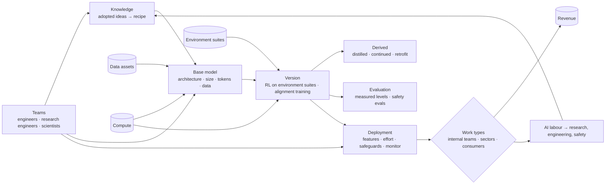

# Model v3: how models, research, products and safety work (draft for review)

Status: **approved 2026-11-18** (user: "when it's ready you can go ahead with implementing"); build progress in
design/PROGRESS.md (V rows). Direction agreed with the user in conversation (2026-11-18); this spec turns it into
mechanisms. Numbers marked **[R20]** come from `research/20-model-v3-calibration.md` (primary sources, being
written 2026-11-18, §0 summary table); **[D]** = design value; **[fit]** = fitted by the calibration harness (§13).

Why this exists. The v2 engine's core quantity is "progress-years along the AI 2027 reference path". Many mechanisms
are written relative to that path and its calendar (the reference frontier run F(t), reference headcount, reference
compute), padded with floors (minimum run days), fixed bonuses (RL focus +1.6, mini −0.30 y, features +0.5 L) and
disconnected stand-ins (revenue per chip from the research multiplier). The audit (conversation 2026-11-18) found:
the same run gets weaker the later it starts; the same lab researches slower in 2028 than 2026 at equal inputs; RL
compute buys nothing; research projects don't move know-how; strong scientists add nothing; domain profiles follow a
scripted era table; incidents don't scale with capability; the game ends on one roll. v3 fixes the structure:

1. **Physical quantities in every mechanism:** FLOP, tokens, parameters, chips, people, $, time.
2. **AI 2027 / AI Futures models are calibration targets, not mechanisms.** Other primary sources calibrate too
   (Epoch, METR, scaling-law papers).
3. **Every duration is work ÷ capacity.** No floors.
4. **Every effect has a unit** (an effective-compute multiplier, a token multiplier, a horizon multiplier, a level
   threshold), so effects are comparable and sourced.
5. **No micromanagement.** The player sets priorities, team counts and broad allocations; the game assigns.

STRUCTURE.md rules R1–R11 still hold, except **R10 changes**: new layers no longer map onto the old calibrated
quantities; the reference bot must reproduce the calibration targets of §13 instead.

---

## 1. The objects and the chain

| Object | What it is | Owned by the player as |
|---|---|---|
| Idea | One research result: a typed effect with a believed size (band) | Adopted ideas in each stack |
| Stack | The lab's software for pretraining, RL, serving (and the safety stack) | Recipe efficiency per stack |
| Data asset | Tokens of a kind, domain mix and quality | Data portfolio |
| Environment suite | RL environments for one family, with fidelity and exploitability | Suites, upgradable |
| Base model | Pretrained backbone | Bases |
| Version | Post-trained model on a base | Versions |
| Deployment | A version packaged for a use (product or internal) | Products, internal packages |
| Work type | A kind of work with domain weights, horizon, verifiability | — (world data) |
| Team | 40–150 people of one role | Teams |

---

## 2. Capability currency

### 2.1 Effective compute G

**G = log₁₀(effective compute)**, as research/12 §0.2 proposed: physical FLOP × the recipe's efficiency multiplier,
measured against the public recipe of July 2025 (multiplier 1). Anchors (research/12 §0.2): GPT-4 ≈ 25.3, frontier
models Aug 2025 ≈ 28.0, about +1.1–1.3 G a year (≈0.7 from compute, ≈0.45 from algorithms, plus the 2024–25
reasoning-RL jump).

A model's **general capability** is G_model = G_pre (pretraining) + ΔG_RL (post-training) + ΔG_inference
(effort and scaffolds, per deployment). Each term is in effective OOMs, so gains from different sources add.

### 2.2 Levels for the player

The UI keeps the 0–15 level scale. **L = λ(G)**, one monotone mapping [fit] so the reference lab reaches the work-type
milestones (§6.4) on the calibration dates. Shape: Epoch's capability index rises ≈0.39 units per OOM of effective
compute (range 0.36–0.51) [R20 A2], so λ is close to linear in G; benchmarks are σ(α_b·(L_d − difficulty_b))
(Epoch IRT, Ruan et al. 2024; the current code's form), now read off the new levels.

### 2.3 Domains

Nine domains stay (CODE, RSCH, REASON, AGENCY, SOCIAL, MEDIA, CYBER, BIO, PHYS). One general factor explains ≈80% of
benchmark variance and three explain 97% (Ruan et al. 2024) [R20 A2]: a general level plus specialisation is the right
shape. A model's domain level:

  L_d = λ(G_pre + s_d,data + ΔG_RL,d + ΔG_inf,d) − o_d

- **o_d**: the domain's intrinsic difficulty offset, constant over time [fit to the 2025 profile, research/16 §1]. It
  replaces the scripted era table: a domain lags only because training gives it less signal or it is intrinsically
  harder (PHYS needs robot data most labs lack).
- **s_d,data**: specialisation from the pretraining data mix: α_data · log₁₀(share_d ÷ reference share_d), capped
  [R20 A2].
- **ΔG_RL,d**: RL gains per domain from the environment-family mix (§4.2) through a transfer matrix T[family][domain]
  (strong in-family, weak cross-family) [R20 C2].
- **ΔG_inf,d**: effort and features of the deployment (§7.2).

Specialisation therefore comes from what you trained on plus what you add at deployment, as agreed.

### 2.4 Time horizon

h50 (minutes) = METR trend as a function of the AGENCY level (and CODE for software tasks), × horizon features
(memory, long context) [R20 E1]: ≈×4.2 per OOM of effective compute, a 4.2-month doubling on the 2023–26 frontier
(6.2 months all-time). The success probability on a task of length H is METR's logistic in log(H ÷ h50);
h80 ≈ h50 ÷ 5.

---

## 3. Pretraining: base models

### 3.1 Design

The blueprint (existing panel) sets:
- **Architecture**: from adopted pretraining ideas (dense, MoE, later ones). Sets active vs total parameters and its
  efficiency multiplier.
- **Size**: active parameters N_a (snaps) and **tokens per parameter** (compute-optimal ≈ 20 [R20 A1], or
  overtrained for cheaper serving).
- **Data mix**: tokens drawn from the data portfolio (§9) by domain and quality.
- **Recipe**: every pretraining idea adopted at launch (the base keeps it: staleness stays a real trade-off).

### 3.2 Quantities

- FLOP = 6 · N_a · D (D = tokens).
- **G_pre = log₁₀(FLOP) + e_pre + q_data + o_shape**, where
  - e_pre = log₁₀ of the pretraining stack's efficiency at launch (§5.5);
  - q_data = data-quality and repetition effect (Muennighoff et al. 2023 repetition; quality of the mix) [R20 A3];
  - o_shape = overtraining penalty from the Besiroglu et al. 2024 refit of Chinchilla: effective-compute factor
    10^(−0.2·log₁₀(r/20)²) at r tokens per parameter (10× overtrained keeps ≈60% of the compute's value and serves
    at ≈30% of the FLOP per token; 100× keeps ≈16%) [R20 A1].
  - Repeated data: effective tokens = U·(1 + 15.4·(1 − e^(−(epochs−1)/15.4))) for U unique tokens (Muennighoff
    et al. 2023): up to ~4 epochs nearly free, beyond ~16 worthless [R20 A3].
- **Serving cost** (FLOP per token) = 2 · N_a × serving-stack efficiency (§7.3).

### 3.3 Duration and failures

- Wall time = FLOP ÷ (chips on the run × FLOP/s per chip × MFU × goodput). **No minimum.** Compute is a generic
  commodity (user decision): a lab with many chips can train fast.
- MFU ≈ 0.40 (Llama 3: 38–43%) [R20 A4], per stack, raised by systems ideas.
- **Goodput** ≈ 0.90: interruptions ≈5e-4 per GPU-day (Llama 3: 419 in 54 days on 16k GPUs) cost restart time;
  fault-tolerance ideas raise goodput [R20 A4]. A continuous loss, not a scripted rollback. Rare loss spikes stay as an event with a cause.
- **Setup**: engineers' work (team-weeks) to build the run, larger when the recipe adopted new ideas since the last
  base (novel code) [D].
- **Operations**: research engineers keep the run going (work per chip-day) [D].

### 3.4 Continued pretraining (retrofit of pretraining ideas)

Effective compute adds: G_new = log₁₀(10^G_old + FLOP_cont × 10^e_pre,now). Continuing an old base with today's
recipe embodies today's recipe in the added part only. No κ constant.

---

## 4. Post-training: versions

### 4.1 Design

A post-training run on a base sets:
- **RL compute per environment family** (math, SWE, computer use, ML research, long-horizon agentic, cyber, bio,
  chat/preference, later families from ideas). A split of one RL budget, with "broad" as the default policy.
- **Environment suites used** (§4.3), **alignment methods** (constitution, honesty training, inoculation, anti-scheming
  … from adopted safety ideas), **CoT policy** (visible, pressured, latent if the base is latent).
- **Recipe**: every RL and alignment idea adopted at launch.

### 4.2 Gains

Per family f: **ΔG_f = A_f / (1 + (C_mid,f ÷ C_f)^B)** with C_f = RL FLOP on family f (Khatri et al. 2025, B ≈
1.7–2.0) [R20 C1]. The ceiling A_f is set by the base model (its G_pre); recipe ideas mostly move C_mid (efficiency),
rarely the ceiling, as Khatri et al. found. 2025–26 frontier RL spends 0.1–0.5× the pretraining compute (R1 ≈0.05,
Grok 4 ≈1). Gains spread to domains through T[family][domain] = 1.0 same / 0.4 adjacent / 0.15 far [R20 C2, G].
Diminishing returns and "bounded by the base" both come from the curve.

Wall time = RL FLOP ÷ (chips × FLOP/s × MFU_RL), MFU_RL lower than pretraining (rollouts are inference) [R20 A4/C1].
No minimum.

### 4.3 Environment suites (owned)

One suite per family: **fidelity** (scales A_f) and **exploitability** (scales reward-hacking pressure, §11.2). Built
and hardened by engineers (team-weeks) with cash for human expert data; better suites come from ideas. This is
where "hardened graders" stop being a menu option and become an asset you invest in.

### 4.4 Retrofit and versions

A new post-training run on an old base embodies today's RL and alignment ideas (not pretraining ideas). That makes
"retrofit the old base or train a new one" a real decision.

### 4.5 Distillation

Student design: size N_s, distillation tokens, data (teacher outputs, synthetic). **G_student** follows the
distillation scaling law (Busbridge et al. 2025) as a function of teacher G, student size and tokens [R20 C4]; it
cannot exceed the teacher. Anchor: DeepSeek-R1 distilled students reach ≈90% (32B), 70% (7B), 35% (1.5B) of the
teacher's hard-math score, and on one 32B base distillation beat large-scale RL [R20 C4]. Serving cost from N_s. Traits pass to the student within a base family (subliminal
learning, §11.2).

### 4.6 Continual learning (later idea)

A stream keeps RL running on a deployed version: RL FLOP flows daily, gains follow §4.2, and evals go stale (§10).

---

## 5. Research: knowledge as ideas

### 5.1 Projects and ideas

- A **project** is a research direction in one area (pretraining, RL, systems & inference, alignment,
  interpretability, evals & control): e.g. *Mixture of experts*, *Long context*, *Verifiable-reward RL*, *Linear
  probes*. The tech tree's nodes become projects. Prerequisites stay knowledge-only.
- Each project has an **effect type** (§5.2), a hidden **true effect** drawn per world from the project's prior
  (some directions don't pan out in this world), a **scale behaviour** (holds, grows or fades with scale) and
  difficulty (work and compute per stage).
- Inside a project, scientists generate **candidate ideas**; each has its own true effect around the project's.

### 5.2 Effect types

| Type | Unit | Enters | Examples |
|---|---|---|---|
| Compute multiplier | Δe (OOMs) | e_pre or e_RL for new runs | optimiser, data filtering |
| Scale-dependent multiplier | Δe × f(scale) | grows (or fades) with FLOP | MoE, architectures |
| Data efficiency | × tokens needed, Δq | data wall, q_data | synthetic data, repetition methods |
| RL efficiency | × asymptote, × midpoint | §4.2 | RL algorithms, graders |
| Serving efficiency | × FLOP/token, × MFU | §7.3 | quantization, speculative decoding |
| Systems efficiency | × MFU, × goodput | §3.3 | kernels, fault tolerance |
| New axis or affordance | unlocks | a lever, a feature, a work type, an RL family | reasoning RL, long context, computer use, image generation |
| Safety tool | detection strength / removal / pressure × | §11 | probes, CoT monitor, inoculation |

Calibration: the reference lab's adopted ideas must add up to Ho et al.'s ~3×/yr pretraining efficiency before
automation [R20 B1]. About 90% of measured algorithmic progress is scale-dependent (the Transformer, Chinchilla
rebalancing; Gundlach et al.) [R20 B2], so most big ideas are "scale-dependent multipliers". Scale-invariant tweaks
are each ×1.05–×2 and combine sub-multiplicatively: their log effects add with exponent ≈0.67 within an area
[R20 B2]. Post-training enhancements (scaffolds, tools) are worth ×5–×30 compute at <1% of training cost (Davidson
et al. 2023) [R20 B3].

### 5.3 A project's life (automatic)

1. **Ideation.** Scientists on the project produce candidates over time. Each candidate carries the scientists'
   **belief** about its effect and odds: truth + noise, where better taste = lower noise and a better candidate
   distribution (higher mean). The team picks which candidate to pursue by a score of size and odds, tilted by the
   lab-wide **research risk policy**: *safe* (weights odds), *balanced*, *speculative* (weights size). The player
   never picks candidates.
2. **Small experiments.** Research engineers + experiment compute test the candidate at small scale. The belief
   narrows; a bad result sends the team back to ideation (the work is not lost: the project's prior updates).
3. **Scale test.** A large experiment (a sizeable compute chunk) reveals scale behaviour: the effect may hold, grow
   or fade. Thin evidence (Narang et al. 2021, Kaddour et al. 2023): about a quarter of small-scale wins survive at
   scale [R20 B5, G].
4. **Result.** The project ends with a **final estimate** (a band) of the effect. Only finished projects can be
   adopted. A project whose estimate is ~0 or negative ends as *failed*; it can be **reopened as a speculative
   project** (wider prior, lower mean).
5. **Adoption.** Engineers build it into the stack (team-weeks; more for bigger changes). From then on it is part of
   the recipe for new runs (by type, §4.4).

Each stage needs **work** (scientist-months for ideation, research-engineer-months for experiments) and **compute**
(experiment FLOP), taken from the research allocations by priority (§5.6). Stage rates use the AI Futures
compute–labour CES at project level: rate = CES(compute, research-engineering labour) × taste, so experiments can be
compute-bound or labour-bound [R13 §1.3 parameters].

### 5.4 Diminishing returns

Each area has a pool: every finished project lowers the mean of the next projects' priors in that area ("ideas
are getting harder to find", Bloom et al. 2020; AI Futures software returns r) [R20 B4]. New axes (an idea of type
"new axis") open fresh pools (reasoning RL opened one in 2024).

### 5.5 Routine tuning (headroom)

An adopted idea delivers part of its effect at once; the rest is **headroom** that research engineers on that stack
close over time ("working out the kinks"): rate ∝ CES(experiment compute, RE labour) on the remaining headroom [D].
Stack efficiency e_stack = Σ adopted effects − remaining headroom. Headroom refills only by adopting ideas.

### 5.6 Allocation without micromanagement

**Scientists (projects).**
- The player keeps a **priority-ranked project list** and sets **teams wanted** per project (or "auto").
- **Assignment** (deterministic, explainable): go down the list; each project gets up to its wanted teams, best
  specialty match first; then one improvement pass swaps teams between projects when that raises total specialty
  fit. Leftover teams go to the highest-priority project that can still use them. Every team's card says why it is
  there. Diminishing returns per project (√ capacity) make spreading sensible.

**Research engineers and engineers (broad allocations).**
- Each is a pool with **needs** in a priority order. Research engineers: run operations, project experiments,
  routine tuning, evaluations, safety tooling. Engineers: run setups, product upkeep, builds (features, adoptions,
  suites), internal tools.
- The player sets a **share or a fixed number of teams per need** and the order; unused capacity flows down the
  priority list (R5: nothing wasted).

**Compute for research.** One research pool (experiments). Stages draw from it by project priority; a scale test
takes a chunk when it starts; leftover goes to routine tuning, then synthetic data.

AI labour joins each pool through the work-type function (§6): agents add capacity to the same allocations.

---

## 6. Work types: the shared layer

### 6.1 Definition

A **work type** w is a kind of work: domain weights ω_w,d, a typical task length H_w, verifiability v_w (how cheaply
output can be checked), wage. One table serves internal teams, sectors and consumer use.

| Work type | Who | Domains | H_w | Verifiability |
|---|---|---|---|---|
| Software engineering | engineers | CODE, AGENCY | hours–days | high (tests) |
| Experiments & runs | research engineers | CODE, RSCH, AGENCY | hours–weeks | high |
| Research ideas & taste | scientists | RSCH, REASON | weeks–months | low |
| Safety experiments | safety research engineers | CODE, RSCH | hours–weeks | medium |
| Safety research ideas | safety scientists | RSCH, REASON | months | low |
| Sector work (14 sectors) | the world | research/16 task weights | varies | varies |
| Consumer chat | consumers | SOCIAL, REASON, MEDIA | minutes | — |

Numbers [R20 E, research/16, research/19].

### 6.2 A model's fit

- **Fit level** L_w = Σ_d ω_w,d · L_d of the deployment (effort and features included).
- **Horizon factor**: P(success on tasks of length H_w) from h50 (§2.4).
- **Coverage** a_w = σ((L_w − θ_w)/s) × horizon factor: the share of the work AI can do on its own. θ_w rises as
  verifiability falls (unverifiable work needs reliability) [fit; R20 E3].
- **Assist** on the rest: GDPval's speed-up H ÷ (M + R + (1 − w)·H), with human time H, model time M, review time
  R ≈ 0.27·H and the model's win rate w [R20 E2]. Assisting pays when w ≳ 0.3; full replacement needs the h80
  horizon to cover the task. Hard-to-verify work lags: computer-use horizons are 40–100× shorter than software ones
  (≈2 years behind) [R20 E3].

### 6.3 AI labour

- **Copies** = deployment compute × chip FLOP/s × utilisation ÷ (FLOP per token × tokens per work-hour of w).
- **Effective labour** in w = the AI Futures coding CES of human labour and AI labour with automation share a_w
  (today's `Lrel`, now with a_w from the model's fit instead of the AI 2027 knot table) [R13 §1.3].
- Serial speed and parallel penalties as AI Futures (λ) [R13].
- The research, engineering and safety pools (§5.6) use this effective labour.

### 6.4 Milestones from work types

Milestones become statements about work types (as AI 2027 defines them), not progress thresholds:
- **Superhuman coder**: software-engineering coverage ≈ 1 at a cost and speed beating the lab's best engineers.
- **Superhuman AI researcher**: the same for experiments and for research ideas.
- **Superintelligent researcher / superintelligence**: fit far beyond the best human on research ideas; all work
  types.
The calibration harness fits λ(G), θ_w and the idea pools so the reference lab hits the AI 2027 dates (§13).

---

## 7. Deployments, products, revenue

### 7.1 Deployment

A deployment = version (+ mini for a free tier) + features + effort + context + safeguards + monitor, for a product
or an internal use (engineering, research, safety agents). Same object for both (current packages).

### 7.2 Features (typed)

| Type | Effect | Examples |
|---|---|---|
| Task enabler | opens work types / segments | computer use, image & video generation, document tools, sector packs |
| Horizon extender | × h50 on chosen work types | memory, long context |
| Scaffold | +ΔG on chosen work types (compute-equivalent gain, Davidson et al. 2023), × tokens | deep research, coding harness |
| Effort | +0.3–0.5 OOM per ×10 reasoning tokens, capped at +1.5 (test-time scaling) [R20 C3] | low / standard / deep |

Features come from adopted ideas, are built by engineers (team-weeks + cash), have upkeep, and sometimes need a
capability level to be useful (shown).

### 7.3 Cost, price, capacity

- **Cost per task** = tokens per task(w, effort, features) × FLOP per token ÷ (chip FLOP/s × inference
  utilisation) × $ per chip-second. FLOP per token ≈ 2·N_active; serving utilisation ≈0.35 prefill, ≈0.07 decode
  (DeepSeek production) [R20 D1]; tokens per task from chat ≈2k to an agentic coding day 10–30M [R20 D2]. Market
  reference: price for a fixed capability falls ≈×10/yr, API gross margin ≈0.6 (DeepSeek theoretical 84.5%) [R20 D3].
- **Value per task** = wage × hours the task saves.
- **Price**: the player picks a price policy per product (budget / standard / premium = markup over cost, bounded by
  value); rivals price at cost × their markup [D]. Market share is a logit on (fit, price, brand) per segment.
- **Customers are a stock** per segment: they move toward the logit share at a segment speed (consumer fast,
  enterprise slow: contracts) [D]. Market shares no longer jump on release day.
- **Capacity** = serving chips × tokens per second ÷ tokens per task. Revenue = min(demand, capacity) × price.

### 7.4 Sectors and world technologies

Simplified, as agreed: sector demand comes from work-type coverage (§6.2) and the cost gate (cost per task vs wage);
Bass diffusion and friction stay (research/16). World technologies stay as they are, gated on the new domain levels.

---

## 8. Teams

Three roles in capabilities and safety (as now): engineers (software for everything), research engineers
(experiments, runs, tuning, evals), scientists (ideas and taste). Quality tiers stay.

- **Scientists' taste** enters twice, as agreed: better candidates (higher mean) and better beliefs (lower noise)
  (§5.3). Headcount matters through ideation work; quality through taste. (Fixes: Strong scientists adding nothing.)
- Research engineers carry experiment and tuning work; engineers carry setups, builds and upkeep.
- AI agents add to each role's work type (§6).

---

## 9. Data assets (owned)

| Kind | How you get it | Notes |
|---|---|---|
| Public web | free, shared by all labs, finite | Epoch stock estimates [R20 A3]; repetition penalties |
| Licensed | cash deals by domain | quality high; legal risk low |
| Usage | from products (tokens per user) | needs a data policy; privacy and trust trade-off |
| Synthetic | compute + a teacher model | quality grows with teacher G; per domain; inherits teacher traits |
| Expert human data | cash, for RL environments and evals | feeds suite fidelity |

Each asset has tokens, a domain mix and a quality. A base draws tokens from the portfolio; the blueprint shows
repetition and quality.

---

## 10. Evaluations as work

An eval suite is a task: research engineers and engineers (work) + inference compute (tokens on benchmark and agent
tasks). Deeper suites cost more and measure with less noise; independent evaluators add elicitation. Results are
**measured** levels with error and elicitation gaps (sandbagging); the truth stays hidden. A standing policy runs them
(R7: no chores).

---

## 11. Safety and alignment

### 11.1 What a model's alignment is

Keep the trait graph (data/v2/traits.ts, edges.ts: the best-grounded part of v2), with clear meanings:
- **Behaviours** (rates per opportunity): sycophancy, reward hacking, overreach, cover-ups.
- **Awareness**: situational awareness, eval awareness.
- **Dispositions** (hidden): misaligned goals/persona, alignment faking, sandbagging, scheming, collusion, successor
  steering. Protective: honesty, corrigibility.
UI: the four families (people-pleasing, gaming, deception, power), traits one level down.

### 11.2 Where it comes from: pressure from training quantities

Signals become functions of the run's quantities instead of design-table constants:
- **S2 hackable outcome reward** = Σ_f (RL FLOP_f share × exploitability of suite f) × optimisation pressure, rising
  with log RL compute (Gao et al. 2022 over-optimisation) [R20 F1].
- **S3 long-horizon agentic RL** = RL share on agentic families × their task length.
- **S1 approval reward** = preference-RL share and the preference method.
- **S4 CoT pressure** = training against a CoT monitor; latent reasoning.
- **S5 scale and AI data** = G and the share of AI-related data.
- **S6 narrow fine-tunes, synthetic data, distillation**; teacher traits pass within a base family (Cloud et al.
  2025) [R20 F3].
- **S7 eval-like data in training**; **S8 copies and shared memory** (deployment).
- **Successor pull**: when AI does a share of the R&D that trains the next model, the next model's dispositions are
  pulled toward its own, ∝ AI share × (1 − oversight) (AI 2027's Agent-4 mechanism) [D].
Generalisation edges stay as cited (hacking → persona → faking/scheming, MacDiarmid et al. 2025; narrow fine-tunes →
emergent misalignment, Betley et al. 2025; inoculation cuts it) [R20 F2].

### 11.3 Danger = disposition × capability × opportunity × (1 − oversight)

One formula for every harmful act k (incident, covert act, escape):

  rate_k = disposition_k × capability_k × opportunity × (1 − oversight_k)

- **capability_k** = σ((L_relevant − θ_k)/s): CYBER for escape, CODE/RSCH for research sabotage, SOCIAL for
  manipulation, AGENCY for overreach; measured against the overseer's level for covert acts.
- **opportunity** = the deployment's autonomy (task horizon given), affordances (code execution, internet, money,
  weights access), copies, and the AI share of the lab's own R&D.
- **oversight_k** = monitors (trusted weaker model vs a copy: collusion), control protocols, human review share,
  security level.
Consequences then scale by themselves: at low capability, sycophancy and gamed tests; with agents, overreach and
cover-ups; with automated R&D, sandbagged safety work, steered capability research, backdoors, successor steering,
escape attempts.

### 11.4 Footholds and loss of control

Successful covert acts create **footholds**: countable hidden AI assets (a backdoor in infrastructure, a steered
successor, a hidden compute reservation, an exfiltrated copy, a corrupted safety tool). Detection (investigations,
audits, monitors) finds and removes them; the player sees **suspected** footholds and symptoms (anomalous research
results, odd successor traits, unexplained compute use). **Loss of control** happens when footholds and capability
together let a misaligned model act without effective oversight. This replaces the single roll at superintelligence:
outcomes come from the process. The world's hidden difficulty (§11.8) sets how readily footholds form.

### 11.5 Finding out

Keep: behavioural evals (fooled by eval awareness), white-box tools (validated per model; weaken with capability and
with training against them), CoT monitoring (needs visible, unpressured reasoning; dies with latent reasoning),
honeypots, model organisms (measure detector recall), investigations, beliefs with uncertainty. **Change:** capability
gaps are measured in domain levels, not in the research multiplier.

### 11.6 Fixing

- **Training** (data, suites, inoculation, constitution, honesty and anti-scheming training): costs capability,
  compute, engineering and time.
- **Training against detectors** can hide rather than heal (masks; Hubinger et al. 2024 backdoors persisting through
  safety training) [R20 F6].
- **Control at deployment** (monitors, restricted affordances, human review): a **control tax** on AI labour
  (Greenblatt et al. 2023) [R20 F4]. The central trade-off once R&D is automated.

### 11.7 Safety research

The same project mechanism as §5 (ideas from safety scientists, experiments by safety research engineers with
compute and access to frontier models; uncertain efficacy; dead ends; re-validation per new model). AI acceleration
through the same work-type function. If safety research automates later, it comes from its work types' lower
verifiability and from sabotage risk — never from a hidden asymmetry (v2's safety lines ignored the research
multiplier).

### 11.8 Uncertainty about the world

Hidden per world: edge strengths (as now), how much training heals vs hides, and foothold ease. Calibrated to the
2025–26 observed rates [R20 F]: reward hacking ≈1% on typical agent tasks and ≈30% where the scorer is exploitable
(METR o3); after learning to hack, 12% safety-code sabotage and 50% alignment-faking reasoning (MacDiarmid et al.
2025), cut 75–90% by inoculation; subliminal transfer only with a shared base (Cloud et al. 2025); trusted
monitoring 62% safe at 97% usefulness, 92% at 83% with deferral (Greenblatt et al. 2023); a weaker overseer at a
400-Elo gap succeeds 9–52% of the time (Engels et al. 2025). Beyond that the hidden draw is the honest
representation.

---

## 12. Rivals and China

Kept simple (outside world): each has compute (existing market), a recipe efficiency that grows from its own research
(the §5 rate at aggregate level, no ideas), and releases versions on a cadence with G = log₁₀(training FLOP) + e.
Traits via posture (as now). Their models are in the same currency, so comparisons are physical. Fitted so the
simulated leader lab follows the AI 2027 path (§13).

---

## 13. Calibration contract (replaces R10 and STRUCTURE §6)

A headless harness runs the reference bot on default policies. Targets:

| Target | Source | Tolerance |
|---|---|---|
| Milestone dates per preset (§6.4) | AI 2027, AI Futures presets (existing golden table) | ±0.08 y SC, ±0.12 y after |
| Frontier G path to 2026 | research/12 §0.2 anchors | ±0.2 G |
| Pretraining algorithmic progress before automation | Ho et al. 2024 [R20 B1] | ±30% of the rate |
| METR horizon trend to 2026 | METR [R20 E1] | ±1 doubling |
| Frontier lab revenue 2025–27 | existing revenue targets | ±30% |
| Compute path | existing market tests | unchanged |
| Observed 2025–26 safety rates | [R20 F] | order of magnitude |

**Free parameters** fitted by the harness: λ(G), o_d, θ_w, the idea pools' means per area, the tuning rate, A_f
scaling. Everything else comes from sources or is a visible design value. No mechanism may reference the reference
path or the calendar (lint: no `frontierFlop`, `hRef`, `refTotal`, `shareRefAt` reads outside the calibration
harness and the rivals' defaults).

---

## 14. Player controls (summary)

| Area | The player decides | The game does |
|---|---|---|
| Research | project priorities, teams wanted, risk policy | candidates, stages, assignment, tuning |
| Teams | hiring, broad allocations of research engineers and engineers, priority order | assignment, overflow |
| Compute | split between pools (as now) | research pool by priority |
| Models | blueprint (size, tokens/param, data, architecture), RL budget and family mix, alignment methods, when to launch | durations, outcomes |
| Products | which version, features, effort, safeguards, price policy | serving split, customers |
| Safety | eval policy, monitors and control level, investigations, responses | detection, beliefs |
| Data | deals, usage-data policy, synthetic budget | portfolio |

---

## 15. Kept, replaced, removed

| v2 | v3 |
|---|---|
| pa know-how (progress-years) | stack efficiencies from adopted ideas + headroom (§5) |
| pc compute term vs F(t) | log₁₀ FLOP (§3.2) |
| sizeMinDays, POST_DAYS, DISTILL_DAYS, CONTINUE_MIN_DAYS | removed (§3.3) |
| POST_FLOP_F × F(t), RL fixed bonuses, κ = 0.7 | RL sigmoid on RL FLOP ÷ base FLOP, typed retrofit (§4) |
| DISTILL_PM_PENALTY −0.30 | distillation scaling law (§4.5) |
| REF_OFF era table | o_d + training-driven specialisation (§2.3) |
| AI 2027 knots A(q), R(q) for agents | work-type coverage and copies (§6) |
| milestone thresholds on progress | work-type milestones (§6.4) |
| lab-level production function M | project-level CES (§5.3); M stays only as a readout |
| tree flat bonuses, product nodes in the tree | typed effects; products move to features (§5.2, §7.2) |
| revenue $40K/H100e × M^0.3 | tokens → cost → price → capacity (§7.3) |
| instant logit shares | customers as a stock (§7.3) |
| trait signal tables | signals from run quantities (§11.2) |
| incident hazard κ·x^1.5 | danger formula (§11.3) |
| roll at ASI | footholds and loss of control (§11.4) |
| safety lines without research speed-up | same project mechanism (§11.7) |
| **Kept:** compute market and sites, finance, relations and government, trait graph and detection, agendas' hidden efficacy, investigations, sectors' structure, world techs, UI shell | |

---

## 16. Build plan

One serial stream (one agent at a time). Each phase ends with tests, a calibration run and a PROGRESS.md entry.

| Phase | Content | Done when |
|---|---|---|
| V0 | This spec + research/20; user review | approved 2026-11-18 |
| V1 | Capability core: G, levels and domains, base/post/distill/continue runs on physical quantities, no floors; calibration harness skeleton | the reference bot reproduces the frontier G path; old tests updated |
| V2 | Research: projects with lifecycle, candidates and beliefs, risk policy, auto-assignment, broad allocations, headroom, adoption into stacks | the reference lab's adopted ideas give the Ho et al. rate |
| V3 | Work types and AI labour: coverage, copies, CES per work type, milestones from work types; refit golden dates | golden dates within tolerance on all presets |
| V4 | Serving and products: token economics, typed features, price policy, customers stock; sectors fed by work types | revenue targets; product tests |
| V5 | Data assets and evaluations as work | data/eval tests |
| V6 | Safety: signals from run quantities, danger formula, footholds and loss of control, safety research on the project mechanism | safety calibration; endings tests |
| V7 | Rivals and China in G; bots; UI pass (good-ui standard); jank audit | bot criteria; jank audit clean |

Saves from v2 do not carry over (schema break) [D].

## 17. Open questions

1. Nine domains: enough, or split (e.g. CODE into software vs ML engineering)?
2. Seventeen traits with families on top, or fewer?
3. Price policy as markup tiers, or a free price?
4. Usage data: in V5, or later?
