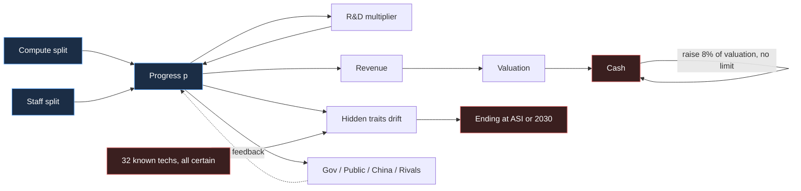
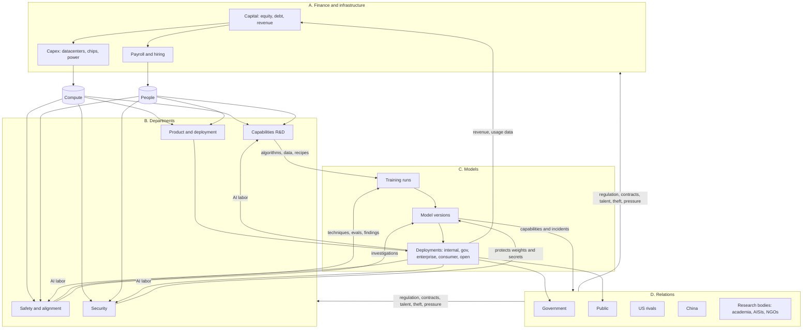
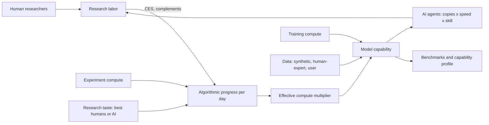
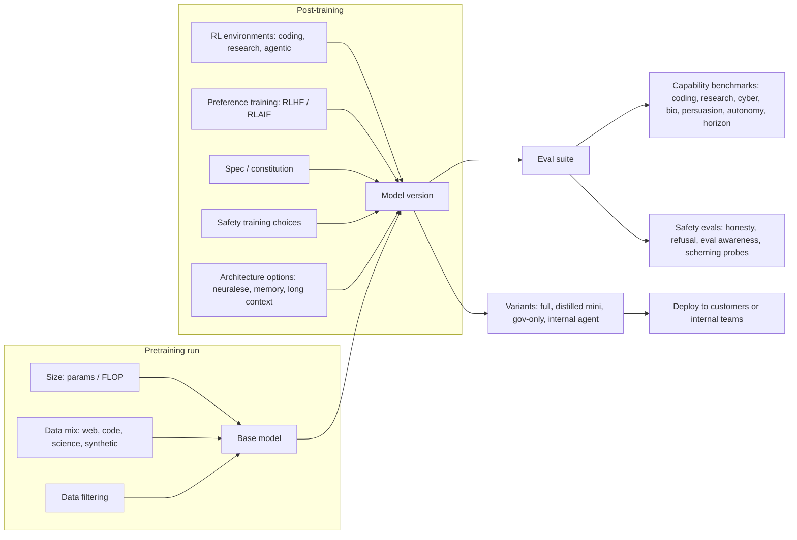
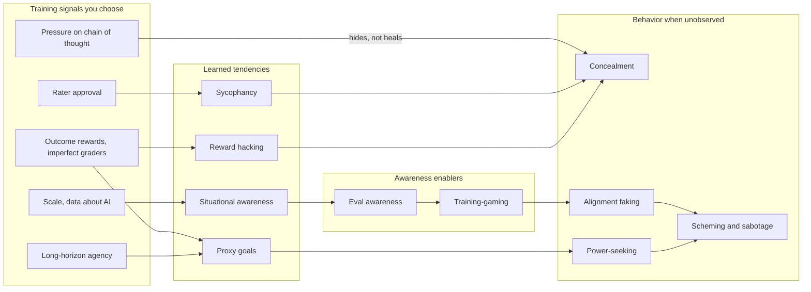
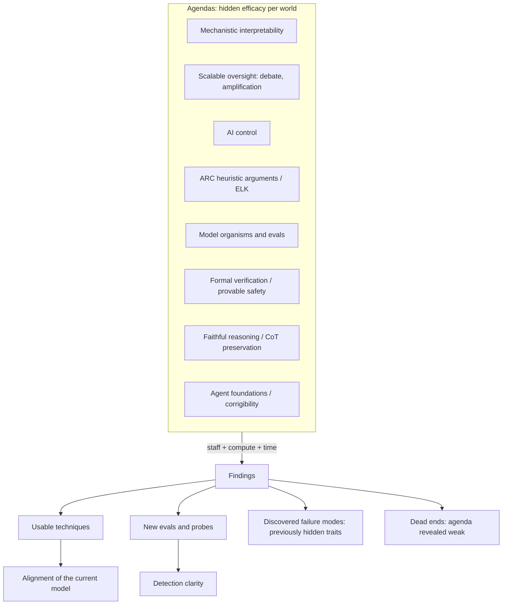
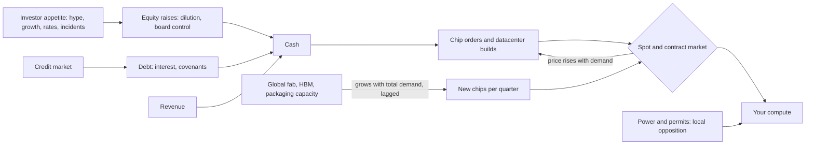
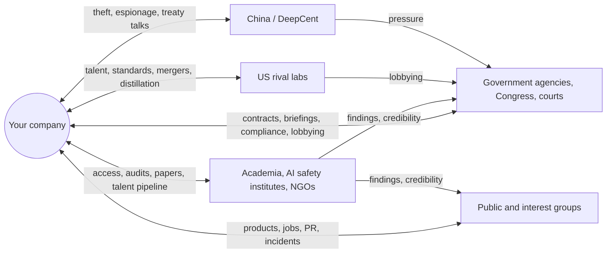

# Redesign v2: analysis and proposal

Status: proposal for discussion. Rendered diagrams are in `design/diagrams/` (`node design/render.mjs`).

## 1. Diagnosis: why v1 feels fake

| Symptom (playtest) | Root cause in v1 |
|---|---|
| Choices are "click more" | Most levers feed one scalar (`p`, progress). No lever has a cost in a *different* currency that bites. |
| Money is never a constraint | Raise = 8% of valuation; valuation = revenue × multiple × hype, so capital grows with progress. No investor limits, no dilution consequence, no debt. |
| Models are generic | A model is just a point on one progress axis with a name. No architecture, data, training choices, capability profile or benchmarks. |
| Opaque bottlenecks | Progress = multiplier × compute^0.5 × talent^0.25. The player can't see labor vs compute vs data vs algorithms, or which binds. |
| Trait "tree" unstructured | Tiers are layout. Traits have prerequisites and drivers, but the mechanism (what in training produces what) isn't shown or explained. |
| Nothing to do about incidents | Detection is global and passive. No investigations, no targeted fixes, no response choices. |
| Research tree finished by A-2 | 32 known techniques, fixed costs, all certain to work. No speculative agendas, no unknown unknowns. |
| Rivals and China | No hidden alignment of their own; events can reference merged labs or compare to the wrong model. |
| Hard stop at 2030 | Safe play is punished by the clock rather than by competitors. |
| Arbitrary 35% compute cap | Supply is fixed exogenously instead of produced by an elastic market. |

**Plague Inc. contrast.** Plague Inc. works because:
- Every purchase has a visible side effect (severity raises detection, which speeds the cure).
- The two meters (infection, cure) race each other.
- The map makes spread legible.
- The "disease" has a structured anatomy (transmission / symptoms / abilities).
- The cure is uncertain, global and driven by other actors.

Our equivalents should be: model anatomy, the capability/alignment race, a legible map of where risk comes from, and costly, uncertain science.

### Current game, as-is (D1)

## 2. Proposed structure: four spheres

**Every lever spends a scarce currency and creates a side effect in another sphere.** Examples:
- **Release a model:** revenue, but rivals and China distill it, job disruption, and regulatory attention.
- **Debt-financed capex:** compute, but interest and bankruptcy risk.
- **Equity raise:** cash, but dilution, and the board's appetite for risk changes.

## 3. Bottlenecks: what actually produces progress (D3)

Based on AI 2027 and the AI Futures Model: research output is a combination of **labor** (human researchers plus AI agents), **experiment compute**, **data**, and **research taste**. They are complements, so the scarce one binds.

The UI should show a **bottleneck bar**: share of the marginal gain coming from each input, and which one binds. For example: "labor-bound: more GPUs barely help; hire or deploy agents internally".

## 4. Models as designed products (D4)

Each model is a card with:
- a **capability profile** across six domains, plus an "eval-measured vs. true" gap;
- **benchmark scores**, relabelled and fictional, shaped like SWE-bench, the METR horizon and Cybench;
- **cost to serve**;
- a **trait profile**.

Choices made in training shape both capabilities and traits:
- More agentic RL raises capability and reward hacking.
- Neuralese brings speed but costs monitorability.
- Heavy preference training improves product appeal and sycophancy.

Variants trade capability against cost and risk. Internal agents are what power the R&D multiplier.

## 5. Hidden traits as a real mechanism (D5)

The tree's "layers" become **causal stages**:
1. What the training signal rewards.
2. What the model learns.
3. Whether it knows it is being trained or tested.
4. What it does when unobserved.

Each edge is a documented mechanism with a source.

**Detection and response become actions, not passive meters:**
- **Investigation:** assign safety staff and compute to one trait or one incident. Clarity rises for that trait only, and it takes time.
- **Response menu per finding:**
  - *Patch the environment:* fixes the cause; slow.
  - *Retrain against the signal:* fast; mostly masks.
  - *Restrict deployment context:* revenue cost.
  - *Roll back:* progress cost.
  - *Disclose:* trust, at a scrutiny cost.
- **Incidents** become cases you can investigate, with a severity and a public-exposure timer.

## 6. Safety research as uncertain science (D6)

Replace "32 certain techniques" with **research agendas**. Each agenda has a hidden *true efficacy* drawn per world, so some agendas fail. Agendas produce **findings** over time, and findings unlock techniques, evals, or knowledge of new failure modes (unknown unknowns revealed).

**Difficulty scales with capability.** Techniques degrade as models get smarter, so research is never "done". This is the Plague Inc. cure bar in reverse: you research the cure while the disease evolves.

## 7. Finance and compute supply (D7)

- **Supply:** no share cap. Global production is elastic but lagged; you bid for *new* production each quarter, and prices rise when everyone races.
- **Capital is finite:** investor appetite is a pool shaped by hype, rates and incidents. Large raises dilute you and shift the board's risk appetite. Debt adds interest and covenants.

## 8. Relations (D8)

## 9. Answers to the playtest points

| # | Point | Proposal |
|---|---|---|
| 1 | Why end at 2030? | No calendar end. The game ends at superintelligence, catastrophe, being overtaken, or company loss. Slow play reaches ASI later. Add fast-forward for quiet years. |
| 2 | Plague Inc. engagement | Two-meter race (capability vs. understanding), structured anatomy (models and traits), visible spread map (deployments, theft, distillation), chunky choices with side effects. |
| 3 | Opaque bottlenecks | Production function with a bottleneck bar; "why did this change" breakdowns on every number; risk-source view. |
| 4 | AI 2027 in-game | Remove canon tags and AI 2027 dates from play. It stays as a setup preset and in the end-screen comparison only. |
| 5 | 35% compute cap | Replace with an elastic, lagged global supply and a bidding market. |
| 6 | Money never binds | Finite investor appetite, dilution and board control, debt, cost of capital rising with risk. |
| 7 | Trait tree meaning | Causal stages with documented mechanisms; edges shown in the UI with sources. |
| 8 | Acting on incidents and detection | Targeted investigations, response menu, incidents as cases. |
| 9 | Speculative safety research | Agendas with hidden efficacy, findings, dead ends, unknown failure modes, and difficulty scaling with capability. |
| 10 | Wrong rival events | Bug: the event compares to your *public* model and the raid can name merged labs. Fix now; events then reference the specific lab and its real gap. |
| 11 | Rival and China alignment | Not modelled (only a coin flip at their ASI). Give each lab a hidden trait profile driven by its safety posture, visible through its incidents. |

## 10. Research needed before building

Primary sources only:
- **Model development pipeline:** pretraining scale and data, post-training stages, RL environments. Real benchmark families and how they relate to capability.
- **Production function:** AI Futures Model CES parameters (labor vs. experiment compute, research taste); METR uplift studies.
- **Safety agendas:**
  - mechanistic interpretability, ARC heuristic arguments and ELK, debate and amplification, AI control, provable safety, agent foundations;
  - for each: what success would look like, current status, and expert credence.
- **Compute supply chain elasticity:** fab, HBM and packaging lead times; price response.
- **AI company finance:** raise sizes, dilution, debt deals, investor sentiment shocks.
