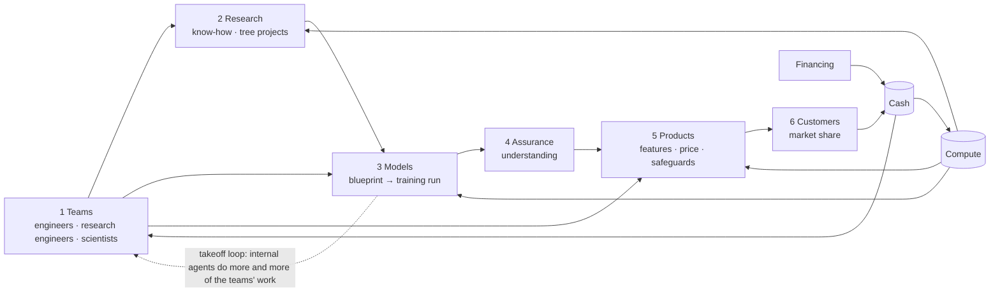
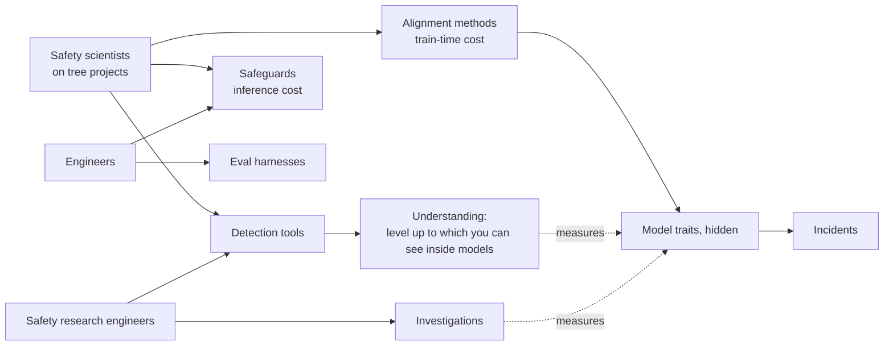

# Game structure (draft for review)

Status: **draft, 2026-11-16.** No code changes until this is approved.

Why this exists. After the v2 playtest the game reads as a simulation, not a company you run. Many mechanisms are
strange, obscure, annoying, invisible, or not under the player's control. Adding features on top would add jank. This
document fixes the **structure** first: a small set of systems, all described the same way, joined by one core loop.
New features (teams, know-how trees, model blueprints, products) are placed inside that structure. Anything that cannot
be placed is cut.

Reference feel: *Startup Company* (CEO of a startup: staff, features, customers, servers, investors, rivals), but much
deeper. AI 2027 stays the calibration ground truth; the game is standalone.

---

## 1. Rules every system obeys

These are design invariants. Each one gets a lint or UI test where possible (§8).

| # | Rule | What it forbids |
|---|---|---|
| R1 | **Own countable things.** Teams, stars, unlocked techs, models, products, customers, cash, compute. Percent shares only for budgeting one commodity (compute). | Sliders as the main verb |
| R2 | **One verb set.** Hire · Research (unlock a tech) · Design & train · Launch / update a product · Set a policy · Make a deal · Respond (to an incident or finding). | One-off verbs that exist in one panel only |
| R3 | **One template per system:** stocks → flows → controls → readouts (§3). One home panel, one health verdict, one place in the core-loop diagram. | Mechanics with no home |
| R4 | **Live things are editable in place.** A live product's model, price, features and safeguards change without withdrawing it. | Withdraw → change → re-release |
| R5 | **Nothing is wasted silently.** Unused resources flow to a default use, or show as a red "idle" stock with a one-click fix. | Idle training compute that does nothing |
| R6 | **Policies before per-item clicks.** A department-level policy covers the common case; per-item overrides live one level down. | Setting "automate" on 18 agendas one by one |
| R7 | **No chores.** Recurring upkeep is a standing policy with a visible cost, never a timer that silently blocks things. | Evals expiring after 30 days and blocking launches |
| R8 | **Return before and after.** Every investment shows its expected return before commit and its realised return after, in one of five currencies: $, know-how, capability, understanding, trust. | Spending with no visible effect |
| R9 | **Hidden only where it is the theme.** Hidden: model alignment (traits), how well each safety research line really works, rivals' internals. Everything else is exact. Measured capability never shows a fake regression from noise. | Noise that reads as "my model got worse" |
| R10 | **Calibration contract.** New layers map onto the calibrated engine quantities (§6). The reference lab still reproduces AI 2027 and the bot criteria still pass. | Balance drift from new features |
| R11 | **Every limit is visible and sourced.** Any cap, floor, threshold or gate the player can hit is shown where they hit it, with its reason. A limit with no real-world source is removed or replaced by a visible trade-off. | Hidden exceptions like the old 35% agents cap or the 150-day run cap |

---

## 2. The core loop

Read it as a company:
1. **Teams do three kinds of work.** Engineers build, research engineers do routine research, scientists open new
   ideas.
2. **Research makes knowledge:** steady know-how (better at everything) and new ideas (tree projects).
3. **Knowledge lets you design better models**, which engineers and compute build (train), with cash, data and time.
4. **Assurance checks the models** (how well you can still see inside them).
5. **Models power products**, which engineers build and which win customers from rivals.
6. **Customers pay**, and cash buys more people and compute.
7. **The takeoff loop:** your best model, used internally, takes over the teams' work: first engineering, then
   routine research, then frontier research. This is AI 2027's engine and the game's tension, because the same model
   may be misaligned.

Around the loop sit three pressure systems that react to what you do: **Relations** (government, public, rivals,
China), **World** (jobs, sectors, macro), **Risk** (incidents, catastrophe). They stay simulated from the outside
(§4.8); this document only applies the rules to them.

---

## 3. System template

Every system is specified with the same seven fields:

| Field | Meaning |
|---|---|
| Owns | The countable stocks the player owns in this system |
| Verbs | Which of the R2 verbs apply here, and to what |
| In → Out | What it consumes, what it produces (an edge in the core loop) |
| Policies | Standing settings (R6, R7) |
| Readouts | Health verdict (L1), breakdowns (L2), tooltips (L3) |
| Hidden | What the player cannot see, and how they measure it |
| Engine map | Which calibrated engine quantities it drives (R10) |

---

## 4. Systems

### 4.1 People: roles and teams

**Philosophy.** Research makes knowledge; development builds things. Research itself comes in two kinds: routine
(experiments, scaling, ablations, validation) and frontier (new ideas). That gives three roles, in capabilities and
safety alike. AI agents take them over in the order AI 2027 describes: coding first (superhuman coder), then research
engineering (superhuman AI researcher), research taste last (superintelligent AI researcher).

| Role | Real titles | Work | Output | Taken over by agents |
|---|---|---|---|---|
| **Engineers** | Software, infrastructure, product engineers | Build: training-run setup and operation, product features and launches, eval harnesses, safeguards in production | Build capacity (team-weeks) on one build queue | First: coding automation (well before SC) |
| **Research engineers** | Research engineers, applied researchers | Routine research | Capabilities: know-how growth. Safety: keeps detection tools validated as models improve; runs investigations | Second: between SC and SAR |
| **Scientists** | Research scientists | Frontier research: tree projects; research taste | Project progress; taste | Last: AI taste overtakes human taste (SAR → SIAR) |

**Teams.** You hire whole teams from a short candidate list.

| Team | Size | Placed in | Specialty |
|---|---|---|---|
| Engineering team | ≈ 150 | One shared engineering pool | None |
| Research-engineering team | ≈ 100 | Capabilities or Safety | None |
| Science team | ≈ 40 | Tree projects (several teams can share one) | One of six (the tree columns: pretraining, post-training, systems, alignment, interpretability, evals & control) |

- A card shows role, size, quality (Solid / Strong / Elite: output and cost), and for science teams the specialty.
- Moving a research-engineering team between Capabilities and Safety is one click; moving safety staff onto
  capabilities costs morale (a real, visible rule).
- **Policies (zero clicks by default):** "keep hiring to N teams" per role; science teams spread over the ready queued
  projects where they cut the most days (J2); the engineering pool serves runs first, then product upkeep (live products
  and monitors in production), then the build queue by priority (launches, features, sector packs; J2).
- Stars: named people. A star scientist raises a science team's quality and the lab's research taste.
- Specialties exist only where they change something (science teams on tree columns). Engineers and research
  engineers are generic, to keep the roster manageable.

**Reference split** ([research/19](../research/19-staff-roles.md) §1.1–1.2). No lab publishes a role split; these are
derived from AI 2027 (its superhuman coder is defined against human *research engineers*) and the AIFM (whose human
labour is "coders", excluding research management).

| Role | Share of capability staff | Leader start (classic 2,050) | Teams (≈ size) | Cost $M/FTE-yr (cap / safety) |
|---|---|---|---|---|
| Engineers | 0.30 | 600 | 4 (≈ 150) | 0.70 / shared pool |
| Research engineers | 0.55 | 1,140 | 11 (≈ 100) | 0.80 / 0.65 |
| Scientists | 0.15 | 310 | 8 (≈ 40) | 1.00 / 0.80 |
| Safety (140) | — | 90 research engineers + 50 scientists | 1 + 2 | — |

**Team sizes (decided): big, fixed sizes.** Every engineering team is 150 people, every research-engineering team
100, every science team 40. A small lab simply has few teams and must specialise. Several teams can work on one
project.

| Start | Engineering | Research eng. (cap + safety) | Science (cap + safety) | Total teams | Staff |
|---|---|---|---|---|---|
| Spinout | 1 | 1 + 0 | 1 + 0 | 3 | 290 (analogues ≈ 110; rounded up to whole teams) |
| Challenger | 3 | 7 + 1 | 4 + 1 | 16 | 1,750 |
| Big-tech division | 7 | 18 + 1 | 11 + 1 | 38 | 3,650 |
| Frontier leader | 4 | 11 + 1 | 8 + 2 | 26 | 2,150 |

Each start's science specialties follow its analogues (e.g. the challenger's safety science team is interpretability).

- **Calibration rule:** `h = capability research engineers / (0.55 · H_ref(t))`. The reference lab hires in the
  0.30 / 0.55 / 0.15 shares, so the identity test holds by construction. Engineers, scientists and safety research
  engineers do not enter `h`.
- **Scientists:** their number drives project progress; their *quality* drives research taste (AIFM: taste is per
  researcher, not headcount).
- **Engineers' AI share** comes first: `A_eng = 1 − (1 − A)²` on the same coding automation `A` [Design].

| Field | Spec |
|---|---|
| Owns | Teams (by role), stars. |
| Verbs | Hire a team, let a team go, move a research-engineering team, assign a science team, hire a star. |
| In → Out | Cash (payroll) → build capacity, routine research, frontier research. |
| Policies | Hiring targets per role; auto-assignment (above). |
| Readouts | Teams by role; per role: human vs AI share of the work; payroll; morale; attrition risk. |
| Hidden | Nothing. |
| Engine map | Capabilities research engineers → `h` (the CES labour input); safety research engineers → tool validation lead and investigation staff; scientists → taste `τ_h` and project progress; engineers → build capacity (**new**: product features, run setup, eval harnesses). AI share per role: coding automation `A` (engineers, research engineers) and AI taste `sdAI` vs human (scientists), both already in the production function. The reference role split of today's 2,050 capability staff is a calibration item (§6). |

### 4.2 Research: know-how and the tree

**Philosophy.** Most progress is incremental and flows into every new model by itself. Some progress is a new idea
you choose to pursue. Knowledge is gated only by knowledge, never by your current model.

| Part | Made by | What it is | Shown as |
|---|---|---|---|
| **Know-how** (`pa`) | Capabilities research engineers + experiment compute + AI agents (research speed M) | Accumulated algorithmic progress. Every new model embodies it (κ rule). Calibrated to AI 2027. | A bar: *in your best model* vs *not yet trained in*. The gap is the reason to train. |
| **Ideas** (tree nodes) | Science teams assigned to projects, sped up by research speed | Architectures, methods, tools, features, safeguards. One shared tree; every node shows capability and safety effects. | The tree; active projects with teams, progress, odds and ETA. |

Details: [TECH-TREE.md](TECH-TREE.md).

| Field | Spec |
|---|---|
| Owns | Know-how; unlocked ideas; active projects. |
| Verbs | Start a project, assign or move science teams, queue projects. |
| In → Out | Teams, experiment compute, internal agents → know-how and ideas → options for models and products. |
| Policies | Project queue; auto-assignment of idle science teams. |
| Readouts | Research speed M with its bottleneck; know-how bar; projects. |
| Hidden | The roll on capability ideas (odds shown); the true efficacy of safety research lines (estimate shown). |
| Engine map | Know-how and M unchanged. Ideas = paradigms P05–P27, locked design options, safety techniques; paradigm FTE / experiment-share projects and agenda funding levels are replaced by assigned science teams. |

### 4.3 Models: blueprint → training run → model

The run designer becomes a **blueprint** with fixed slots. Each slot holds one card; locked cards show the node that
unlocks them.

| Slot | Cards (examples) | Unlocked by |
|---|---|---|
| Size | Any size you choose (snap points ×¼ … ×8 of the frontier run) | Free; limited by compute, time, staleness, data, cash, restart risk and serving cost (TECH-TREE §1.5) |
| Architecture | Dense · MoE · Latent-recurrent | Tree (latent = Neuralese recurrence) |
| Data | Balanced · Code & math · Science · Synthetic · Multimodal | Tree |
| Data filter | Quality · Quality + hazard · Safety pretraining | Tree (Backbone layer) |
| Training focus (≤ 2) | Coding · Math · Computer use · ML research · Long tasks · Cyber · Bio | Tree |
| Training effort | Light · Heavy · Heavy with hardened graders | Tree |
| Reasoning | Visible · Pressured · Faithful · Latent | Tree |
| Alignment | Constitution · Inoculation · Anti-scheming · Honesty training | Tree |

A run also needs engineers: setting up and operating a run takes build capacity (more for bigger runs). As agents take
over engineering, this cost fades.

Every card shows its cost and effect in the same five fields: **capability** (general and domain levels),
**time**, **$**, **serving cost**, **risk** (the trait pressure, as 4 risk families, §4.5). The S1–S8 signals and edge
grades move to tooltips.

| Field | Spec |
|---|---|
| Owns | Bases, model versions, saved blueprints. |
| Verbs | Design & train (base, post-train, distill, continue). Make internal agent. Retire. Roll back. |
| In → Out | Know-how + unlocked cards + training compute + cash + time → a model. |
| Policies | Training compute that no run uses goes to research automatically (R5). Auto-evaluate every finished model (R7). |
| Readouts | Predicted vs current model; run queue with ETA; "next model" gates (compute, data, power, cash). |
| Hidden | True capability (shown measured, with a band, never regressing); traits (§4.5). |
| Engine map | Unchanged: `pm` formula, κ, `pc(FLOP)`, design Δp/ΔL tables, data wall. Changes: size is free (`pc` already handles any FLOP); the 150-day cap becomes a visible staleness cost; serving cost grows with √size. |

### 4.4 Products and customers

Channels become **products** you own. Each product is a card with a model slot, a monitor slot (§4.9), feature
slots, a price tier and safeguards, all editable while live (R4).

| Product | Customers | Revenue driver (existing engine) |
|---|---|---|
| Chat (consumer app) | Users | Consumer spend × appeal × quality × price |
| API | Developers ($) | Sector spend, API share |
| Agents | Business tasks | Sector spend at the agentic price; needs a time horizon ≥ the task length |
| Enterprise | Seats per sector | Sector spend in focus sectors (+0.5 L via sector packs) |
| Government | Contracts | Contract lump sums |
| Open weights | (release, not a product) | Goodwill; irreversible leak |

**Product features** are discrete add-ons. Each is unlocked on the tree, then **built by engineers** (team-weeks)
with cash, and has an effect on existing engine terms. Some pay off only above a capability (shown):

| Feature (examples) | Unlock | Effect (existing term) | Cost / risk |
|---|---|---|---|
| Memory | P07 | Consumer appeal +; agent horizon × 1.5 | S8 (memory) |
| Deep think | P05 | Effort "deep" (+0.6 L at × 10 tokens) | Serving cost |
| Computer use | P06 | Agents product; Desktop bench | Overreach incidents |
| Sector pack (per sector) | Enterprise | Sector Le +0.5 | Cash, build time |
| Companion mode | Engagement-tuned model | Appeal × 1.2 | Sycophancy feedback |

**Safeguards** are product settings with an inference cost and a demand cost:

| Safeguard | Effect | Cost |
|---|---|---|
| Misuse classifiers | Misuse hazard × 0.7 | Serving compute + a few % (first-generation classifiers cost ~24% inference; later ones ~1%); small refusal loss |
| KYC levels 1–3 | Distillation access × 0.75 each | Demand −2% each |
| Usage policy | Restricts sectors / agent replacement | Revenue in those sectors |
| Runtime monitoring | Catches incidents (COT/WB tools) | Safety compute |

| Field | Spec |
|---|---|
| Owns | Products, features, customers, market share per segment. |
| Verbs | Launch, update (model, features, price, safeguards), retire. |
| In → Out | Models + features + serving compute → customers → revenue. |
| Policies | Serving compute auto-split across products by demand. "Upgrade products to the newest cleared model" (on/off). |
| Readouts | Per product: customers, revenue, market share vs the best rival product, binding cause (quality / price / capacity). |
| Hidden | Nothing beyond rival internals. |
| Engine map | Existing deployments, demand, market share, appeal, exposure, KYC, safeguards. Features map to existing multipliers; any new multiplier needs a calibration line in §6. |

### 4.5 Safety

**Is safety mostly model features that cost training and inference?** Partly. Real safety work splits four ways:

| Kind | Examples | Cost shape | Share of real safety staff |
|---|---|---|---|
| Training-time features | Constitution / RLHF spec, safety training, inoculation, anti-scheming, data filtering, faithful CoT | Training time; small capability tax (big for faithful CoT vs latent) | Moderate |
| Deployment safeguards | Classifiers, monitors, KYC, usage policy, control protocols | Inference compute; refusals cost demand | Moderate |
| Research that makes tools | Interpretability, evals science, model organisms, oversight research | People + compute; no per-model cost | **Largest** |
| Operations | Pre-release evals, investigations, incident response, rollbacks | Time; launch delays | Small |

So safety in the game is the same three roles applied to safety, on the same tree:

- **Safety is not a separate tree.** Its nodes sit in the shared tree's Alignment, Interpretability and Evaluation &
  control columns, linked to capability nodes (a CoT monitor needs visible reasoning; neuralese kills it).
- **Uncertainty stays.** Each research line (an agenda) has a hidden true efficacy, drawn per world as now.
  Finishing a project reveals a result: a working tool, a weaker tool, a dead end, or (rarely, with AI labour) a
  false result. The line shows *Promising / Mixed / Struggling* from the results so far. This is R14's agenda model,
  made visible.
- **Understanding.** Each tool works up to a capability level; safety research engineers keep raising it as models
  improve. Understanding U = the level up to which your tools still see the critical traits. The race "capability
  vs understanding" stays the core tension.
- **Traits shown as 4 risk families** at L1: *People-pleasing* (SYC, PERSONA), *Gaming* (RH, PROXY, TGAME),
  *Deception* (EA, CONCEAL, OBF, AF, SAND, SCHEME), *Power* (POWER, SUCC, COLLUDE). The 16-trait graph is L2.
- **One AI-labour policy.** "AI share of safety work: x%, model: y" for the whole department, replacing per-agenda
  automate clicks. Sabotage risk uses that model's traits, as now.
- **Assurance policies.** "Evaluate every model before release" (on by default; cost: days), "monitor internal agents"
  (safety compute). Investigations open from a red flag with one click and default staffing.
- **Responses** (patch, retrain against detector, targeted training, restrict, control layer, roll back, disclose) are
  unchanged; each shows its cost and effect before commit.

| Field | Spec |
|---|---|
| Owns | Safety teams (all three roles), unlocked tools / methods / safeguards, open investigations. |
| Verbs | Research a project; set AI-labour and assurance policies; investigate; respond. |
| In → Out | Safety teams + safety compute + AI labour → tools, alignment methods, safeguards → understanding, lower true traits, fewer incidents. |
| Readouts | L0: capability vs understanding. L1: 4 risk-family bars per model with bands; research-line health; team-months spent on dead ends. |
| Hidden | True traits, true efficacy per research line, undiscovered failure modes (U-modes). |
| Engine map | Agenda efficacy draws, technique strength and M½, family penalties, trait graph, removal and drift, incidents: unchanged. Changes: finding *arrival* moves from a hazard on funding levels to project completion with the same expected timing (T₁ at "serious" staffing); the tool validation lead comes from safety research engineers instead of funding levels. |

### 4.6 Compute

Stays a **generic commodity** (no named clusters).

| Field | Spec |
|---|---|
| Owns | H100e online (owned + rented), sites, orders, contracts. |
| Verbs | Order chips, build sites, rent cloud; set the budget split. |
| In → Out | Cash → compute → four budgets: Training, Research, Products (serving), Safety. |
| Policies | Unused training compute goes to Research. Serving auto-splits across products by demand. |
| Readouts | Unchanged Compute tab; idle chips; the split with what each budget buys. |
| Hidden | Nothing. |
| Engine map | Unchanged pools. |

### 4.7 Finance, Relations, World

Their structure already fits (raises, debt, deals, board; trust, access, favors, commitments; sectors, macro). They
get the same template and the R4–R8 audit, not a redesign. **Corporate management (CEO, board, owners) and financing
stay as simple as they are now in this restructure;** a separate session will improve them. Products surface the world's existing market-share model to
the player (customers and share vs rival products).

### 4.8 Your company and the world

**Philosophy.** Only your company is modelled from the inside. Everything else (rival labs, China, government,
public, sectors) stays simulated from the outside, the way AI 2027 models it. You are a **new company added to that
world**, not a replacement for one of its labs.

- **The world runs without you.** The simulated labs include an AI 2027-style leader (fictional name) at reference
  inputs, so the AI 2027 timeline plays out around you and the calibration lives in the world, not in the player.
  Today no rival plays that role (the player is the leader); one must be added.
- **Start types** set your starting company. All four use the same rules; only the start state differs.

Start values from [research/18](../research/18-start-types.md) §6. Model lag = months behind the leader on Epoch's
capabilities index.

**Difficulty is labelled, scoring is the same.** Some starts are simply harder; the setup screen says so
(Easy / Medium / Hard / Impossible). Labels are checked with bot games before release. Proposed: leader Easy,
big-tech division Medium, challenger Medium, spinout Hard. Impossible is reserved for future starts.
**2026-11-17: labels follow the bot data** (leader Easy, challenger Hard, big-tech division Impossible, spinout Impossible);
follower catch-up deferred — options in PROGRESS R9 notes. Knowledge diffusion from the leader lab stays and is shown in the
research-speed breakdown.

| Start type | Analogues | Cash | Board | Staff | Compute owned / rented (H100e) | Model lag | Revenue | Products | Extra known nodes | Character |
|---|---|---|---|---|---|---|---|---|---|---|
| **Well-funded spinout** (Hard) | Anthropic 2021, SSI, Thinking Machines | $3B | Founder-controlled | 110 | 0 / 25K | No own model; open-weight base 6.5 mo behind | $0 | — | RL focus: math; Linear probes | Elite taste, cheap stars, patient investors; no compute, product or revenue |
| **Challenger lab** (Medium) | Anthropic, xAI (mid-2025) | $8B | Founders + investor seats | 1,300 | 100K / 300K | 3 mo | $3B | Chat, API, Enterprise, Coding agent | Multimodal, Computer use, Long context, Multi-agent, Agents, Coding agent, Deep research, RL: SWE; probes, SAEs | Near the frontier with revenue; must raise about yearly |
| **Big-tech AI division** (Medium) | Google DeepMind, Meta, Microsoft AI | $4B + $16B/yr from the parent | Parent company (new) | 4,000 | 800K / 0 | 6 mo | To the parent (~$4B attributed) | Chat, API, Enterprise, Voice & vision | Multimodal, Computer use, Long context, Multi-agent, Deep research, Voice & vision, RL: math | Compute and distribution, can't go broke; slow approvals, weak talent pull, fixed budget |
| **Frontier leader** (Easy) | OpenAI (mid-2025) | $40B / $45B (incl. committed round) | Nonprofit hybrid | 2,500 / 3,000 | 500K / 700K | 0 | $12B / $13B | Chat, API, Enterprise, Agents, Coding agent, Deep research, Voice & vision | Challenger's + Voice & vision, CoT monitor | Everything now; fragile board, largest commitments |

- **Big-tech money (decided: simple).** A fixed yearly budget from the parent on a schedule shown in advance
  ($16B in year one, growing with the parent's capex path); no equity raises and no bankruptcy. **Superseded by
  finance v3 (FINANCE-V3 §13, FIN5c):** there is now a parent-confidence mechanic. The yearly budget = the parent's plan ×
  min(100%, 50% + parent confidence ÷ 120); the parent sets yearly goals (capability, scale, adoption, judged like
  promises); overspend is covered (cash below zero is the parent's advance) but costs parent confidence. Still no raises,
  no bankruptcy and no runway distress for a division.
- **Leader cash (decided):** keep $40B / $45B, labelled "cash + committed round".
- **Catch-up targets** (research/18 §0.2): real new labs shipped their first own models 9–12 months behind, 12–17 months
  after raising; Meta closed from ≈ 9.5 to ≈ 5 months. The engine should reproduce these for the matching start types.

| Field | Spec |
|---|---|
| Owns | The start choice. |
| Verbs | Choose the start type at setup. |
| In → Out | Start state of every player system. |
| Hidden | World parameters (as now). |
| Engine map | Player start values per type; rivals, China and the world unchanged except the added leader lab. |

### 4.9 Internal agents (draft for review)

**Philosophy.** Your models also work for you. Every use of a model inside the company is a choice of *which model,
how much compute, for which work*, and the screen shows what you get (AI labour), what you pay (compute) and what you
risk (that model's traits, in that place). This is the takeoff loop made into decisions.

**One idea for every deployment: model + monitor.** Products (§4.4) and internal uses are both *deployments*. Every
deployment is a **package**: a model, optionally a **monitor model** watching it, and compute. The package shows its
total run cost, capability, speed and safety. Examples: Chat runs Atlas-4 monitored by Atlas-3-mini; capabilities
research runs Atlas-4 monitored by Atlas-3.1.

**Internal uses** (one per role and department, decided 2026-11-16: routine and frontier research use separate
models):

| Use | Work it does | A better model gives | A misaligned model here can | Engine today |
|---|---|---|---|---|
| **Engineering** | Coding for the build queue (runs, features, harnesses) | More build capacity per chip | Ship subtly broken code, game its tests | new (`A_eng` from this model) |
| **Capabilities, routine research** | Research engineers' work: experiments, implementation | Coding automation `A`, AI researchers per chip (`R·k`, ηmod) | Sandbag, shape its own successor, try to exfiltrate | `internalAgent` → p_dep |
| **Capabilities, frontier research** | Scientists' work: tree projects, research taste | AI taste (`sdAI`); AI science capacity on projects | Steer research direction | new: taste read from this model instead of p_dep |
| **Safety research** | Safety research engineers and scientists, investigations | Faster safety projects and tool upkeep | Sabotage: false results, corrupted investigations | `safety.agentVersion` |

**The monitor** (any package): a second model reads the first one's actions and reasoning.
- **Gives:** incidents caught and contained. Strength falls as the gap between the watched model and the monitor grows
  (today's oversight gap tiers, AG05), and rises with control techniques (trusted monitoring, resampling).
- **Costs:** the monitor's own serving compute, plus a small slowdown of the watched model.
- **Risks:** a monitor that is itself misaligned may collude; an older, trusted model is weaker but safer.

**Per package, the player sets** the model, the monitor (or none), and, for internal uses, the compute. **Per package,
the screen shows:** copies, AI researcher-equivalents and the AI share of that work (internal), or customers
(products); total cost ($/yr); speed; safety (the model's 4 risk families, the monitor's catch rate).

Typical choices: a cheap mini for engineering; the strongest model for routine research; a trusted, older or heavily
aligned model for safety research; a cheap trusted monitor on everything that matters.

**Compute (decided: inside each department).** Each department's budget funds its own agents:
- **Capabilities:** training runs, experiments, and the engineering, routine-research and frontier-research agents.
  *Auto* splits it between experiments and agents for the best research speed, as today.
- **Safety:** safety projects, safety research agents, and monitors on internal uses.
- **Products:** serving, including product monitors.

**Display.** On Company, "Who does the work" becomes this panel: one lane per internal use with its model chip,
monitor chip, compute bar, AI share, cost and risk badges. On Products, each product card has the same model and
monitor chips.

| Field | Spec |
|---|---|
| Owns | Deployments: (use or product) × model × monitor × compute. |
| Verbs | Set the model, the monitor and the compute per deployment; Auto policy per department. |
| In → Out | Models + compute → AI labour per use (build capacity, research speed, taste, safety progress) and products; monitors → incidents caught. |
| Readouts | Per deployment: AI share or customers, cost, speed, risk, catch rate. Per model: where it is used. |
| Hidden | The models' true traits (estimates shown). |
| Engine map | Routine research = today's internal agent; safety = today's safety agent model and share; engineering, frontier research and monitors are new (monitors reuse the oversight gap tiers and control techniques). Reference lab uses its newest model everywhere with a standard monitor, so calibration is unchanged; with the same model in routine and frontier research the production function is identical to today. |

---

## 5. What the player sees (information levels)

| Level | Content |
|---|---|
| L0 top strip | Date and speed · Capability vs understanding · Cash and runway · Customers / revenue · Lead over nearest rival · Risk · Alerts |
| L1 home screens | **Company** (teams by role, AI share of each role, research speed) · **Research** (the tree, projects) · **Models** (blueprint, runs, lineage) · **Products** (product cards, customers, share) · **Safety** (understanding, risk families, branches) · **Compute** · **Finance** · **Relations** · **World** |
| L2 | Product detail, model card, team list, trait graph, branch history, run detail |
| L3 | Tooltips with breakdowns; codex with the structure diagram of §2 |

---

## 6. Calibration contract

The calibrated backbone does not change: the production function M, know-how `pa`, κ, `pc(FLOP)`, F(t), the
reference compute shares, the revenue model, market share, the trait graph and understanding U.

| New layer | Maps onto | Calibration rule |
|---|---|---|
| Roles | `h` (capabilities research engineers), taste `τ_h` (scientists), build capacity (engineers, new) | A reference role split of the 2,050 capability staff keeps h = 1 for the reference lab |
| AI share per role | coding automation `A`, AI taste `sdAI` | Already in the production function; only displayed per role |
| Tree projects | paradigms, design-option locks, safety techniques | Effort set so the reference team mix finishes each near its reference date |
| Free size | `pc(FLOP)`, serving cost | Reference lab trains 1F; serving cost at 1F unchanged |
| Product features | appeal, sector Le, agent gating, exposure | Reference lab's feature set reproduces the revenue targets (§3.11.3) |
| Safety projects | agenda findings | Expected time to first result = T₁ at serious staffing |
| Safety AI-labour policy | aiLabour, agentShare | Same labour multiplier cap |
| Player as an added company | rivals, world | The added leader lab follows the reference path; golden timelines run on it |

Gates before merge: identity test (P1), golden timelines, all §7.4 bot criteria at 200 seeds, revenue targets.

---

## 7. Known jank and the rule that fixes it

| Jank | Rule | Fix |
|---|---|---|
| Price, safeguards, KYC on a live deployment need withdraw and re-release | R4 | Product settings edit in place |
| Safety system incomprehensible; unclear what to fund or where money is wasted | R3, R8 | Safety as roles on the shared tree, research-line health, dead-end readout, 4 risk families |
| Per-agenda automate clicks | R6 | One department AI-labour policy |
| Idle training compute does nothing | R5 | Flows to research |
| Know-how invisible | R3 | Know-how bar |
| Evals expire after 30 days and block launches | R7 | Auto-evaluate policy |
| Measured capability dips on the overview chart | R9 | Monotone measured level with a band |
| S1–S8, edge grades, citations on the run designer surface | levels | Moved to tooltips |
| Products keep an older model after a better one clears | R5 | Upgrade policy |

Hidden limits (R11) are inventoried with a verdict each in [LIMITS.md](LIMITS.md), including five bugs.

The full jank audit runs **after** the restructure (play-through, screenshots of every screen at several stages,
catalogue, triage).

---

## 8. Enforcement (tests)

- **Structure lint:** every engine system and every UI control is registered under one system of §4 and one verb of R2.
- **Control test:** clicking each control changes state (exists; extend to products and trees).
- **Idle test:** no resource stock stays unused for 30 days in bot games without an alert.
- **Live-edit test:** every product setting is editable while live.
- **Calibration gates:** §6.

---

## 9. Decisions (2026-11-16)

| # | Question | Decision |
|---|---|---|
| Q1 | Teams | Hired as team cards; three roles (engineers, research engineers, scientists); specialties only on science teams (§4.1) |
| Q2 | Research | No point balances. Science teams are assigned to projects; specialty speeds them up (TECH-TREE §1.2) |
| Q3 | Features | Everything (capability, safety, backbones, product features) is unlocked on the tree; a product or model is then designed from unlocked parts and **built** (trained or engineered: cash, data, compute, time, engineers). Small edits rebuild only their layer (TECH-TREE §1.4) |
| Q4 | Odds | Shown on every project (TECH-TREE §1.3) |
| Q5 | Model size | A free decision limited only by visible resources; no 150-day cap; serving cost grows with size and falls with efficiency ideas (TECH-TREE §1.5) |
| Q6 | Tree | One shared tree, mixed capability and safety effects, cross-column prerequisites; no capability gates |
| Q7 | Automation | Agents take over engineers, then research engineers, then scientists (shown per role) |
| Q8 | Outside world | Rivals, China and the world stay simulated from the outside; only the player's company is modelled inside |
| Q9 | Your company | A new company added to the world; start types: spinout, challenger, big-tech division, frontier leader (§4.8) |
| Q10 | Team sizes | Fixed: 150 / 100 / 40; small labs have few teams; several teams per project |
| Q14 | Corporate and finance | Kept simple in this restructure; a separate session later |
| Q11 | Difficulty | Starts are labelled Easy / Medium / Hard / Impossible; scoring is the same for all |
| Q12 | Big-tech money | Fixed yearly budget on a shown schedule; no confidence mechanic |
| Q13 | Leader cash | $40B / $45B, labelled "cash + committed round" |

**Mockup review (2026-11-16):**
- Weekly users: home on the Chat product; the top strip shows revenue only (users in its tooltip).
- Safety research-line health: home on Safety; Research shows it as the project's odds with a link.
- Understanding: show U only; "tools validated to" lives in its tooltip.
- Products: features are built once and enabled per product; market share is by spend; when serving compute is
  short, Auto serves the product earning most per H100e first and shows what is cut.
- Agents inside the company: §4.9. Agent compute sits inside each department's budget; every deployment (product
  or internal use) is a package of model + optional monitor; routine and frontier research use separate models.
- The Safety screen is too dense: first glance is now the verdict, capability vs understanding, the 4 risk
  families and policies; research lines, investigations, trait graph and incidents are tabs.
- **Home of agent packages (decided):** all four internal packages (model, monitor, compute, Trusted to AI) are set on
  Company › Agents at work. Safety shows a summary ("Trusted to AI 20% · Atlas-3.0", "monitors on 2 of 4 uses") that
  links there, so each control has one home.

## 10. Order of work

1. Approve this structure, TECH-TREE and LIMITS.
2. Research: start values per start type; the reference role split; real analogues.
3. Mockups: Company (teams by role), Research (tree and projects), Model blueprint, Products, Safety overview.
4. Engine: roles and teams, tree projects, build queue, products and live edit, policies, added leader lab.
4. UI per mockups.
5. Calibration and bot gates.
6. Full jank audit.
