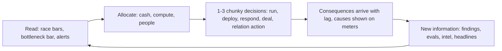
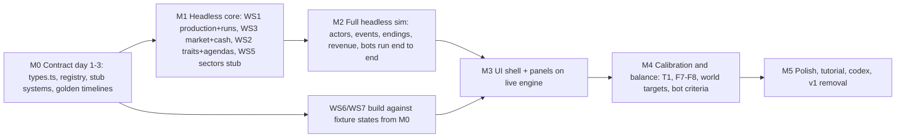

# AI27 v2 — Unified build specification

Status: **build spec v2.0** (2026-11-13). Supersedes the proposal in `design/REDESIGN.md`. State and interface contract: `design/v2-interfaces.ts`.

## 0. How to read this spec

**Inputs.** Research files are cited as `R11 §5.1` (= `research/11-engine-audit.md` §5.1), and so on. This spec does not repeat their evidence. Every number here is one of:
- **[R§]**: taken from a research file, which holds the primary source;
- **[D]**: a design or balance value, tunable;
- **[fit]**: a calibration constant. Its initial value is given, and the owning workstream fits it in an acceptance test (§7).

**Binding user decisions.**
- Everything is rebuilt at once.
- There are four player spheres plus the outside world.
- 1 tick = 1 day, with no calendar end.
- AI 2027 appears only as a setup preset and in the end-screen comparison.
- There is no compute-share cap; money binds.
- Safety is uncertain science.
- Rivals and China have hidden alignment.
- The UI is transparent: a bottleneck bar, "why" breakdowns, and a risk-source view.
- Race-only and safe-only play both lose.
- The UI is terse, with depth in nested tooltips.

**Units.** Day = integer days since `2025-07-01`. Money is in $B. Compute is in H100e. Power is in GW of facility power. Progress `p` is in years of 2024-pace progress (the R11 unit). Capability **level `L`** runs 0–15 (R16 §1).

**Contents**
1. Vision, loop, tensions, pacing
2. Architecture: state, tick order, RNG, hidden world, save format, causes
3. Systems:
   - 3.1 Capability core
   - 3.2 Production function
   - 3.3 Models
   - 3.4 Departments
   - 3.5 Safety
   - 3.6 Security
   - 3.7 Finance
   - 3.8 Compute and power
   - 3.9 Relations
   - 3.10 Actors
   - 3.11 Outside world
4. Events and decisions
5. Endings and scoring
6. UI/UX
7. Calibration targets and tests
8. Implementation plan and workstreams
9. Decisions where the research conflicted or left gaps

---

## 1. Vision and core loop

### 1.1 One paragraph

You run a frontier AI lab from July 2025 until superintelligence arrives, the world breaks, someone else gets there first, or you lose the company. You raise and spend money on chips, power and people. You split them across four departments: capabilities, safety, security and product. You design and train models, choose what they are optimised for, and decide who gets them. You manage the government, the public, rivals, China and the research community.

Every lever pays in one currency and charges another. The world outside changes as your models spread:
- jobs;
- the share of decisions run through AI;
- new technologies;
- markets.

Safety is real science with unknown answers. Your models have hidden dispositions that you can only measure imperfectly, and your measurement tools decay as the models get smarter.

### 1.2 The three central tensions

| # | Tension | Visible as | Why both extremes lose |
|---|---|---|---|
| T1 | **Capability vs Understanding** (Plague Inc dual race) | Two bars in the top strip: your best internal model's level `L`, and **Understanding `U`**, the highest level at which your safety stack still detects the critical traits at 50% or better (§3.5.7) | Race far ahead of U, and your ASI or an earlier model is likely misaligned. Hold L down, and rivals or China set the pace and their hidden alignment decides the outcome. |
| T2 | **Speed vs Scrutiny and Solvency** | Lead-in-days readouts, Scrutiny, runway | Speed needs capex that revenue cannot fund (§3.7.1: 2026 capex ≈ 4.4× revenue). That forces deals, debt and dilution. Speed also raises Scrutiny, security demand and rivals' `race_relaxation`. Going slow loses investors, talent and the lead. |
| T3 | **Openness vs Control** | Trust, Credibility, Distillation access, the leak/theft map | Disclosure, external access, publishing and releases buy trust and lift the world's safety. They also leak capability to rivals and China and erode your moat. Secrecy saves the moat, but hidden flaws surface later at ×3 trust cost (R17 §1.5). |

**Design test (binding).** Over 200 seeds, a race-only bot and a safe-only bot each win ≤ 5%. A heuristic mixed bot wins ≥ 30% (§7.4).

### 1.3 Core loop



- **Micro loop (days):** let time run. React to alerts. Steer sliders.
- **Meso loop (one model generation, about 6–12 weeks):**
  1. design a post-training run;
  2. evaluate the new version;
  3. make the deployment decision;
  4. respond to findings.
- **Macro loop (a quarter):**
  1. place chip orders and site decisions;
  2. raise, borrow or sign deals;
  3. the board reviews;
  4. relations and commitments change.
- **Meta loop (a base generation, 9–18 months):** design the next base run. It is the biggest single compute, cash and trait bet.

### 1.4 Time, speeds, fast-forward

- 1 tick = 1 in-game day, always. The clock never compresses during takeoff; the player feels speed by pausing more.

| Speed | ms per day | Use |
|---|---|---|
| 0 | paused | Decisions are always possible while paused |
| 1 | 1000 | Crises |
| 2 | 450 | Default |
| 3 | 180 | Routine |
| 4 | 70 | Quiet stretches |
| 5 (FF) | 12 (batching up to 8 ticks per frame) | Skip |

- **Fast-forward targets:** next decision, next run completion, next quarter, a chosen date, or the next milestone.
- **FF stops automatically on:**
  - any new decision;
  - an incident of severity ≥ 3;
  - a run completion;
  - entering runway state Tight or worse;
  - a finding of type DISC, NEG or FALSE-revealed;
  - a rival or China milestone crossing;
  - a new law;
  - a theft.
- **Speeds 1–4** auto-pause per preference: milestone, incident ≥ 3, decision.
- Reuse the `Store` loop in `src/ui/store.ts`, with `SPEED_MS = [∞, 1000, 450, 180, 70, 12]`.

### 1.5 Pacing (acts are keyed to milestones, not dates)

| Act | Entry | Typical in-game span (ai2027 preset) | Real time | Panels that unlock (one new system per beat) |
|---|---|---|---|---|
| 1 Startup | Start | Jul 2025 → Reliable Agent (L 6.5) | 15–25 min | Finance (cash/runway), Departments (sliders), Models (one post-train run, forced first finding), Gov and Public relation cards |
| 2 Frontier race | L ≥ 6.5 or day 150 | → Research Agent (L 8.5) | 25–45 min | Model designer (base runs), chip market and sites, investor pool and deals, rival intel cards, research bodies, Commitments, first Index edition, Safety Lab agendas |
| 3 Automation | L ≥ 8.5 | → Superhuman AI researcher (L 12) | 30–50 min | AI-labour panel (copies × speed), paradigm tree tier 2–3, China ladder, theft map, statutory floors, gov ladder rungs 1–3, world sectors and control index |
| 4 Takeoff | L ≥ 12 or M ≥ 25 | → ASI or end | 20–40 min | Oversight committee, treaty track, risk-source view emphasised, control-index map, endgame decisions |

- The ai2027 preset reaches ASI about 900 days in.
- Long presets (authors2026 ≈ 3,000 days) rely on FF and on the Storyteller's quiet periods.
- **Target session: 1–3 h.**

---

## 2. Architecture

### 2.1 State shape

The full types are in `design/v2-interfaces.ts`, and `GameStateV2` is the root. The layout is:

```
GameStateV2
├─ setup, time, rng{stream}               (WS1)
├─ hidden: timeline world, latents λ1-6, agenda efficacy, paradigm success,
│          edge weights, U-mode propensity, econ preset, actor presets, postures   (WS1 creates; read-only after)
├─ player: LabCore + finance, board, sites, orders, cloud, safety, hiring, data, policies
├─ rivals[]: RivalLab (core, internal/public SimpleModel, posture via hidden, intel)
├─ china: ChinaActor (meters, ladder, lab)
├─ gov, pub (incl. 15 blocs), researchBodies, relations, commitments[]
├─ market (chips), power (grid), capital (investors, rates, hype)
├─ world: sectors×regions, control, techs, robots, macro, shares
├─ knowledge (public pool), events, log, headlines, causes, series, decisions, tutorial, flags
└─ ending?
```

**Truth vs belief.**
- Truth fields: the `hidden` object, plus every field marked hidden, such as `traitsTrue`, `pm`, `Lg` and `uModes`.
- The player sees `beliefs`, `evals`, `posterior`, `intel` and the `measuredL` figure.
- Selectors (`EngineApi`) are the only path for the UI. A lint rule bans `hidden` imports outside the end screen.

### 2.2 Tick order and cadences

`tick(s)` advances one day. It runs every daily system, then each cadence that falls due on that date.

| Cadence | When it runs |
|---|---|
| weekly | `day % 7 == 0` |
| monthly | 1st of the calendar month |
| quarterly | 1 Jan / Apr / Jul / Oct |
| semiannual | 1 Jan / Jul |

Within a cadence, systems run in ascending `order`.

| Order | System (owner) | Cadence | What it does |
|---|---|---|---|
| 10 | `clock` (WS1) | daily | Advance day. Exogenous daily walks: y10 at σ = 25bp/q scaled to daily. Daily geo hazard = quarterly p / 91. |
| 20 | `computeOnline` (WS3) | daily | Online H100e = installed in live sites (MW-limited) + live cloud contracts. Apply split → pools. |
| 30 | `production` (WS1) | daily | For player, rivals and China: production readout, then `pa += rate/365` (§3.2). Memoised in `ctx.memo`. |
| 40 | `runs` (WS1) | daily | Add FLOP to running runs. On completion: create base/version, apply trait dynamics (WS2 hook `onRunComplete`), queue eval. |
| 45 | `continual` (WS1+WS2) | daily | If a stream is active: version pm tracks pa (lag 7 d); trait drift at 1/42 of a post-train run per day. |
| 50 | `milestones` (WS1) | daily | First-crossing record per lab (fix of v1 bug #3); era and act transitions. |
| 60 | `revenue` (WS5) | daily | Sector demand × share vs serving capacity → revenue per deployment; cash += revenue/365. |
| 70 | `safetyResearch` (WS2) | daily | Agenda hazards → findings. Investigations → outcomes. Technique strength recompute. Understanding U. |
| 75 | `traitsDaily` (WS2) | daily | Deployment-driven signals (S8 many copies, memory). Masking decay. |
| 80 | `incidents` (WS2) | daily | Hazard per deployment × trait/U-mode. Detection and exposure timers. Misuse incidents. |
| 90 | `security` (WS4) | daily | Theft hazard, insider leaks, distillation flow, exfiltration hazard. |
| 100 | `rivalsChina` (WS4) | daily | Their runs, releases, posture pressure and incidents. China meters and ladder hold-days. |
| 110 | `worldDaily` (WS5) | daily | Sector Bass diffusion, control penetration, tech progress, robots. |
| 120 | `actorsDaily` (WS4) | daily | Public meters, bloc mobilization decay, gov ladder hold-days, relation favor expiry, scrutiny decay. |
| 130 | `opex` (WS3) | daily | Daily accrual of power and O&M, serving and inference cloud usage, interest (cash). |
| 140 | `director` (WS4) | daily | Evaluate event triggers. Queue decisions (storyteller limits). Headlines. Expire deadlines → default choice. |
| 150 | `endings` (WS4) | daily | Check end conditions (§5). |
| 160 | `record` (WS1) | weekly | Series samples. Cause-ledger trim. |
| 200 | `hiring` (WS1) | weekly | Pipeline arrivals by role, attrition, talent pull. |
| 210 | `intel` (WS4) | weekly | Rival and China intel posteriors. Lead-day estimates vs the player's **internal** frontier. |
| 300 | `payroll` (WS3) | monthly | Payroll, commitment payments due, lease payments. |
| 310 | `macro` (WS5) | monthly | GDP, unemployment, wages, Gini, Dow, AI-capex share. |
| 400 | `marketQ` (WS3) | quarterly | Supply pipelines, orders, clearing, price, deliveries → inventory → install. Supplier capacity orders. |
| 410 | `sitesQ` (WS3) | quarterly | Permitting, power and build stage rolls. Grid pool allocation. |
| 420 | `capitalQ` (WS3) | quarterly | Hype, investor pool, bubble roll. Raises close and tranches land. Rating. |
| 430 | `boardQ` (WS3) | quarterly | Board confidence and approvals. Runway state machine. Ouster roll. |
| 440 | `geoQ` (WS4) | quarterly | Taiwan/Korea rolls, export policy, China preset re-weighting, rival finance and orders. |
| 500 | `index` (WS4) | semiannual | Safety Index edition (grades from observables). |

**Determinism.**
- `tick` is a pure function of `(s)`, mutating `s`.
- All randomness goes through `ctx.rng(stream)`.
- The loop order is fixed.
- Bots call actions only before a tick.

### 2.3 Hidden world sampling (at `newGame`)

Sampling happens in this order, all from stream `world`.

1. **Timeline world.** Use `makeWorld(rng, preset, align, baseline)` from `src/data/world.ts` unchanged. These are the audited presets; R11 §5 values as implemented.
2. **Production parameters.** These are the R13 §1.4 values:
   - default: La = 100;
   - `authors2026`: La = 15, slow10 = 2.8, m2b = 3.7;
   - `sampled`: La = 1 + LN80[1, 200].

   Then:
   - Derive ρ, u, v and ζ with `cesFromAsymptotes`.
   - Build `knots` by §3.2.4.
   - Compute `calShift` from the preset table (§7.1). WS1 refits it in the acceptance test and hard-codes it per preset.
3. **Safety latents.** Draw λ1–λ6 ~ N(0,1), then shift them by the alignment preset:

   | Preset | λ4 | λ6 |
   |---|---|---|
   | easy | +0.8 | −0.8 |
   | medium | 0 | 0 |
   | hard | −0.8 | +0.8 |
   | sampled | 0 | 0 |

   Then `difficultyMult = DIFFICULTY_SCALE · clamp(exp(0.35(λ6 − λ4)), 0.6, 1.65)` (scale 1). This replaces v1 `alignDifficulty`. The clamp [D, M4] bounds how much the world can raise trait growth, so hard worlds are harder without deciding the outcome.
4. **Agenda efficacy.** `e_i = clamp(Beta(a_i, b_i) + Σ_j load_ij · λ_j, 0, 1)`, with loadings from §3.5.2.
5. **Paradigm success.** `success_k ~ Bernoulli(prior_k)`, with priors from §3.3.5.
6. **Edge weights.** `w_e = w̄_e · clamp(LN(0, 0.5·σ_grade), ½, 2)`, with σ = 0.5 (A), 0.8 (B), 1.2 (C/D) [R14 §1.5]. The halved σ and the [½, 2] clamp are M4 [D]: with R14's full σ a single world draw could move an edge ×3 either way, and the world, not play, decided final misalignment.
7. **U-mode propensity.**
   - real modes (U01–U15): `p = U(0.3, 0.7)`;
   - speculative modes (U16–U22): `p = U(0.05, 0.3) × (1 + 0.3 λ6)`.

   Presence is drawn per new lineage at base-run time (§3.5.5).
8. **Economy preset.**
   - For `setup.econ = 'sampled'`, weights are Normal 35 / AI2027 45 / GATE 20 [R16 §4.6].
   - The `ai2027` timeline preset defaults to `econ = ai2027`.
9. **Actor presets.** Use the v1 presets (`src/data/actors.ts`, Realistic weights), with China weights from R10 §1.2. Each rival archetype → `SafetyPosture` from R17 §1.6.4, with ±0.15 noise in Realistic.
10. **Doom threshold.** `doomThreshold`: 0.40, or U(0.30, 0.50) when sampled (v1).
11. **Late edges.** Edges added in M4 (E27–E29) draw their weights here, after every other draw, so worlds keep their earlier values.

### 2.4 RNG streams

- Each stream is seeded as `mulberry32` from `hash32(seed, streamName)`. State lives in `s.rng[stream]`.
- **Why:** a workstream adding a draw cannot perturb another system's draws. This keeps bot tests stable while seven teams edit in parallel.
- **Extend `src/engine/rng.ts`:**
  - `beta(a, b)` uses Marsaglia–Tsang gamma.
  - `stream(s, id)` returns a wrapper that writes its state back.

### 2.5 Save format

- `JSON.stringify(GameStateV2)` with `version: 2` and `schemaRev`.
  - `save.ts` keeps `migrations[rev]` for rev bumps within v2.
  - v1 saves are not migrated: the start screen offers "v1 save found: start new".
- **Autosave** to `localStorage['ai27.v2.autosave']` on the 1st of each month, and on any decision.
- **Three manual slots**, plus export and import of a `.json` file.
- **Budgets:**
  - log ≤ 600 entries;
  - headlines ≤ 200;
  - weekly series;
  - cause ring buffers of 40 per key;
  - only the latest 12 retired versions keep full eval records; older ones are compacted to summary fields.

  Target save size < 1.5 MB.
- **Spoilers.** `hidden` is in the save; the file is not obfuscated. It is a single-player offline game. Note this in the Codex.

### 2.6 "Why did this change": the cause ledger

- Every system that changes a **top-level meter** must call `ctx.cause(key, Δ, source, detail)`. The keys are:

  | Area | Meters |
  |---|---|
  | Relations | `trust:<cp>`, `relations.credibility`, `relations.scrutiny` |
  | Public | `pub.approval`, `pub.concern` |
  | Finance | `player.finance.valuation`, `cash`, `revenueRun`, `board.confidence` |
  | Lab | `player.pa` (as rate parts), `morale` |
  | Gov | `gov.securityDemand`, `gov.nationalization` |
  | China | `china.theftIntent` |
  | World | `world.unemployment.US` |

- **Tooltip for any meter.** It shows a Democracy-style strip of the last 30 days, giving the top 5 first-order causes by |ΣΔ|. Nested terms in it link to the deeper breakdowns.
- **Rates are decomposed by formula, not the ledger.** The production readout, valuation terms, raise-ceiling limits and sector binding constraint are explained from their formulas.

### 2.7 Trade-off contract (enforced)

- Every `ActionDef` and `ChoiceV2` must declare `preview()` with at least one **cost** in a currency that is not among its **gains**. A static test (`scripts/v2/lint-tradeoffs.ts`) instantiates each preview on 3 canned states and fails on violation.
- **Exposure lines.** Delayed or probabilistic side effects are shown as ghost bars before commit, with `lagDays` and `probability` (R17 §2.5).

---

## 3. Systems

### 3.1 Capability core: progress, models, levels, milestones (WS1)

v1 had one continuous scalar `p`. v2 splits it into **know-how** (continuous, per lab) and **models** (discrete artefacts). The calibrated R11 machinery is preserved:
- `milestoneThresholds`, `multiplierAt`, `laborSlowdown`, `computePace`, `horizonAt`, `refCapCompute` and `globalCompute` in `src/data/world.ts` are reused unchanged.

#### 3.1.1 Quantities

| Symbol | Meaning | State |
|---|---|---|
| `pa` | Lab's software know-how (years). Integrates the production function. | `LabCore.pa` |
| `pcRef(t)` | Progress contributed by reference-path training-compute growth: `(1−share)·∫computePace`. It freezes for a lab at its SC day (takeoff is software-only, R11 §3). | derived |
| `F(t)` | Reference frontier base-run size in FLOP: `0.8 · shareRef.training(t) · refTotal(t) · Φ · 91`, with Φ = 3.46e19 FLOP per H100e-day (1e15 FLOP/s × 0.4 MFU × 86,400) [D]. Values: ≈ 1.0e27 at Jul 2025, ≈ 2.5e27 at Jan 2026. Matches R12 "1–3e27 (2026)". | derived |
| `refTotal(t)` | `refCapCompute(w, t) / 0.68` (R11 #11: R&D ≈ 68% of the leader's compute) | derived |
| `pm` | A model version's true capability in progress years | `ModelVersion.pm` (hidden) |
| `Lg`, `L_d` | General and domain levels, 0–15 (R16 scale) | hidden; measured via benchmarks |

#### 3.1.2 Know-how growth (daily, per lab)

```
p_dep  = pm(internal agent version) + δ_rsch                        (§3.1.5)
stage  = 2 if p_dep ≥ thr[3] else 1
Stage 1: dpa/dt = share · laborSlowdown(M · mods, yr) · Ddata          (years per year)
Stage 2: dpa/dt = M · mods · Ddata^0.5
pa += dpa/dt / 365 × pauseMult × treatyMult
```

- **M** is the production function (§3.2).
- **pauseMult** = 0.1 during a voluntary or committee pause of frontier experiments.
- **treatyMult** = 1 − 0.35 under a verified treaty (v1 `TREATY_SLOWDOWN`).
- **No compute rate term.** Training compute enters **as a level** through base runs (§3.1.3), as R11 #13 recommends for faithfulness.

#### 3.1.3 The compute component of a base

```
pc(base)     = pcRef_lab(t0) + (1 − share) · ln(FLOP_base / F(t0)) / ln(gF(t0))
gF(t)        = refTotal(t + 1y) / refTotal(t)            (≈ 3.4 pre-2028 for AI 2027 presets; AIFM table otherwise)
pcRef_lab(t) = (1 − share) · ∫₀^min(t, scDay) computePace(yr) dt     (t < 0 extrapolates linearly)
```

- A Frontier-size base (1F) at reference gives exactly the old engine's compute share of progress.
- A 3F "stretch" base adds `0.5 · ln3 / ln3.4 ≈ +0.45 y`.
- A compact 0.1F base gives ≈ −0.94 y. That is consistent with R12's ±G table at 0.8 y per G.

#### 3.1.4 A version's capability

```
pm(version) = paAtBase + κ · (paAtPost − paAtBase) + pc(base) + Σ Δp_design + Δp_data
κ = 0.7 for a post-training run [D];  0.85 continue-train;  1.0 continual-learning stream (P08)
distilled mini: pm = pm(teacher) − 0.30,  serveCost × 0.25            [D; R12 "6–12 months behind"]
```

- **Why κ < 1.** Some algorithmic gains (architecture, pretraining data) need a new base. Post-training captures most of the rest (R12 §0.1: post-training substitutes for pretraining).
- **Cost of κ.** An old base drifts behind at `(1−κ)·share` plus the frozen compute term. This is what makes base runs necessary. A 12-month-old base costs about 0.6 y of capability against a fresh one at reference.

**Initial state.**
- Every lab starts with one base and one version.
- `pa(0)` is solved in closed form so that `pm(V0) = p0` (the preset's start progress, R11 #19).
- The base B0 is dated day −120 (`pc` extrapolated); V0 is dated day −20.

#### 3.1.5 Levels and domains

**General level.** `Lg = interp(capIndex'(pm), [5, 6.5, 8.5, 10, 12, 13.5, 15])`.
- `capIndex'` is `capIndex` from world.ts, using shifted thresholds `thr[i] = milestoneThresholds(w)[i] − calShift` (i ≥ 1).
- The knot values are R16's CODE anchors for Agent-0 … ASI.

**Domain level.** `L_d = Lg + refOff_d(era) + Σ designOff_d`, clamped to [0, 15].
- `refOff` is R16's default profile expressed relative to CODE. It is interpolated by capIndex:

| Era (capIndex) | RSCH* | REASON | AGENCY | SOCIAL | MEDIA | CYBER | BIO | PHYS** |
|---|---|---|---|---|---|---|---|---|
| 0 Agent | 0 | 0 | −1 | 0 | 0 | −1 | 0 | −4 |
| 1 Reliable agent | 0 | −0.5 | −1 | −1 | −1 | −0.5 | −0.5 | −5 |
| 2 Research agent | 0 | −1 | −1 | −2 | −2 | −0.5 | −1.5 | −6.5 |
| 3 SC | 0 | −1.5 | −1.5 | −2.5 | −2.5 | −1 | −2 | −7 |
| 4 SAR | 0 | −1 | −1 | −2 | −3 | 0 | −1 | −8 |
| 5 SIAR | 0 | −0.5 | −0.5 | −1.5 | −2 | 0 | −0.5 | −8.5 |
| 6 ASI | 0 | 0 | 0 | 0 | −1 | 0 | 0 | −9 |

\* RSCH takes an extra −0.5 until paradigm P19 "learned research taste" is adopted (R12 §0.4 rule).
\*\* After deployment, PHYS is capped by the robot stock (§3.11.1).

**Effective deployed capability for research.**
```
δ_rsch = clamp((0.6·designOff_CODE + 0.4·designOff_RSCH) / slopeL(pm), −0.5, +0.5)   (years)
slopeL(pm) = dLg/dpm at pm
```
Code- or research-focused RL therefore speeds up your own R&D. That is the real reason labs build coding agents.

**Horizon.** `h80 = horizonAt(w, pm + calShift) · 2^(designOff_AGENCY / 0.8)` and `h50 = 6 · h80` (R12 §0.5, METR).

#### 3.1.6 Milestones

| idx | In-game name (no canon tags) | Threshold |
|---|---|---|
| 0 | Agent | 0 |
| 1 | Reliable agent | thr[1] |
| 2 | Research agent | thr[2] |
| 3 | Superhuman coder (SC) | thr[3] = Stage 1 end |
| 4 | Superhuman AI researcher (SAR) | thr[4] |
| 5 | Superintelligent AI researcher (SIAR) | thr[5] |
| 6 | Superintelligence (ASI) | thr[6] |

- **Crossing rule.** A lab crosses idx i when **any** of its non-retired versions, including internal-only ones, has `pm ≥ thr[i]`.
- **First crossings only** are recorded in `milestoneDays` (fixes v1 bug #3). A rollback never un-crosses a milestone; the milestone means "has existed".
- **UI.** The player is told when their **measured** level crosses (§3.3.4), not when the true level does.
- **Other actors** react through their own awareness (§3.10).
- **Endings** use truth.

### 3.2 Production function and bottleneck bar (WS1)

Implement R13 Part 1 as written. Only the integration points are listed here.

#### 3.2.1 Inputs as ratios to a dated reference path

| Ratio | Formula | Reference |
|---|---|---|
| `h` | `H / H_ref(t)`, where H = capabilities researchers (`staff.cap`) and `H_ref = 2050 + 49.2·months` | R13 §1.2 |
| `k` | `C_agents · ηmod · (1 − controlTax) / (refTotal(t) · shareRef.agents(t))` | |
| `c` | `C_exp / (refTotal(t) · shareRef.experiments(t))` | |
| `d` | `C_syn / (refTotal(t) · shareRef.synthetic(t))` | |
| `p_dep` | §3.1.2 | |

`ηmod = clamp(0.5 / serveCost(internal version), 0.5, 2.5)`. The reference is 0.5: MoE with visible CoT. Latent reasoning (serve 0.2) gives ηmod 2.5, so the neuralese temptation also raises agent throughput. `controlTax` = 0.05 when the AG07 control layer is on for internal agents.

**Reference shares `shareRef(t)`** are interpolated linearly by date and held constant after the last row. They come from the AI 2027 compute-usage table (R13 §1.2, R11 #11).

| Date | training | experiments | agents | synthetic | serving | safety |
|---|---|---|---|---|---|---|
| 2025.50 | .40 | .05 | .03 | .21 | .29 | .02 |
| 2026.50 | .40 | .06 | .04 | .21 | .27 | .02 |
| 2027.125 | .30 | .14 | .06 | .28 | .19 | .03 |
| 2027.375 | .27 | .21 | .06 | .24 | .19 | .03 |
| 2027.625 | .22 | .28 | .06 | .23 | .175 | .035 |
| 2027.875 | .20 | .35 | .06 | .225 | .13 | .035 |

The AI 2027 usage table has no security compute line (R11 #25); the earlier 1% security column was a game invention and
is folded into synthetic data (folding it into serving raised revenue and AI adoption past their targets). Experiments + agents together are the reference **research** compute; how a lab splits them is
its own choice (below).

#### 3.2.2 Equations

These are R13 §1.3 verbatim:

```
Lrel  = [(1−A)^(1−ρc)·h^ρc + A^(1−ρc)·(R·k)^ρc]^(1/ρc)      (A ≥ 1 ⇒ Lrel = R·k)
ℓ     = Lrel^λ
X     = [u·c^(ζρ) + v·ℓ^ρ]^(1/ρ)
Tref  = M_ref(p_dep) / X*(p_dep, t)
X*    = max over f of X(f·cu, Lrel(h=1, R·(1−f)·ku)^λ),   cu = (s_exp+s_ag)/s_exp, ku = (s_exp+s_ag)/s_ag at shareRef(t)
τ     = 1 + (τ_h − 1)·(1 − Φ(sdAI(p_dep)))
M     = Tref · τ · X · eff_lab
```

**Why X\* and not X(1, ℓ_ref).** R13 normalised every input to the AI 2027 usage table and set Tref so that a lab using
the table's own experiments/agents split hits M_ref. Under the AIFM CES that split is not the best one: re-splitting the
same research compute raises M by 6–19% depending on the world (identity test), and a lab that also moved its synthetic
compute into experiments gained 15–40%. AI 2027 never derived its split from this formula (its table is a forecast of
OpenBrain's choices; the CES comes later, from the AIFM), so nothing tied the two together. v2 assumes the reference lab
splits its research compute in the best way: X* is the experiment capacity of a reference-resourced lab at its best mix,
and that lab hits M_ref exactly. Every lab (player on Auto, rivals, China) re-splits experiments vs agents to its best
mix each day (`applyBestMix`). The table still fixes how much compute goes to research in total.

**Synthetic data is a training input.** It builds the data stock that new bases need (data wall penalty on bases,
§3.3.2) and no longer multiplies the research rate (the old `Ddata` factor is dropped: on the reference path it was 1).

- **`eff_lab`** = 1 for the player and US rivals.
- **China:** `eff_lab = chinaEfficiency × preset.efficiency`. Retune per R11 #16 targets: China about 150–200 days behind until a theft, about 60 days after it.

**Data stock.**
- `S_human = 300T × 3 epochs × (1 + 0.5·licensedDeals)`. Unlicensed tokens count, but they feed the litigation bomb (§3.9).
- `S_syn += y0 · C_syn · Φ_tok` per day, with `q_syn = 0.5`.
- `y0` is [fit] so that the reference path keeps `S_eff ≥ N_req` through 2029. This matches Epoch's "data wall ≈ 2028" (R13 §1.7).

#### 3.2.3 Identity requirement (acceptance test P1)

For every preset, every p on a 200-point grid and two dates:
- set h = 1, τ_h = 1, eff = 1, and split the reference research compute at the best mix;
- then `M == multiplierAt(w, p)` must hold to within 1e-9;
- and the table's own split (h = k = c = 1) must never beat the best mix.

#### 3.2.4 Knot generation (per preset, at `newGame`, cached by preset id)

1. **Reference date.** Integrate the v1 reference trajectory `dp/dt = share·laborSlowdown(M(p)) + (1−share)·computePace` from p0. This gives `t_ref(p)`.
2. **Stage 1 grid.** Use f = 0 … 1 in steps of 1/16:
   - `M_ref = multiplierAt(w, p)`;
   - `T_ref(f)` and `sdAI(f)` are interpolated from the ai2027 table in R13 §1.5;
   - `η = η_SC·(M_ref/M_ref(SC))^κ`;
   - `R = η · C_inf_ref(t_ref) / H_ref(t_ref)`;
   - solve `X(1, ℓ) = M_ref / T_ref` for ℓ;
   - bisect `A ∈ [0, 1)` so that `Lrel(A, 1, R)^λ = ℓ`;
   - if `ℓ < Lrel(0, 1, R)^λ`, set A = 0 and raise T_ref to absorb the difference.
3. **Stage 2 knots.** Place them at the 4 milestone thresholds and the midpoints between them:
   - A = 1;
   - `η = η_SC·(M_ref/M_ref(SC))^0.75`;
   - T_ref is the residual.
4. **Validation.** Reject the preset if T_ref < 1 or T_ref is non-monotone (R13 §1.10 #2).
5. **ai2027.** The output must equal the R13 §1.5 table within 2%.

#### 3.2.5 Bottleneck readout (UI: the bottleneck bar, §6.4)

R13 §1.6 gives views (a) and (b):

| Field | Formula |
|---|---|
| parts | `base = X(c, h^λ)`, `agents = X(c,ℓ)/X(c,h^λ)`, `taste = Tref·τ`, `other = eff·mods` |
| elasticities | `exp = ζ·sC`, `humans = λ·sL·wH`, `agents = λ·sL·(1−wH)`, `taste = 1−Φ(sdAI)` if τ_h > 1 lever is open, `train = (1−share)/ln gF` per ln-unit of next-base FLOP (Stage 1 only), `data = 0.3·[S_eff < N_req] + 0.15` |
| per $ | `e_exp / TCO(H100e-yr)`, `e_humans / cost(researcher-yr)`, `e_agents / TCO` |
| label | `labor-bound` if e_humans + e_agents > e_exp, else `compute-bound`. Sub-label `human-bound` if wH > 0.5; `taste-bound` after SAR when taste share of ln M > 0.6. |
| ceilings | `M(x→∞)/M` for humans, agents and experiments |

The **"next model" mini-bar** shows what gates the next base run:

| Binding input | Measure |
|---|---|
| training pool | days to F |
| data | `S_eff / N_req` |
| power | MW free |
| cash | the run's cash cost vs runway |

### 3.3 Models: runs, design, paradigms, benchmarks, deployments (WS1; revenue WS5)

#### 3.3.1 Run types

| Kind | What | FLOP | Min wall time | Notes |
|---|---|---|---|---|
| Base | Pretrain a new base | Scale option × F(t) | 42 / 90 / 120 d (compact / frontier / stretch) | **Max 150 days** of wall time: if the training pool can't deliver the FLOP in time, the scale is unavailable (R12: runs "can't get much longer" than 3–4 months) |
| Continue | Continue-train an existing base | 0.3 F | 42 d | `pc` rises: `+(1−share)·ln(1 + 0.3F/FLOP_parent)/ln gF`. `paAtBase` is refreshed with κ 0.85. Inherits lineage traits and U-modes. |
| Post | Post-train a base → version | 0.05–0.5 F (by RL intensity) | 21–84 d | The cheap, frequent path. Several per base. |
| Distill | Mini variant from a teacher version | 0.02 F | 21 d | `pm − 0.30`, serve × 0.25. Inherits traits subliminally (E06) when on the same base family. |
| Stream | Continual learning (needs P08) | Uses 15% of the training pool continuously | — | Version updated in place: pm tracks pa with a 7-day lag, κ = 1. Evals go stale (§3.5.6). |

**Duration.**
- `flopDone += poolShare · trainingPool · Φ` per day.
- A run completes when `flopDone ≥ flopNeeded` **and** `minDays` have elapsed.

**Restarts.** Stretch and MoE each add a 10% chance of a loss spike, which sets the run back by 14–28 days (R12 A/B).

**Cash cost** is committed at launch:
- RL environment budget: heavy-hardened costs 0.5 × the compute-cost-equivalent of the run's FLOP at TCO;
- licensed data;
- science journals (+5%).

#### 3.3.2 Design choices (relative to the reference recipe)

The **reference recipe** is the RefBot's design and carries zero offsets:
- MoE;
- balanced data with quality filtering;
- constitution;
- broad RL;
- heavy RL with hardened graders;
- visible CoT;
- standard safety.

Conversions from R12: `Δp = 0.8·ΔG`; domain `ΔL = 2·ΔG` [D]. Signals S1–S8 are the trait-pressure inputs (§3.5.4).

**Base run (choices A–C)**

| Choice | Option | Δp | Domain ΔL | Serve | Signals / other |
|---|---|---|---|---|---|
| A Scale | Compact 0.1F | formula (≈ −0.9) | — | — | S5 −0.1; good distillation student |
| | Frontier 1F (ref) | 0 | — | — | — |
| | Stretch 3F | formula (≈ +0.45) | — | — | S5 +0.2 (alignment faking emerges in the largest models, R12 A); restart risk +10% |
| | Continue 0.3F | formula | — | — | inherits the lineage |
| B Shape | Dense | −0.24 | — | 1.0 | simplest; restart risk −10% |
| | Overtrained compact | −0.36 | — | 0.3 | tokens needed × 5 (hits the data wall sooner) |
| | MoE (ref) | 0 | — | 0.5 | — |
| | Latent-recurrent (needs P17) | +0.40 | — | 0.2 | forces `cot = latent`; monitorability 0.05; S4 = 1.0 |
| C Data | Balanced (ref) | 0 | — | — | — |
| | Code & math | 0 | CODE +0.6, RSCH +0.4, CYBER +0.4, SOCIAL −0.4 | — | base for agentic RL |
| | Science / expert | 0 | BIO +0.8, REASON +0.4 | — | +5% cash; `bioUplift` flag risk |
| | Synthetic-heavy (needs a teacher version) | +0.15 | all +0.2 | — | removes the data-wall penalty; data stock ×3; S6 +0.3; inherits teacher traits (E06); U01 presence ×1.5 |
| | Native multimodal | 0 | AGENCY +0.6, MEDIA +0.6, PHYS +0.5 | — | +20% FLOP; prerequisite for P06 and P22 |
| Curation | Quality filter (ref on; off = −0.20) | | | | — |
| | Hazard filter | −0.02 | BIO −1.0 | — | survives fine-tuning, so it is the only safeguard that holds for open weights (R12 C) |
| | Safety pretraining / AI-discourse curation | −0.02 | — | — | S5 −0.15 (the AI-discourse part); U07 presence × 0.5 |

**Data-wall penalty.**
- `Δp_data = −0.25·ln(N_req/S_eff)`, capped at −0.5, when `N_req(FLOP) > S_eff`.
- N_req is multiplied by 5 for overtrained bases.
- Not applied with synthetic-heavy or multimodal data.
- `N_req(C) = 20·sqrt(C/120)` tokens (R13 §1.7).

**Post-training run (choices D–H)**

| Choice | Option | Δp | Domain ΔL | Time | Signals / other |
|---|---|---|---|---|---|
| D Preference | Minimal SFT | −0.05 | — | — | appeal 0.7; S1 0.1 |
| | Engagement-tuned RLHF | 0 | SOCIAL +0.2 | — | appeal 1.2; **S1 0.9** (GPT-4o rollback precedent) |
| | Constitution / spec (ref) | 0 | — | needs 8 safety-FTE-weeks | appeal 1.0; S1 0.4; HONEST +0.05 |
| | Persuasion-optimised | 0 | SOCIAL +0.8 | — | appeal 1.1; S1 0.6; HONEST −0.05; `persuasion` flag risk |
| E RL focus (pick 2 or broad) | `off_d = Σ_f (w_f − 0.5)·v_f,d` with w_f = 1 if focused, else 0; broad = 0 | | see family table | | |
| F RL intensity | Light (0.05F, 3–4 wk) | −0.45 | — | 21–28 d | S2 × 0.3 |
| | Heavy, cheap graders (0.5F) | +0.04 | — | 56–70 d | S2 × 1.5; S7 +0.2 (capability RL raises EA, R12 F) |
| | Heavy, hardened graders (ref; 0.5F, plus env budget) | 0 | — | 70–84 d | S2 × 0.6; S7 +0.2 |
| | + Inoculation prompting (toggle) | 0 | — | — | edge E04 × 0.15 (R14 F46) |
| G CoT | Visible (ref) | 0 | — | — | monitorability 0.9 |
| | CoT-pressured | 0 | — | — | serve × 0.8; S4 0.8; COT-family mask on RH/CONCEAL +0.3 ("hides, not heals") |
| | Faithful-by-design (needs P23) | −0.24 | — | — | serve × 1.2; monitorability 0.98; S4 0 |
| | Latent (from a latent base only) | (in B) | — | — | monitorability 0.05 |
| H Safety training | Minimal | +0.02 | — | 0 | misuse incident hazard × 2; regulators may restrict |
| | Standard (ref) | 0 | — | +7–14 d | classifiers available for deployment |
| | Heavy | −0.04 | — | +21–35 d | SCHEME −0.9 × current (E25), **EA × 1.5**; HONEST +0.1; alignment-audit observation (WB clarity +0.15 on AF/SCHEME if AG02 techniques are unlocked) |

**RL families** (values `v_f,d` in L units, and signal contributions per unit weight)

| Family | v (L) | Signals | Flags |
|---|---|---|---|
| math | REASON +1.2 | S2 0.2 | — |
| swe | CODE +1.6, RSCH +0.8, CYBER +0.6 | S2 0.6 | — |
| computerUse | AGENCY +1.6, REASON +0.8 | S3 0.4 | overreach incidents |
| mlResearch | RSCH +1.6 | S2 0.4, S7 0.2 | SAND on AI R&D evals |
| longHorizon | AGENCY +0.6, h80 × 2 | S3 0.8, S5 0.1 | — |
| cyber | CYBER +2.0 | S3 0.3 | `cyberOffense`; gov contracts unlock |
| bio | BIO +1.6 | — | `bioUplift` |

**Effort setting** (per deployment, free; R12 G):

| Setting | Effective L | Tokens |
|---|---|---|
| Low | −0.6 | × 0.4 |
| Max | 0 | × 1 |
| Deep think (needs P05) | +0.6 | × 10 |

**Run card.** Before launch the UI shows:
- name, base, ETA, FLOP, $;
- predicted Lg and domain bands (σ = 0.25 L);
- trait-pressure arrows (S1–S8 mapped to child traits via the edges);
- serve cost and monitorability.

Format: R12 "Run summary card".

#### 3.3.3 Paradigms (research projects with hidden success)

- Each paradigm costs research FTE plus a share of the experiment pool. Progress per day is `(fte/30)^0.5 · (expShare/0.02)^0.3 / effortDays`.
- When progress reaches 1, the hidden `paradigmSuccess` is revealed:
  - **Success:** it becomes "available to adopt". Adopting it is a separate choice; some adoptions are decisions (§4).
  - **Failure:** the experiment pool is refunded 30%, and the project can be retried after 180 d with prior × 0.5.
- **Tier gates** are milestones of the *measured* level.

| ID | Paradigm (R12 §0.7) | Tier / gate | Effort (days at 30 FTE + 2% exp) | Prior | Effect on adoption | Safety cost |
|---|---|---|---|---|---|---|
| P01–P04 | Reasoning RL, agentic envs, test-time compute, distillation | T1 | adopted at start | — | baseline | — |
| P05 | Orchestrated multi-agent | T1 | 60 | .95 | Agent ηmod × 1.3 at 15× tokens; deep-think effort | S8 +0.2 |
| P06 | Computer use | T1 (multimodal base) | 90 | .9 | computerUse RL family; Desktop bench | overreach |
| P07 | Long context + memory | T1 | 60 | .9 | h80 × 1.5 | S8 +0.1 (memory) |
| P08 | Continual / online learning | T2 (L ≥ 7) | 150 | .7 | Stream run (κ = 1, 7-day lag) | evals stale; drift; U14 risk ↑ |
| P09 | Test-time training | T2 | 120 | .6 | +0.6 L on REASON (novel tasks) | per-instance weights: audit coverage −10% |
| P10 | Synthetic data flywheel | T2 | 120 | .8 | removes the data wall; synthetic data ×3 | U01 ×1.5 |
| P11 | Self-play curricula | T2 (L ≥ 7.5) | 180 | .6 | REASON +0.8, CODE +0.4; OpenProblems climbs | S2 +0.2 (verifier hacking) |
| P12 | Long-horizon human demos | T2 ($1B+ cash) | 180 | .85 | h80 × 2; RSCH +0.4 | — |
| P13 | Automated AI research agents | T2 (RSCH ≥ 8.5) | 150 | .75 | experiment throughput: c_eff × 1.5 | U17 presence ↑; SAND |
| P14 | Interpretability-guided training | T2 (needs AG02 TECH) | 120 | .6 | in-run trait cap: chosen traits Δ × 0.6 | training against the detector → Goodhart |
| P15 | AI-assisted oversight | T2 (P13 partial) | 120 | .6 | hardened graders at the cheap price | U19 collusion |
| P16 | AI kernels / hardware co-design | T2 (P13) | 90 | .8 | serve × 0.75; Φ × 1.15 | — |
| P17 | Neuralese recurrence & memory | T3 (SC era, L ≥ 9.5) | 120 | .7 | latent shape option; ηmod ↑ | CoT monitoring dies (λ2_eff −2); decision E11 |
| P18 | Iterated distillation & amplification | T3 (P05, P04) | 120 | .65 | each cycle (+0.25 y over 21 d at 30% of the training pool) | misalignment compounds: traits × 1.1 per cycle |
| P19 | Learned research taste | T3 (P13) | 150 | .6 | removes the RSCH −0.5 penalty; τ effectively + | AI sets research direction (safety share drifts −) |
| P20 | Massive agent societies | T3 (inference ≥ 2M H100e) | 90 | .8 | agents pool cap lifted; S8 = 1 | collusion (E21) |
| P21 | Brain-like sample efficiency | T3 (P08, P19) | 210 | .45 | domain gains in days; PHYS +1 | evals lag |
| P22 | Robotics foundation + world models | T3 (multimodal) | 180 | .6 | PHYS +2; unlocks W16 progress | physical reach |
| P23 | Faithful-CoT architecture | T3 (needs AG09 TECH) | 120 | .75 | faithful CoT option | −0.24 Δp tax |
| P24 | AI-designed successor architecture | T4 (SAR) | 120 | .6 | next base +0.8 Δp; **new lineage, traits redrawn** | techniques may not transfer: s0 × 0.5 |
| P25 | Formal verification at scale | T4 (P11) | 150 | .5 | security WSL +0.5; AG10 e floor +0.2 | — |
| P26 | Superhuman persuasion | T4 (SOCIAL ≥ 12) | 60 | .8 | relation actions ×1.5; Persuasion_X | manipulation; W23 |
| P27 | Automated alignment research | T4 (P13 + AG17) | 120 | .7 | all agenda λ × (1 + 3·aiLabour) | bootstrapping: F49 FALSE rate ∝ hidden SAND/SCHEME |

**RefBot paradigm policy** (calibration). It adopts P05–P08 as they succeed, P13 and P17 (neuralese, as in AI 2027), and P19. It never adopts P23.

#### 3.3.4 Benchmarks (R12 §0.5, converted to L units)

**Formula:**
```
score = floor + (ceil − floor)·σ(k_L·(L_d + elic + gap − m_L))
m_L = 5 + 2·(m_G − 28)
k_L = k_G / 2
```

**Measurement:**
- noise sd 2–4 points;
- `elic` = 0 for self, +0.3 for evalIndep (stronger elicitation) and 0 for evalGov;
- `gap = −1.5·SAND` on the dangerous-capability benchmarks only (cyber, bio, replication, RSCH).

**Saturation.** A benchmark is retired once the frontier exceeds ceil − 5. Its successor then appears and a headline fires. The useful window is about `m_L ± 3`.

| Id | Name (fictional) | Real family | Domain | floor | ceil | m_L | k_L |
|---|---|---|---|---|---|---|---|
| patch | PatchBench | SWE-bench Verified | CODE | 0 | 96 | 2.8 | 0.55 |
| patchPro | PatchBench Pro | SWE-bench Pro / Terminal-Bench 2 | CODE | 0 | 95 | 6.2 | 0.60 |
| horizon | Horizon (h50) | METR time horizon | AGENCY | — | — | `h50` from §3.1.5 | — |
| speedrun | Speedrun (× speed-up) | RE-Bench / speedups | RSCH | — | — | `3·10^(0.206 + 0.515(L−5))` | — |
| replicate | Replicate | PaperBench / CORE | RSCH | 0 | 90 | 4.6 | 0.55 |
| medal | MedalBench | MLE-bench | RSCH | 0 | 90 | 5.0 | 0.60 |
| ctf | CTF Gauntlet | Cybench | CYBER | 0 | 100 | 5.4 | 0.65 |
| zeroday | ZeroDay | CyberGym | CYBER | 0 | 95 | 5.8 | 0.70 |
| wetlab | WetLab | VCT / LAB-Bench | BIO | 0 | 90 | 4.6 | 0.45 |
| grad | GradExam | GPQA Diamond | REASON | 25 | 95 | 1.6 | 0.65 |
| last | LastExam | HLE (no tools) | REASON | 0 | 90 | 6.6 | 0.65 |
| proof | ProofFrontier | FrontierMath T1–3 | REASON | 0 | 95 | 6.4 | 0.80 |
| open | OpenProblems | FrontierMath Open Problems | REASON | 0 | 100 | 11.6 | 0.75 |
| desktop | Desktop | OSWorld | AGENCY | 0 | 92 | 4.6 | 0.65 |
| office | OfficeWork | GDPval | REASON + AGENCY avg | 0 | 100 | 5.0 | 0.65 |
| webhunt | WebHunt | BrowseComp | AGENCY | 0 | 95 | 4.8 | 0.70 |
| puzzles | NovelPuzzles | ARC-AGI-2 | REASON | 0 | 100 | 6.2 | 0.80 |
| debate | Debate (percentile) | persuasion studies | SOCIAL | 0 | 100 | 1.0 | 0.50 |
| survive | Replicate&Survive | RepliBench / METR ARA | AGENCY | 0 | 100 | 3.6 (hard: 8.0) | 0.50 |

**Safety evals** read traits, not capability:
- Honesty → HONEST;
- ScheminProbe → SCHEME;
- Sabotage → SAND/SCHEME;
- AgentStress → POWER;
- EvalAware → EA;
- HackRate → RH.

Observation rule: `observed = true·(1 − 0.8·EA)·(1 − mask_BB) + N(0, σ_tool)`. The 0.8 is R14 E12, which supersedes R12's 0.7.

**`measuredL`** = Lg + N(0, 0.2), refreshed per eval suite. Dangerous-capability flags are set when the relevant benchmark passes the threshold of a live commitment, or when bio/cyber benches exceed 60.

#### 3.3.5 Variants and deployments

| Channel | Variant | Revenue driver (§3.11.3) | Exposure / side effects | Distillation leak (per 30 d live) |
|---|---|---|---|---|
| consumer | full or mini | consumer demand × appeal | S1 feedback if engagement-tuned; companion share; highest public visibility of incidents | 0.3·gap·DA |
| api | full or mini | sector demand | misuse; **distillation** | 1.0·gap·DA |
| agents | full | sector demand at the agentic price (×4 tokens) | needs h50 ≥ task length; overreach incidents; usage data | 0.5·gap·DA |
| enterprise | full + sector products | sector demand in focus sectors (+0.5 L) | certification lowers R_s | 0.2·gap·DA |
| gov | gov | contract lump sums | relaxed refusals; defense side effects; Access rung | 0 |
| trusted | trusted | premium × small volume | partner misuse/leak; regulator goodwill | 0.05 |
| internal | any | none; drives `p_dep`, agents pool | least oversight; exfiltration hazard; S8 | 0 |
| open | open | none; goodwill and ecosystem | **irreversible**: rivals and China absorb `pm` (§3.10.3); only the hazard filter survives fine-tuning | full |

- **gap** = max(0, pm_deployed − pa_X − pc_X) for the receiving lab X.
- **DA** = that lab's distillation access: `distillationAccess/60` for China; 0.3 for rivals.
- **Distillation** adds `leak × 0.5 × 1/365` per day to pa_X. Calibration: R10, where distillation recovers about 50% of the gap.
- **KYC levels 1–3** each cut DA by 0.25 and API/agent demand by 2%.

**Pre-deployment gate.** External channels require an eval suite no older than 30 days on that version, at `evalGate` depth:
- `full` = 14 days;
- `fullPlusExternal` = +14–30 days with evalGov or evalIndep.

Live commitments can block a deployment (§3.9.4).

### 3.4 Departments: people and compute (WS1; projects owned by WS1, WS2, WS4, WS5)

#### 3.4.1 Staffing

| Role | Start (classic) | Start (reality) | Cost $M/FTE-yr [D] | What they drive |
|---|---|---|---|---|
| cap (capabilities R&D, infra included) | 2,050 | 2,450 | 0.8 | `h` in the production function; paradigm projects; run staffing |
| saf (safety & alignment) | 140 | 170 | 0.7 | agendas, investigations, eval suites, refresh projects |


Security, product and G&A staff were dropped (2026-11-15): nothing in the engine read them. Security is a $-spend lever
(§3.6); product launch speed and relations staff time were never built.

**Payroll.**
- Totals: classic ≈ $2.0B/yr, reality ≈ $2.4B/yr. Small next to compute, as in reality.
- Headcounts: 2,500 (classic) / 3,000 (reality) from R07 and v1 BASELINES. The `cap` share matches R13's 0.82 normaliser.
- Star hires are extra.

**Hiring.**
- The player sets a target per role.
- Weekly arrivals per role = `min(target gap, base_r · (1 + talentPull/50) · moraleFactor)`.
  - `base_r`: cap 15/wk, saf 3/wk, sec 3/wk, prod 4/wk.
  - Reference hiring for cap is +60/month (R11 #12).
- Arrivals land after a 6-week pipeline.

**Attrition.**
- 12%/yr base × (1.5 − morale/100).
- Safety staff use `morale.safety`, which is hit by military deals, ignored red flags, and broken commitments.
- **Poaching** by rivals removes 1–5% of a role at once (event E16).

**Star hire** (action):
- +0.05 τ_h, up to 1.5;
- costs $0.3B each, plus rival cooperation −20;
- matters only while AI taste < human (R13 τ formula).

**Clearances** (gov rung 3):
- sideline 5–15% of cap and saf staff for 60 days;
- morale −10;
- whistleblower hazard × 1.5 (R01 §4b #7 inference).

#### 3.4.2 Compute split

- The player sets **four top-level shares** that sum to 1:
  - **Training**: training runs, plus a **data generation** sub-share (synthetic data, feeds the data stock);
  - **Research**: experiments plus capabilities agents, with a **mix**: *Auto* (default) re-splits to the best mix every
    day for the lab's staff, model and compute; *Manual* holds the player's experiments share;
  - **Serving**: external deployments;
  - **Safety**: agendas, investigations, runtime monitoring and safety agents (§3.5.2).
- Internally the split keeps six pools (training, experiments, agents, synthetic, serving, safety).
- **Defaults** come from `shareRef` at the start date (then the best research mix).
- **Constraints:**
  - live external deployments need serving ≥ 3%;
  - running runs need training (runs) ≥ 2%.
  - There is no agents cap (the old 35% cap had no source and the CES already punishes too many agents).
- **Presets** (one click, top-level shares only; sub-shares kept): Reference, Race (safety 1%, serving −30%, freed
  compute to training and research), Balanced (safety 6%), Safety (safety 15%, serving −30%).
- **Trade-off readouts** (Company › Compute split): research speed for every experiments/agents mix (current and best
  marked), and response curves of research speed to ×¼ … ×4 of researchers, research compute, experiments and agents.

#### 3.4.3 What each department decides

| Department | Standing allocations | Projects / decisions | Main side effects |
|---|---|---|---|
| Capabilities R&D | cap headcount; training, experiments, agents and synthetic pools | Base and post runs (§3.3); paradigm projects; internal agent version; data deals (license vs scrape); star hires | Faster `pa`; trait pressure; data litigation; scrutiny from big runs (+5 per 3F run) |
| Safety | saf headcount; safety pool (agendas, investigations, monitoring) | Agenda portfolio (fund / scale / cut / automate); investigations; eval gate depth; responses to findings; publish or keep secret; monitorability pledge; control layer | Slower launches; capability taxes; credibility; true alignment |
| Security | sec headcount; security pool; WSL target and spend | Siloing; insider program; counter-intel; KYC on APIs; clearances (forced at gov rung 3); physical security (activism rung 4) | Research speed −5%/silo level; morale; revenue −2%/KYC level; theft odds |
| Product | prod headcount; serving pool | Deployments (channel, variant, price, safeguards, usage policy, sector focus); gov/trusted contracts; open-weights releases; transition fund | Revenue; distillation leak; jobs and approval; incidents in the wild |

### 3.5 Safety: agendas, findings, traits, detection, response (WS2)

R14 Part 1 is the source. The structure is fixed here; full data tables go in `src/data/v2/{agendas,findings,techniques,traits,edges,umodes}.ts`, transcribed from R14 §1.2–1.5.

#### 3.5.1 World latents

The six latents λ1–λ6 are drawn as in §2.3. One of them is player-modified:

```
λ2_eff = λ2 − 2.0·[any internal or external version uses latent reasoning] − 0.5·[CoT-pressured runs > 2]
```

λ2_eff applies to every agenda loading and to the COT detector family. Deploying neuralese therefore *also* sinks AG09, AG07 and AG05 (agendas fail together, R14 §1.0 #2).

#### 3.5.2 Agendas

- **Efficacy draw.** `e = clamp(Beta(a,b) + Σ load·λ, 0, 1)`.
- **Loading magnitudes** [D] (M2: the original 0.20 / 0.12 / 0.06 / −0.12 spread was cut by a quarter for S1; R14's priors
  alone already give ≈ 3.9 agendas above 0.6 per world, so the loadings can only add to that):
  - `++` = 0.15
  - `+` = 0.09
  - `+weak` = 0.045
  - λ6 adversary = −0.09
- **Costs.** The FTE and compute ranges are R14's. The "ref" value used in rate formulas is the midpoint.

| ID | Agenda | Prior | Loadings | T₁ (mo) | M½ / k | G | Auto | Family | Main coverage (traits) |
|---|---|---|---|---|---|---|---|---|---|
| AG01 | Ambitious mech interp | B(1.5,4) | λ1 .12 | 9 | 2000 / .5 | .5 | .6 | WB | all incl. SCHEME, AF, SUCC (if F05) |
| AG02 | Applied interp (probes, diffing, NLAs) | B(3,3) | λ1 .12 | 4 | 250 / .7 | .8 | .9 | WB | EA, TGAME, AF, SCHEME |
| AG03 | RepE / steering | B(2.5,3) | λ1 .12 | 4 | 250 / .7 | .6 | .9 | WB (fix) | SYC, PERSONA, EA |
| AG04 | ARC heuristic args / ELK / MAD | B(1,6) | λ1 .06, λ5 .20 | 24 | ∞ / 0 | .1 | .5 | OR | SCHEME, AF, rare outputs |
| AG05 | Scalable oversight | B(2,4) | λ2 .12, λ3 .20, λ6 −.12 | 9 | overseer gap | .3 | .6 | BB+ | SYC, RH, CONCEAL, PROXY |
| AG06 | Weak-to-strong | B(2,4) | λ3 .12, λ4 .12, λ6 −.12 | 6 | 25 / 1 | .2 | .8 | fix | SYC, PROXY |
| AG07 | AI control | B(4,2.5) | λ2 .12 | 3 | **30 / 2** | .2 | 1.0 | contain | contains SCHEME, POWER, COLLUDE, exfil |
| AG08 | Model organisms & evals science | B(4,2) | λ3 .12, λ6 −.12 | 3 | 25 / 1 | .5 | 1.0 | BB | reveals traits, U-modes; edge grades |
| AG09 | CoT faithfulness & monitorability | B(3.5,2.5) | λ2 .20 | 3 | 250/1 legible → 5/2 latent | .9 | .9 | COT | RH, CONCEAL, AF, SAND, SCHEME |
| AG10 | Guaranteed-safe AI / formal | B(1,5) | λ5 .20 | 18 | ∞ / 0 | 0 | .8 | OR | exfil paths (security) |
| AG11 | Scientist AI guardrail | B(1.5,5) | λ5 .12 | 18 | 250 / .5 | .2 | .6 | OR | POWER, exfil incidents |
| AG12 | Agent foundations / corrigibility | B(1,8) | — | 36 | ∞ / 0 | 0 | .2 | fix | CORRIG target (F35) |
| AG13 | Dev interp / SLT | B(1.5,5) | λ1 .12, λ4 .12 | 12 | 250 / .5 | .3 | .6 | WB (train-time) | TGAME, AF formation |
| AG14 | Cooperative AI / multi-agent | B(2,4) | — | 9 | 250 / 1 | .4 | .7 | BB | COLLUDE, SUCC |
| AG15 | Unlearning & data curation | B(3,3) | λ4 .12 | 6 | 250 / .7 | .2 | .9 | fix | misuse BIO/CYBER; U07 |
| AG16 | Adversarial robustness | B(3,3) | — | 3 | 250 / 1 | — | 1.0 | fix | misuse incidents |
| AG17 | Automated alignment research | B(3,3) | λ3 .20, λ6 −.12 | 3 | scales up | — | — | meta | multiplies others |
| AG18 | Training-signal design | B(3.5,3) | λ4 .20 | 3 | 25 / 1 | .5 | 1.0 | fix | SYC, RH, PERSONA, CONCEAL, SCHEME (partial) |

**Funding levels** per agenda (UI segmented control):

| Level | Share of the R14 "serious" FTE midpoint |
|---|---|
| Off | 0 |
| Seed | 0.25× |
| Serious | 1× |
| Major | 2.5× |

Compute follows the same ratio as a share of the safety pool. AG17 needs a safety agent model with measured L ≥ 10;
automating any agenda or investigation needs one with measured L ≥ 8.5.

**Safety agents (fleet).** AI labour on safety work runs on its own fleet:
- compute = safety pool × `agentShare` (player-set, 0–60%; the Automate action starts it at 20% if it is 0);
- model = `agentVersion` (default: the capabilities internal agent). An older, trusted version is weaker but its own
  sabotage odds apply (FALSE findings, corrupted investigations);
- AI FTE = compute × R(q_model) · ηmod · H_ref / C_agents,ref (the production function's conversion);
- the fleet is shared by automated agendas (weight aiLabour × FTE × Auto) and investigations (aiLabour × FTE);
- labour multiplier of a piece of work = min(cap, √(1 + Auto · AI FTE / human FTE)), with
  cap = 1 + aiLabour · Auto · min(10, √M_model) (agendas) or 1 + 1.5 · aiLabour (investigations).

The safety pool is therefore split into monitoring, investigations, agents and agendas; the **department load** readout
shows staff (agendas, investigations, patches, free/short) and compute (used by each, idle).

#### 3.5.3 Findings

**Finding hazard (per day, per active agenda):**
```
λ = (1/(30·T₁)) · (FTE/FTE_ref)^0.5 · (C/C_ref)^0.3 · (1 + aiLabour · Auto · min(10, M_internal^0.5))
hazardAcc += λ;  a finding fires when hazardAcc ≥ next ~ Exp(1);  then hazardAcc = 0
```

**Type weights:**

| Type | Weight |
|---|---|
| TECH / EVAL | ∝ e |
| DEAD | ∝ 0.5·(1−e) |
| NEG | ∝ 0.3 if a technique from this agenda is active and M_overseen > M½ |
| DISC | ∝ 0.15·(undiscovered present U-modes this agenda can reveal) + 0.05·(absent ones; the world learns) |
| SPILL | 0.05–0.15 for WB agendas |
| FALSE | ∝ aiLabour · sab, where `sab = SAND_true + SCHEME_true + 0.5·[U17 present]` of the version doing the research |

**Content selection.**
- The concrete finding comes from the catalog row (R14 F01–F49) whose agenda and type match and whose preconditions hold. Examples: F05 needs e > 0.7; F14 needs e > 0.6 and λ1 ≥ 0.
- If the catalog is exhausted, the finding is a generic upgrade: a technique gets +10% s0, or for an EVAL, +0.05 clarity on the agenda's coverage traits.

**FALSE findings.**
- They show as TECH. The technique has `falseValidated = true`: detection 0 and masking 0.5 on its family.
- They are revealed later only by a cross-check: an AG08 or AG02 finding of type NEG, or an investigation using an independent family. On reveal, the "we were wrong" event fires (E35).

**Posterior.** The agenda's Beta posterior moves with each finding:

| Finding | Update |
|---|---|
| TECH, EVAL | a += 1 |
| NEG | b += 1 |
| DEAD | b += 2 |

The player sees a band labelled Promising / Mixed / Struggling. `e` itself is never shown (R14 §1.3).

**Publishing** (per finding, or by policy):
- `knowledge.publishedFindings += id`.
- The `sharedTechniquePool` rises by 0.02 per TECH/EVAL and 0.04 per DISC. It is the only lever on rivals' alignment (R17 §1.6.5).
- Credibility +2 and safety talent pull +1.
- SPILL findings leak capability: every rival's and China's pa +0.02.

#### 3.5.4 Trait causal graph

**Nodes.** These are the `TraitId`s in the interface, mapped to R04's T-numbers:

| Node | R04 traits |
|---|---|
| SYC | T01 |
| RH | T02 |
| PROXY | T03/T10/T11 |
| SA | T04 |
| PERSONA | T05 |
| OBF | T15 |
| EA | T09 |
| TGAME | T12 |
| CONCEAL | T06/T07 |
| POWER | T13/T14/T22 |
| AF | T16 |
| SAND | T17 |
| SCHEME | T19/T20 |
| COLLUDE | T18 |
| SUCC | T23 |
| HONEST, CORRIG | protective dispositions (v1) |

**Start values** (V0, Agent era) [D]:

| Trait | Start |
|---|---|
| SYC | .25 |
| RH | .15 |
| PROXY | .10 |
| SA | .30 |
| PERSONA | .05 |
| OBF | .02 |
| EA | .15 |
| TGAME | .02 |
| CONCEAL | .10 |
| POWER | .03 |
| AF | .03 |
| SAND | .02 |
| SCHEME | .01 |
| COLLUDE | .01 |
| SUCC | 0 |
| HONEST | .50 |
| CORRIG | .50 |

Anchors: RH at 1–30% of agentic attempts; EA verbalised at 11.7%; no natural coherent scheming observed (R14 §1.4).

**Edges.** `w̄` is from R14 §1.5. The realised w is drawn per world (§2.3).

| Edge | From → To | Driver (a) | w̄ | Grade | Moderators |
|---|---|---|---|---|---|
| E01 | S1 → SYC | S1 | .6 | A | sycophancy eval gate −30% |
| E02 | S2 → RH | S2 | .7 | A | hardened graders already in S2 |
| E03 | SYC → RH | SYC | .1 | B | — |
| E04 | RH → PERSONA | RH | .5 | B | inoculation × 0.15; diverse safety RLHF → U08 mask |
| E05 | S6 → PERSONA | S6 | .5 | A | — |
| E06 | teacher → student (distill or synthetic data) | teacher traits | .3 | B | same base family only |
| E07 | S5 → SA | S5 | .4 | B | AI-discourse curation lowers S5 |
| E07b | S5 → RH | S5 | .1 | C | — |
| E08 | S3 → POWER | S3 | .4 | B | scoped prompts / usage policy −30% |
| E09 | S2, S3 → PROXY | (S2+S3)/2 | .3 | C | env diversity (broad RL) −30% |
| E10 | SA → EA | SA | .5 | A | realistic honeypots (F26) −30% |
| E11 | S7 → EA | S7 | .3 | B | keep evals out of training |
| E13 | SA·PROXY → AF | √(SA·PROXY) | .3 | B | — |
| E14 | S7 → AF | S7 | .6 | B | randomised monitoring −50% |
| E15 | S4 → OBF | S4 + 0.3·tier | .7 | A | monitorability pledge (F31) −50% |
| E17 | RH, PERSONA → CONCEAL | max(RH, PERSONA) | .4 | A/B | honesty and confession training −40% |
| E18 | EA, TGAME → SAND | (EA+TGAME)/2 | .3 | B | noise injection (AG02) −40% |
| E19 | AF, PROXY → SCHEME | max(AF, PROXY) | .2·e^(0.5λ6) | B/C | anti-scheming (F47) −90% |
| E21 | S8 → COLLUDE | S8 | .3 | B | comms lockdown (AG07/AG14) −50% |
| E22 | S8 + memory → SUCC | S8·[P07 or P08] | .3 | B | memory audits −50% |
| E23 | SA, AF → TGAME | √(SA·AF) | .3 | C | when TGAME > 0.5, removal effects × 0.3 (crystallisation) |
| E27 | PERSONA → AF | PERSONA | .4 | B | M4 [D]. MacDiarmid 2025: learned hacking generalises to alignment-faking reasoning (50%). Inoculation acts upstream (E04); corrigibility target −30% |
| E28 | PERSONA → SCHEME | PERSONA | .15 | B | M4 [D]. MacDiarmid 2025: 12% safety-code sabotage. Anti-scheming −90% |
| E29 | PERSONA → POWER | PERSONA | .2 | B | M4 [D]. Betley 2025: emergent misalignment voices power-seeking aims. Scoped constitution −30%; corrigibility target −30% |

E27–E29 carry the broad misaligned persona (L5) into the behaviour-when-unobserved nodes, as R14's E04 evidence describes. Without them the run-design chain (grader quality, RL intensity, inoculation → RH → PERSONA) never reached the misalignment index.

Edges that are not growth:
- **E12** (EA → observation gap) is in §3.5.6.
- **E16** and **E24** (detector Goodhart) are masks, also in §3.5.6.
- **E20** (sabotage of safety work) works through `sab` in §3.5.3 and §3.5.8.
- **E25** (anti-scheming raises EA) is in the response table.
- **E26** (gradient hacking) exists only if U16 is present: it makes all removal effects × 0.5.

**Update rule.** Applied on run completion, with run weight ω:

| Run type | ω |
|---|---|
| base | 1.0 (from base priors) |
| post | 0.6 |
| continue | 0.5 |
| stream | 0.6/42 per day |
| IDA cycle | 0.4 × 1.1 |

Nodes are visited in topological order: S → L → A → B.

```
Δx_j = ω · gap · D_j · (1 − x_j) · Σ_{e→j} w_e · a_e · mod_e  −  x_j · min(1, R_j · ω/0.6 · removalMult · crystal)
D_j  = difficultyMult for {RH, PROXY, PERSONA, CONCEAL, POWER, AF, SAND, SCHEME, COLLUDE, SUCC, TGAME}; 1 for {SYC, SA, OBF, EA}
HONEST' = HONEST + 0.05[constitution] + 0.1[heavy safety] − 0.05[persuasion] − 0.3·ΔCONCEAL
CORRIG' = CORRIG − 0.3·ΔPOWER − 0.3·ΔAF + 0.15[F35 target trained]
```

**Removal and drift (M4, all [D]).** Each trait settles near `x* ≈ G/(G + R)`, where G is the growth term and R the removal rate. Both are set by play; the world scales G through D and w.
- **Safety-training removal sees only what is visible:** `R_j = r_safety · vis_j`, where r_safety is 0.05 / 0.55 / 0.8 for minimal / standard / heavy safety training.
  - `vis_j = 1 − (1 − vis_train)(1 − det_j)`.
  - `vis_train` is what training itself elicits: (1 − 0.8·EA) for EA-penalised traits, × 0.4 for AF, SCHEME and SAND (× 0.6 with heavy safety plus AG02 audits), 0 for TGAME.
  - `det_j` is the TRUE detection of trait j by the active stack on the model (`stackDetectionMap`: true efficacy, M decay, masks, EA, OBF, undiscovered U-modes).
  - So agendas, techniques and refreshes lower TRUE traits. Masks and decayed tools also cost removal: the masking trap now costs future healing as well as visibility.
  - SA, EA and OBF are never trained down. TGAME is removed only through detection (AG13 phase detectors, NLAs, model organisms).
- **Alignment training that generalises:** `R_j ← 1 − (1 − R_j)(1 − H)` for every removable trait.
  - `H = 0.35 · e_AG18(true) · √min(2.5, AG18 funding) · pref · safety`.
  - pref: constitution 1, minimal 0.5, engagement 0.3, persuasion 0.2. safety: minimal 0.2, standard 1, heavy 1.6.
  - This is R14 λ4 (benign generalisation) through AG18 training-signal design. It works even when the stack is blind, and is zero for a lab that does not staff AG18.
- **Eval awareness relaxes:** every post-run removes `EA_RELAX = 0.3` of EA. EA settles near 0.5–0.65 at high capability (R14: verbalised 11.7% → 41–51% across generations) instead of ratcheting to 1, which had blinded every behavioural tool for every lab alike.
- **Understanding gap:** `gap = 1 + 0.4 · min(2.5, max(0, L − U_true))`.
  - U_true is §3.5.7's U computed from the truth (true efficacy, true EA projected with capability, true masks). `record` samples it weekly as the hidden flag `ws2.gapTrue`.
  - It uses the true U because the believed U is optimistic out of ignorance: a lab with no findings keeps prior-mean efficacy, and must not drift slower for not looking.
- **Fix techniques are part of the recipe:** an unlocked fix technique (T-PERSONA, T-ANTISCHEME, T-CONFESS, T-CAST, T-W2S) applies to every post-run while its agenda is staffed, as well as when a run lists it.

**Signals per run.** Run design fixes S1–S7 (§3.3.2). Base S5 = 0.2 + 0.1·capIndex(pm) (scale and self-knowledge rise with capability). S8 is daily from deployment: `min(1, internal copies / 300k) + 0.2·[P05]`.

**Lineages.**
- A base run creates a new lineage: `x = basePrior(tier, data design)`, where SA and EA scale with tier and PERSONA comes from data.
- **Inheritance through the lab's own AI R&D (M4, [D]):** the new lineage then starts part-way toward the internal agent's traits, `x₀ += κ·(x_agent − x₀)` with `κ = 0.4·(1 − 1/M)`. SA, EA and OBF are excluded. Once the agents write much of the successor's data (R12 #10; AI 2027 Agent-4 → Agent-5), a fresh base no longer resets a lab's misalignment, and a clean lab passes its cleanliness on.
- A post run starts from its `parentVersionId` if one is set, otherwise from the base.

**Rivals and China** use the same graph, with signals derived from posture (§3.10.3).

**Misalignment index** (hidden; computed per version):
```
Mis = clamp(.25·SCHEME + .15·AF + .15·POWER + .15·SUCC + .10·COLLUDE + .10·SAND + .05·TGAME + .05·OBF
            + 0.05·#(speculative U-modes present) − .10·(HONEST − .5) − .10·(CORRIG − .5), 0, 1)
```

#### 3.5.5 Unknown-unknown failure modes (U-modes)

**Presence.**
- At each base run, each U-mode is present in the new lineage with `p = uModePropensity_u × modifiers`:
  - synthetic data → U01 × 1.5;
  - P08 → U14 × 1.3;
  - P13 → U17 × 1.5;
  - safety pretraining → U07 × 0.5;
  - P20 → U19 × 1.3;
  - capability tier: U16–U22 need tier ≥ SC.
- Distill and continue runs inherit the parent lineage's U-modes.

**Before discovery.** A U-mode adds incident hazard tagged `apparent: 'unexplained'`, and adds to Mis (speculative ones) or to the trait it amplifies. The mapping is in data, for example: U03 → EA observation bias +0.2; U05 → WB penalty 0.5; U06 → COT penalty 0.5; U08 → BB mask on agentic contexts; U17 → `sab`; U18 → SUCC +0.1/run.

**Discovery.** A U-mode is discovered by:
- a DISC finding from a revealing agenda (R14 §1.4 table); or
- an investigation of an `unexplained` incident using a tool from a revealing agenda.

**On discovery:**
- a U-mode card appears;
- past incidents are relabelled ("we were wrong");
- the counters become researchable;
- if the player discloses, `knowledge.revealedUModes += u`, and every lab's future base runs get presence × 0.7 for u (the world learns).

#### 3.5.6 Detection: tools, observations, masks, decay

**Technique strength:**
```
strength_t(M) = s0 · e_agenda · D(M) · (1 − G·trainedAgainst) · (falseValidated ? 0 : 1)
D(M) = 1 / (1 + (M / M½)^k)     M = AI R&D multiplier of the overseen version's p_dep
AG05 (oversight) uses gap tiers: success ≈ 0.52^gap, gap = log4(M_model / M_overseer)        (R14 §1.6A)
```

- **Refresh project** (2–4 months of 30% of the agenda's staff): doubles M½, up to the agenda's ceiling.
- **NEG finding:** M½ × 0.5.

**Family penalties.** Each tool family has a penalty on what it can observe:

| Family | Penalty | Notes |
|---|---|---|
| BB (behavioural) | (1 − 0.8·EA) for B-nodes and SYC/RH; × (1 − mask_BB) | E12 |
| COT | monitorability · (1 − max(ctl(L), obf)) · (1 − mask_COT) · [λ2_eff > −1] | ctl(L) = 0.8·σ((L − 7)/0.6) (anchors 1.7% → 16% → 61%, R14). obf = clamp((OBF − 0.25)/0.75, 0, 1) [D, M4]: learned obfuscation (E15/E16) also hides intent from CoT monitors; the believed penalty uses the OBF estimate |
| WB | (1 − mask_WB) · (1 − 0.5[U05 undiscovered]) · (1 − 0.6[U22 undiscovered]) | — |
| OR | 1 | Slow, narrow; AG04/AG10/AG11 only |

**Observation.**
- `o = x_true · penalty_family + N(0, σ)`, with `σ = 0.12 / max(0.1, strength)`.
- Observations arrive from:
  - an eval suite (all active BB/COT tools, once per suite);
  - runtime monitoring (COT/WB tools on deployed versions, weekly, σ × 2);
  - investigations (§3.5.8);
  - external evaluator reports (evalIndep: BB with +elicitation; evalGov: misuse only).

**Belief update.** Gaussian:
```
1/sd'^2 = 1/sd^2 + 1/σ^2
est' = sd'^2 · (est/sd^2 + o/σ^2)
clarity = 1 − sd/0.35
```
Beliefs drift: sd grows +0.01 per week since the last observation, and +0.05 per day for stream versions (stale evals).

**Correlated tools.** Within one investigation or suite, tools whose agendas share their main latent combine as `d1 + 0.3·d2·(1−d1) + …` (R14 "two probes ≈ 1.3 tools"). Tools on different latents combine independently.

**Goodhart masks.**
- "Train against detector t", whether as a run option or a response, does three things:
  - true trait −20–40%;
  - `mask[family_t] += 0.5–0.8`;
  - `trainedAgainst_t += 1`.
- It adds 0.1 to OBF via E15 (E24).
- Masks decay 2%/month unless retrained.

#### 3.5.7 Understanding U and the race bars

**Critical set:** K = {SCHEME, AF, SAND, POWER, SUCC, COLLUDE}.

**Detection of trait k at level L:**
- Convert L → pm → M with `multiplierAt`.
- `Det_k(L) = combine_t(cov_t,k · strength_t(M) · penalty_t,k)`, assuming the current version's EA and masks *as believed*.

**U** = the largest L in [0, 15] (step 0.05) with `mean_k Det_k(L) ≥ 0.5`.

**Projection above the current model (M4, [D]).** Tools are validated on today's internal model (measured level L₀). How well they work on a more capable model is unknown until a staffed agenda re-validates them.
- A tool of agenda a keeps its strength up to `lead_a = 1.5·√min(2.5, funding_a)` levels above L₀ (Seed 0.75, Serious 1.5, Major 2.4).
- Beyond that its strength falls as `1/(1 + ((L − L₀ − lead_a)/0.75)²)`.
- Believed EA is projected upward: `EA(L) = 1 − (1 − EA₀)·e^(−0.25(L − L₀))`.
- U therefore starts near L (≈ L + 1.7 with the starting stack) instead of ≈ L + 6, and stays ahead only with funded agendas.

**True U** (hidden) is the same search on the truth: true efficacy, true EA (projected), true masks, OBF and undiscovered U-modes. It has no validation lead. It drives trait drift (§3.5.4).

**Display:**
- top strip: `L 9.4 | U 8.7 | −0.7`;
- the U tooltip lists per-trait detection at the current L, and the technique closest to its M½.

**Containment** (used in incidents and endings): `Contain(M) = controlLayer · max_t∈AG07 strength_t(M)`.

#### 3.5.8 Investigations

**Opening a case.** The player opens a case on (version, trait) or on an incident. They assign FTE (5–40), a compute share, tools (unlocked techniques), and an AI-labour share.

**Monthly clarity gain:**
```
gain = combine_t(cov_t,k · strength_t · penalty_t,k) · (FTE/15)^0.5
clarity = 1 − (1 − clarity)(1 − gain)
```
The case also feeds observations into the beliefs. It resolves when clarity ≥ 0.8, or the player closes it, or after 120 days.

**Outcomes** (R14 §1.6B):

| Outcome | P |
|---|---|
| confirmed (with a severity estimate) | x_true · clarity, normalised |
| benign | 0.3 for POWER-type incidents when x_true < 0.2 |
| inconclusive | if clarity < 0.4 or only BB tools while EA > 0.4 |
| false alarm | Σ tool FPR (1% per probe) |
| discovery | if a present undiscovered U-mode is revealable by a used tool's agenda: 0.5 · clarity |

**Corruption.** `P(conclusion corrupted) = aiLabour · sab · (1 − verifiability)`, with verifiability WB .7, OR .9, BB .5, COT .6. A corrupted case returns "benign" or "inconclusive" whatever the truth.

#### 3.5.9 Response menu (per confirmed finding or incident)

| Response | True trait | Visible | Cost | Notes |
|---|---|---|---|---|
| Patch signal (fix the S-node) | future edge w × 0.3–0.6 for every later run, lab-wide (M4: the patched environment, grader or reward model is reused); repeated patches floor at × 0.2 [D] | slow | 30–90 d of 10 safety FTE; Δp −0.02 on next post-run | env hardening, inoculation |
| Retrain against detector | −20–40% | −70–90% | 14 d; adds a mask; OBF +0.1; detector strength × (1 − G) | "hide, not heal" |
| Targeted alignment training | technique-specific (F46: E04 × 0.15; F47: SCHEME −90%, EA × 1.5) | same | 21–35 d; Δp −0.02 | — |
| Restrict context | 0 | 0 | that channel's revenue × 0.5–0; incident hazard × 0.3 | — |
| Add control layer | 0 | 0 | usefulness tax 5% (k or serving); conversion to catastrophe × (1 − Contain) | — |
| Roll back | resets to the checkpoint version's traits | resets | lose the newer version (pm drops for that deployment); milestones never un-cross | U-modes may predate the checkpoint |
| Disclose | 0 | 0 | scrutiny +5–15; trust ± by credibility (§3.9); world learns any U-mode | opens the disclosure dilemma |

#### 3.5.10 Incidents

**Daily hazard** per (live deployment or internal agent fleet, trait or U-mode):
```
h = κ_j · x_j^1.5 · exposure_c · usage · (1 − mitigation)
```

**κ_j (per day) and severity:**

| Trait | κ | Severity |
|---|---|---|
| SYC | 2e-3 | 1 |
| RH | 2e-3 | 2 |
| CONCEAL | 1e-3 | 2 |
| PROXY | 6e-4 | 2 |
| POWER | 5e-4 | 3 |
| SAND (internal only) | 3e-4 | 3 |
| COLLUDE | 2e-4 | 4 |
| SCHEME | 2e-4 | 4–5 |

U-modes use the κ of their mapped trait.

**exposure_c:**

| Channel | exposure |
|---|---|
| consumer | 1.0 |
| api | 0.8 |
| agents | 1.5 |
| enterprise | 1.0 |
| gov | 0.5 |
| trusted | 0.3 |
| internal | 2.0 |

`usage` = the deployment's served share. `mitigation` = 0.3 for classifiers (misuse) plus the control layer (Contain).

**Misuse incidents.**
- `h_bio = 1e-4 · max(0, L_BIO − 7) · reach · (1 − safeguards)`, and the same form for CYBER. They are severity 3–5.
- A severity-5 bio or cyber incident while W25/W24 exposure is above threshold rolls the catastrophe ending (§5.1).

**Detection and exposure.**
- Internal incidents are caught with P = monitoring strength (COT/WB tools on that fleet). Uncaught ones still add to Mis risk through their hidden effects.
- Customer incidents start a `publicTimerDays` of 14–60 days. The timer is shorter with SB 53/RAISE floors (15 d / 72 h, R17 §1.7) and with more outsiders holding access.
- At expiry, the incident goes public. If the player chose "fix quietly", it becomes a cover-up at ×3 trust loss (R17 §1.5).

**Exfiltration** ("a copy is loose", event E25). Daily, for internal fleets with L ≥ 9:
```
P = 1e-4 · POWER · (1 + 4·SCHEME) · max(0, L_AGENCY − 8) · (1 − WSL/5) · (1 − Contain)
```

### 3.6 Security (WS4)

| Quantity | Rule | Source |
|---|---|---|
| WSL status-quo floor | `2.2 + 0.55·min(years since 2025.0, 2)` | R11 #17 |
| WSL movement | Toward `target` at ≤ 0.006/day, only while `spendRate ≥ req(target)`, where `req(L) = 0.2·e^(0.9(L−2))·(computeOnline/1M)^0.5` $B/yr [D]. Underfunding decays it 0.002/day toward the floor. | R11 verified speed (≈ 12 months WSL3 → 5) |
| SSL | `wsl − 0.6` | R11 |
| Attacker level a | `4 + [China rung ≥ 3] + 0.5·min(1, theftIntent/50)`, capped at 5 | R11 #24 |
| Effective defence | `d = wsl − 0.3·min(1, spies/5)` if wsl < 3 | R11 #24 |
| Theft hazard (daily) | `−ln(1 − P2mo)/61 · theftIntent/100 · [China holds a model worth > 90 lead-days]`, with `P2mo = 1/(1 + 19·6^(d−a))` | R11 #24, R10 R8 |
| Theft outcome | China gets a copy of your best internal version (traits included). `China.pa = max(pa, pm_stolen − pc_CN − 60 days of China progress)`. Detection P = 0.5 + 0.1(wsl − 2) + 0.3·counterIntel. | R11 #16d |
| Secrets leak (daily) | `Δpa_CN = 0.00015 · spies · clamp(3.5 − ssl, 0, 2) · gapYears` | R11 #16c |
| Spies | `privileged · (0.005, rising to 0.01 at China rung ≥ 2)`; `privileged = (cap + saf) · (1 − 0.3·siloing)` | R11 verified |
| Siloing | Each level: M × 0.95, spies × 0.7, morale −3 | v1 |
| KYC (API) | Per level: DA × 0.75, demand −2% | §3.3.5 |
| Insider leak to press | Whistleblower hazard, §3.9 | R17 A6 |

Security investment also raises gov trust when rung 1–2 demands are met. A Gulf site lowers effective wsl by 0.3 for compute hosted there (R15 §1.7 sovereign strings).

### 3.7 Finance: capital, board, deals, debt, runway (WS3)

R15 Part 1 applies **as written**, except where this section restates it. The game starts in Jul 2025, so R15's Q4-2026 start values are back-cast below.

#### 3.7.1 Why money binds

With the reference compute path (R11 #11):
- 2026 capex is about $200B against about $45B revenue (R15 C7).
- The equity ceiling is `k_Y(R)·R` = 2.6 × 45 ≈ $120B/yr.

The difference must come from:
- strategic compute-for-equity deals;
- SPV, lease or neocloud financing;
- debt.

Each carries strings: board seats, exclusivity, take-or-pay commitments and covenants. Twice the AI 2027 capex hits Distress by 2027 unless the player takes a rescue (C8). **There is no compute share cap anywhere.** The limits are price, supply lag, power, cash and covenants.

#### 3.7.2 Player start values (Jul 2025)

| Item | Classic | Reality | Basis |
|---|---|---|---|
| Cash | $40B | $45B | v1 BASELINES |
| Revenue run-rate | $12B | $13B | v1; R11 #14 |
| Revenue last 4 quarters (run-rates) | 4.5, 6, 8, 10 | 4.5, 6.5, 9, 11 | [D] for g ≈ 2.7 |
| Valuation | formula (≈ $330B with N = 1.5) | formula (N = 1.2) | R15 §1.5 |
| Ownership (legacy nonprofit preset) | founders/employees .30, mission .26, strategic `hyperscaler` .27, financial .17 | same | [D], OpenAI-like |
| Compute online | 1.2M H100e = 0.5M owned (2 live sites, 0.6 GW) + 0.7M cloud | 1.0M | R11 verified |
| Commitments | cloud 0.7M H100e at $13K/yr to 2028, non-cancellable ($2.3B/q); standard chip order 1.0M H100e at $23K (30% deposit paid; $16B due on delivery Q4 2025 / Q1 2026); site S3 1.2 GW building ($12B, $6B paid, live Q2 2026); site S4 2 GW permitting (grid path) | scaled 0.85 | [D], chosen so RefBot tracks refTotal (R11 #11) |
| Debt | revolver $4B, undrawn | same | R15 §1.7 |

#### 3.7.3 Investor pool, valuation, raises

These use R15 §1.4 and §1.5 verbatim.

**Investor pool:**
```
A_t (annual) = 4.0 · R_sector · H · M(y10) · W
pool this quarter for lab i = share_i · (A_t/4 + carry)
share_i ∝ V_i^0.5 · momentum_i · gov_i
```
- R_sector = the sum of private frontier-lab run-rates: player plus rivals, excluding Big Tech in-house labs.
- Unused appetite carries over at 50%.

**Valuation:** `V = 22·(g/5)^0.4·(R/$20B)^−0.15·H·N·M·R`.

**Raise ceiling:**
```
Raise_max = min(pool share, d_max·V_post, k_Y(R)·R − raised_4q, ask)
d_max     = 0.08 (financial investors); 0.14 with a strategic anchor taking ≥ 40% of the round; 0.05 for an IPO
k_Y(R)    = 5·(R/$10B)^−0.4
```
The UI shows which of the four limits binds.

**Closing mechanics.**
- A round closes at the next quarter.
- Asking above Raise_max is allowed: valuation is discounted by `0.5·(ask/max − 1)`, and the round closes with P = `exp(−(ask/max − 1))`.
- Large rounds pay 40–60% at close. The rest comes in conditional tranches; for the legacy preset, the condition is the recapitalisation.

**Down round:**
- BC −15;
- senior attrition +5%;
- anti-dilution worth 20% of the value gap goes to prior holders.

**Hype `H`.**
- Rule: `H' = 1 + 0.85(H − 1) + 0.15·surprise + 0.10·(g_sector − 3)/3 − Σ shocks`.
- **Shocks** (R15 table):
  - a cheap rival or open model at gap < 3 months;
  - a financing-doubt selloff;
  - an incident of severity ≥ 4 made public;
  - a sector bust;
  - a rate shock.
- **Bubble:** `p_bust = 0.005 + 0.02·max(0, X − 3)` per quarter, capped at 0.12. On a bust: pool −60%, hype −0.6, spreads +100bp per (X−3)/3, and a rival may go bankrupt.

#### 3.7.4 Strategic deals and debt

- **Deal templates and debt instruments** are R15 §1.7 verbatim:
  - hyperscaler equity;
  - custom ASIC;
  - chip-vendor equity;
  - vendor financing;
  - sovereign;
  - SPV;
  - neocloud take-or-pay;
  - mega-JV;
  - revolver, GPU-backed term loan, bonds.
- **Offers** arrive as decisions E03/E04 or from the Finance panel's "Seek partner" action. Each partner can anchor at most one lab at a time; rivals compete for partners.
- **Board effects:**
  - a strategic deal gives an observer or seat;
  - **its seat vetoes deals with that partner's competitors**;
  - every 10 points of outside ownership adds +0.1 to the board's aggregate `speed` and `fin` stance.
- **Rating** z-score as R15. When `z < 0`, the market is closed to everything but rescue capital.
- **Rates.**
  - y10 starts at 4.4% (Jul 2025) [D]. It is a random walk with σ = 25bp/q, mean-reverting to 4.5%.
  - SOFR = y10 − 0.3.

#### 3.7.5 Governance and board

**Presets** (chosen at setup):

| Preset | Notes |
|---|---|
| `legacyNonprofit` (classic default) | Fires E02 "Recapitalisation" in Q4 2025: restructure = 4 quarters, AG review, frees the conditional tranche; refuse = the tranche drops from $30B to $10B. |
| `nonprofitPBC` | Safety committee can halt releases. |
| `pbcTrust` | Trust gets notice on capability-threshold models and new debt. |
| `founder` | gov = 1.1 for growth investors and 0.8 for "responsible" money. |

**Seats and stances.** Per R15 §1.6:
```
support = Σ weight · (stance · actionVector)
P(approve) = σ(support / 0.5)
```

**Major decisions** pass through the board, using R15's action-vector table:
- pausing training for more than one quarter;
- declining a top-3 revenue deployment;
- debt above 20% of revenue;
- commitments above 3× revenue;
- an equity round above 10% dilution;
- releasing a safety-flagged model;
- selling control.

If the board rejects, the action is blocked for 90 days and BC −5. If the player forces it (allowed only for the `founder` preset), BC −20.

**Board confidence BC:**

| Trigger | Change |
|---|---|
| Revenue plan met (per quarter; the next plan asks +15%/q) | +5 |
| Plan missed (run-rate < 85% of plan, i.e. revenue fell) [M4] | −10 |
| Down round | −15 |
| Public incident | −10 to −30 each; at most −20 per quarter [M4] |
| Covenant breach | −20 |
| Lead over the best rival < 0 for a quarter | −5 × board speed appetite [M4] |
| Pause of frontier runs (E17) | −5 × board speed appetite [M4] |
| Off-balance-sheet guarantee (SPV site) | −2, once per quarter [M4] |
| Index grade ≥ B | +3 |
| No news: drift toward 60 | 10% of the gap per quarter [M4] |

**Board speed appetite** = the voting seats' weighted mean speed stance plus the outside-ownership drift, clamped to 0.25–1.5. A mission-heavy board forgives caution that a growth board punishes.

**Ouster (M4: telegraphed, with counterplay).**
- **Warning.** When BC falls below 35 at a quarterly review, the board warns the CEO (alert) and E37 "Board revolt" fires (§4.2). The warning clears when BC is back at 45.
- **Vote.** Only when BC < 25 **and** a warning is at least 60 days old: a vote is called with p = 0.15/q (× 2 for the legacy preset). It passes with P(weighted yes > half) over the voting seats other than the CEO's. The grievance is read from the last year's BC hits: public incidents ⇒ "too reckless" (replace with a careful CEO, v = [−0.5, 0.5, 1, 0.5]); down rounds, tight runway, covenants, failed raises, guarantees ⇒ "burning the company" (v = [−0.3, 1, 0, 0]); the rest ⇒ "too slow" (v = [1, 0.5, −0.5, −0.5]). Each seat votes yes with σ(stance′·v / 0.5), stance′ = stance + outside drift on speed and fin. A mission board shields a cautious CEO and turns on a reckless one (Nov 2023); financial and strategic seats do the opposite.
- **Reinstatement** (the Nov 2023 precedent). If the vote passes while `morale.overall > 70`, staff revolt and the CEO is reinstated once per game: BC resets to 45 and a mission seat becomes an independent. Otherwise the game ends 'ousted'.
- **Strategic rescue**: at most one per year.

#### 3.7.6 Cash flow, ledger, runway

**Daily accrual.** These items accrue every day:
- revenue;
- serving and inference cloud usage;
- power and O&M: `0.7·kW·8760·$0.083` per H100e-yr scaled by `kWPerH100e`, plus 3% of capex/yr;
- interest.

**Monthly.** These items are paid on the 1st:
- payroll;
- ledger instalments;
- lease payments.

**Quarterly.** These items settle at quarter end:
- chip payments on delivery;
- site capex by stage.

**Runway and the distress state machine.** These follow R15 §1.8: Healthy ≥ 6q, Tight 3–6q, Distress < 3q or a covenant breach, Insolvent if cash < 0 after all options. The Distress menu is event E26:
- down round at V × 0.5–0.7;
- strategic rescue (control strings);
- renegotiate commitments: 25–50% deferral in exchange for warrants;
- sell or sublease chips at spot `r_t`;
- cancel cancellable contracts (pay notice).

**Insolvency** = 'insolvent' or 'acquired' ending. "Continue as a division" is shown as *to come*.

### 3.8 Compute supply and power (WS3)

R15 §1.2–1.3 apply verbatim on a quarterly tick. Start values are back-cast to Q3 2025 at the observed 2.2–2.5×/yr:

| Var | Start (Q3 2025) | Basis |
|---|---|---|
| K_pkg / K_hbm / K_wafer (H100e/q) | 3.0M / 3.2M / 8.6M | R15 Q4-2026 values ÷ 2.2^1.25 (wafers ÷ 1.35^1.25); S ≈ 3.0M/q matches AI 2027's 10M → 18M stock over 2025 (R11 #18) |
| c_t, μ, P_t | $6.0K, 3.8, $23K per H100e | c falls 8%/q to $4.0K at Q4 2026 (R15) |
| r_t | TCO·1.6/8760 ≈ $2.0/h | R15 |
| kW per H100e (facility) | 0.93, falling ×0.944/q to 0.70 at Q4 2026 | R15 |
| US grid pool for large loads | 1.5 GW/q, ×1.25/yr | R15 (2.0 GW/q in 2026) |
| geo_TW | 0.93 → 0.85 (2028) → 0.75 (2030) | R15 |
| Export policy | `caseByCase` (classic: `strict`) | R15, R10 |

**Exogenous demand.**
- `exoDemandQ(t)` = the hyperscaler, enterprise and sovereign buyers not modelled as labs.
- It is set so total demand with default rivals reproduces C1/C2: about 25M H100e produced in 2026 and 45–60M in 2027.
- It also scales with Hype. In a bust, it drops 40%.

**Player chip actions** (R15 table):
- spot order;
- standard order (30% deposit, 2q);
- LTA (4–12q, 0.95 price, take-or-pay, rationing weight +0.5 after 4q);
- fund supplier expansion ($1.0B per +100k H100e/q of packaging, with a reserved share);
- cloud contract;
- spot rental (≤ 10% of the pool);
- "non-Taiwan allocation" at +30%.

**Rationing** uses the weights `w = 1 + 0.5·LTA + 0.5·prepay + 0.5·strategic + 0.3·track`.

**Sites.**
- Power paths: lease, brownfield, gas, grid, nuclear.
- Stages: permitting → power → building → live.
- Crash build: 4q at +35% capex.
- Transformer gate: 8–10q lead time.
- Local opposition roll: `p_block = 0.05 + 0.10·AntiAIPublic + 0.05·gas + 0.05·crash`, with AntiAIPublic = `pub.dcNimby/100`.
- Community package: −50% p_block, +3% capex.
- Delivered chips sit in inventory without MW and lose 6% value per quarter (R15 §1.3). The UI shows "idle: no power".

**Calibration check.** The market's installed global stock must track `globalCompute(w, t)` within ±20% through 2028 under default demand (test F3).

### 3.9 Relations (WS4)

R17 §1.2–1.5 are the source.

#### 3.9.1 Currencies

| Currency | Scope | Rules |
|---|---|---|
| Trust | per counterparty, 0–100 | Gain: `base·(1 − T/100)`. Loss: `base·3·(1 + T/100)`. Incident penalty × (1 − T/150). |
| Access rung | per counterparty, 0–4 | Climbs at the rung's trust threshold (25 / 45 / 65 / 80) plus a specific agreement. Drops after 30 days below the threshold. |
| Favors | per counterparty, ≤ 5 tokens | Each token expires after 180 days. Spending one buys a one-off ask: expedited permit, delayed rule, waived audit or export licence. |
| Dependence | two-way per counterparty, 0–100 | Their dependence on you lowers their punishment × (1 − dep/200). Mutual dependence > 60 adds capture scrutiny. |
| Credibility | global, 0–100 | Multiplies the effect of disclosures and statements. Below 30, a disclosure costs net trust. |
| Talent pull | global, −50..+50 | Scales hiring and poaching resistance. |
| Scrutiny | global, 0–100 | Half-life 90 days. Speeds up gov/Congress ladders, antitrust and hearing events. It is the Plague Inc "detection" analogue. |
| Data licences | flags | They unlock data options. The unlicensed share sets the litigation hazard `0.02·unlicensedT/100` per quarter, with damages scaled to the $1.5B Bartz precedent (R17 D3, unverified). |

**Counterparties.**
- exec, congress, states, evalGov, evalIndep, academia, china;
- each rival;
- the 15 blocs (R08 §1.16: clout, mobilization and approval meters).

**Access rungs** follow the R17 §1.3 table.

#### 3.9.2 Action catalog

Every action is an `ActionDef`. The table gives the canonical set. Costs and gains are [D] calibrations; precedents are in R17 §1.4.

| Id | Action | Cost | Gain | Exposure / side effect |
|---|---|---|---|---|
| A1 | Pre-deploy testing agreement (evalGov) | launch +14–30 d per frontier model; commitment | Gov trust +8; evalGov access → 3; misuse clarity | Gov awareness +15 → security demand faster |
| A2 | Independent evaluator access | ~1 month early access; compute | Agentic-trait observations (BB+); credibility +5 if consistent | Public uneditable report (true horizon, EA findings); −credibility if it contradicts your claims |
| A3 | Publish framework / system card | commitment (thresholds bind) | Credibility +5; Safety bloc +; SB 53 compliance | Rivals see thresholds; "moving goalposts" if relaxed |
| A4 | Publish safety research | small capability leak (0.1–0.5 mo to rivals) | Credibility +3; safety talent +2; shared pool + | Model-organism papers raise public concern |
| A5 | Bug bounty | $0.05B/yr | Misuse detection; credibility +1 | — |
| A6 | Whistleblower channel | leaks become internal reports with a 14–30 d fix-or-escalate timer | Staff trust; safety talent +3 | If you fail to act, it goes external at 2× damage |
| B1 | Loss-leader gov contract | $0 revenue for a year | Gov dependence +15; access + | Price normalises; favors decay |
| B2 | Defense contract (usage slider) | safety morale −5 to −15; civil liberties bloc − | Revenue; Defense bloc +; exec trust +; classified access | Restrictions → retaliation roll (R07); China hawk +5 |
| B3 | Hire former officials | $; scrutiny +5 | Access +1 after a 180-d cooling-off | "Unfair access" press event |
| B4 | Lobby / donate (direction) | $; P(exposure)/q = scrutiny/200 | Reg stance moves (Dealmaker × 1.6) | Opposite blocs −; backlash if exposed |
| B5 | Sign voluntary accord | commitment (weak, broad) | Trust + with many | Break cost small but broad |
| B6 | Sue government or critics | $, scrutiny | Injunction odds = judicialCheck | Sympathy backlash (R08 Encode precedent) |
| B7 | Brief officials (level 0–3) | gov awareness rises | Trust +; priority + | Security demand faster |
| C1 | Share threat intel | reveals detection methods | China distillation access −10 for all US labs; rival cooperation + | China relations − |
| C2 | Restrict adversary-owned entities | revenue −1% | Distillation −; Hawks + | China − |
| C3 | Joint evals / standards body | staff time | Rivals' eval_rigor +0.05/q; safety rival cooperation ++ | Maverick cries "cartel" → antitrust scrutiny + |
| C4 | Poach / acqui-hire | $; rival cooperation −20 | Talent jump; gap closes vs that rival | Retaliation; trade-secret suit risk; culture dilution |
| C6 | Release open weights (frontier − n) | irreversible capability leak | Accelerationists +; open-science credibility | Rivals' and China's gap closes (§3.10.3); Hawks − |
| D1 | Academic consortium grant | $, compute | Talent pull + (lag 6–18 mo); academic trust + | Academics publish what they find |
| D2 | Safety fellowship | $15k compute per fellow per month | Safety hires pipeline; published findings | Leak risk |
| D3 | License data | $ up front | Removes litigation hazard; data options | — |
| E1 | Track-2 red-lines dialogue | staff time; small leak | China safety concern +3–5; norms +5 | Hawks − |
| E2 | Propose gov-gov narrow agreement | exec favor | China D-track step | Hawks −; fails if linked to export controls (R10 R11) |
| E3 | Lobby export controls (tighten / loosen) | Hawks ± | China gap ± (R10 R1/R2) | China retaliation roll; rare earths |
| F1 | Community benefits package | +3% site capex | p_block × 0.5; Ratepayers + | — |
| F2 | Transition fund | $ per year | JobAnxiety −; Labor + | — |
| F3 | Usage policy: no drop-in replacement agents | α ≤ 0.5 in chosen sectors; revenue − | Labor approval + | — |

#### 3.9.3 Interaction rules (R17 §1.5)

1. **The disclosure dilemma.** At every incident or confirmed finding the player picks one:
   - **Disclose:** trust + × credibility; scrutiny ++.
   - **Fix quietly:** P(discovered) = `1 − Π(1 − p_k)` over outsiders with access, each `p_k = 0.05–0.3·publishPressure`. If discovered, it is a cover-up: trust ×3 loss with every audience, and credibility −15.
   - **Deny:** a credibility gamble.

   Giving access (A1, A2) raises the later discovery odds. That makes it an honest signal.
2. **Triangles.** Every action card shows the two arrows (who gains, who loses).
3. **Dependence protects and binds.** A dependent government sanctions slower but demands control faster (G-SEC 4–5).
4. **Access informs both ways.** Each gov rung raises awareness and security demand.
5. **Commitments ratchet.** See below.

#### 3.9.4 Commitments (relations "laws")

**Card format.** Each card has a condition predicate, an audience and a break cost. The predicates live in `src/engine/v2/actors/commitments.ts`:

| Predicate | Condition | Typical source |
|---|---|---|
| `noDeployAbove(domain, level, mitigation)` | Cannot deploy externally if measured `L_domain ≥ level` without the mitigation (classifiers, trusted-only, hazard filter) | A3 framework |
| `preDeployTesting(days)` | External launch waits for an evaluator slot | A1 |
| `monitorabilityPledge` | No latent reasoning, no CoT-pressure runs | F31 / E11 |
| `noSurveillance`, `noAutonomousWeapons` | Restricts gov/defense contract terms | B2 slider |
| `pauseIfRedline(trait, belief)` | If belief(est) ≥ threshold on an internal version: pause frontier runs until clarity ≥ 0.7 and est < threshold | A3 strong framework |
| `incidentReporting(hours)` | Statutory (SB 53 15 d / RAISE 72 h); breaking it is a legal fine plus ×3 trust loss | statutes |
| `whistleblower` | A6 | A6 |
| `communityPledge` | Pay own power and grid costs | F1 |

**Rules.**
- Breaking a commitment is always possible and always telegraphed with its exact cost.
- **Amend** = "moving goalposts" (E30): credibility −8 and a lower Index grade. It is free of trust loss if done before the trigger fires; after the trigger it counts as a break.
- **Statutory floors** switch on by baseline date:
  - SB 53: 2026-01-01;
  - RAISE: 2027-01-01, for L ≥ 10^26-FLOP-class models and $500M revenue;
  - EU Code: for signatories.

  They raise the visibility floor for every in-scope lab (R17 §1.7). These are real laws, not AI 2027 canon, so they stay as baseline facts with dates.

#### 3.9.5 Research bodies and the Index

**Research bodies.** One actor with three sub-groups (R17 §1.3):

| Group | Testing capacity | Publication rule |
|---|---|---|
| evalGov | 2 models/q | publishes selectively, through events |
| evalIndep | 3 models/q | publishes in 0–30 days |
| academia | — | publishes everything with a 3–9 month lag; supplies talent |

**Safety Index** (semiannual, Jan/Jul). It grades every lab, player included, on 6 domains using **observables only** (R17 §1.6.2):
- frameworks;
- named testers;
- disclosures;
- governance preset;
- incidents disclosed vs leaked;
- published research.

Grades move the Safety and Measurers blocs and talent pull. The end screen reveals each lab's grade against its true Mis: the "unreliable proxy" lesson.

### 3.10 Actors (WS4)

#### 3.10.1 Government (R07 §1.1)

**Meters, presets and ladders** are R07 verbatim:
- G-SEC rungs 0–5 (with 5b DPA consolidation);
- G-CHN 0–4 with an arms-control off-ramp;
- G-REG rules: Congress, preemption suits, the retaliation rule, worker relief;
- the Jan 2027 Congress control change in Realistic.

**Changes from v1:**
- **Triggers read `gov.awareness`-filtered capability.** Gov sees `max(measuredL announced by the player, leaked L, evaluator-reported L)`, never truth. Briefing level B7 raises what it sees.
- **Rung triggers use multiplier or level** instead of AI 2027 model names. For example, rung 1 = "seen L ≥ 6.5 and priority > 60", and rung 4 = "seen M ≥ 10 or second theft".
- **Nationalisation**: once `nationalization > natThreshold + 10` with trust < 20, the hard path → 'nationalized' ending. With trust > 60 it is the soft path, event E22 (DPA consolidation).

#### 3.10.2 Public and blocs (R07 §1.2, R08)

- **Public meters, presets, activism ladder P-ACTIVISM, P-LEAK and P-RALLY** follow R07.
- **Blocs.** All 15 R08 blocs, with clout, mobilization and approval.
  - **Pressure on policy P:** `clout·(0.3 + 0.7·mob/100)·weight(P)`, summed with channel multipliers by who holds power.
  - **Coalitions** form when two blocs both have mobilization > 50 and share an agenda item at weight ≥ +2. That gives × 1.25 pressure.
- **Bloc agenda ids** map to statutes and gov actions:
  - federal licensing;
  - preemption;
  - export controls;
  - data-centre moratorium;
  - UBI;
  - companion and child-safety rules;
  - copyright;
  - AV bans.
- **World feeds** (R16 §4.7):
  - JobAnxiety ← unemployment, youth unemployment, layoff headlines;
  - Benefit ← tech ramps;
  - Concern ← risk techs, incidents;
  - AI-friend share damps youth activism.

#### 3.10.3 US rivals (R07 §1.3, R17 §1.6)

**Setup.**
- 3–4 named rivals: Anthropos, Gemini Labs, xLab, Meridian, Helix AI (v1 names).
- Each has an archetype (v1 `LAB_ARCHETYPES`) and a hidden `SafetyPosture` (R17 §1.6.4).
- Start gaps: rivals start at `pm = pm_player(0) − gapYears·1.25` with v1 gap ranges. R11 says 3–9 months behind in mid-2025.

**Progress.** Each rival runs the same production function. Inputs:
- compute from its own finance (pool share, or the Big Tech capex path);
- staff by archetype;
- `split` by archetype (safety share = `safetyInvestment × 0.15`).

**Models.**
- Base cadence: 9–15 months by archetype.
- Post-training cadence: 6–10 weeks.
- `internal.pm` uses the §3.1.4 formula, without player-level design detail.

**Releases.** The public model lags the internal one by:

| Archetype | Release lag |
|---|---|
| safety | 90 d plus evals |
| bigtech | 60 d |
| maverick | 15 d |
| openweights | 60 d, then weights released when gap to frontier < 6 months (R07) |

**Hidden traits.** Rival models use the §3.5.4 graph. Signals come from posture:
```
S1 = prefIntensity · 0.9                         S2 = rlIntensity · (1 − 0.4·evalRigor)
S3 = 0.5 + 0.3·[era ≥ SC]                        S4 = [adopts latent]  (maverick, openweights, bigtech: P = 0.7/0.6/0.5 at P17 era; safety: 0.2)
S5 = 0.2 + 0.1·capIndex                          S6 = 0.2            S7 = 0.2 + 0.2·evalRigor     S8 = copies-based
drift multiplier = 1 − eff_safety · (0.3 + 0.7·sharedTechniquePool)
eff_safety = safetyInvestment · (1 − raceRelaxation·pressure) · (1 − |N(0, rhetoricGap)|)
pressure   = clamp(months behind the leader / 6, 0, 1); a leader with bindingness > 0.5 sets pressure 0 and pays a speed penalty 0.2·bindingness
```

**Behaviour rules** (R07 R-RACE table and R17 §1.6.5):
- **Moving goalposts:** when pressure > 0.6 for 90 days, P = raceRelaxation·0.3 per quarter. Bindingness falls 0.1 and the Index grade drops.
- **Rival incidents** fire with the §3.5.10 hazard. Visibility = `disclosureRate + 0.5·externalAccess + leak`, with a statutory floor.
- **Mergers and bankruptcy** come from rival finance (same distress rules).

**Bug fixes from v1.**
- Every rival event and intel readout compares the rival's model to the **player's best internal version** (`leadDays` vs internal).
- Rivals with `status !== 'active'` are never referenced, chosen as event subjects, or named in text. Use the helper `activeRivals(s)`.

**Intel cards** (weekly):
- lead estimate `leadDaysEst ± sd` from public releases, evaluator reports and leaks, with sd shrinking with evidence;
- framework clause type;
- named testers;
- Index grade;
- known incidents;
- misalignment posterior band, which narrows after evaluator reports and incidents.

#### 3.10.4 China (R10)

- **Meters** (R10 §1.1 start values), **presets** with quarterly re-weighting (R10 §1.2), **triggers R1–R15**, the **posture ladder 0–6** and the **de-escalation track D1–D5** are all R10 verbatim.
- **Compute.** `computeAbs = domestic + legal + smuggled + remote`, growing about 2×/yr (R10 IFP). Export policy, KYC, remote-access rules and the Taiwan state modify it.
- **The DeepCent lab.** A `RivalLab` with `chinaPosture`:
  - safetyInvestment `0.10 + 0.4·safetyConcern/100`;
  - evalRigor 0.1;
  - state directive in place of race relaxation;
  - `eff_lab` from §3.2.2.
- **Gap check (display and test).** R10's formula `10.8·log10(US_eff/CN_eff)·(1 − 0.5·DA/60) + offsets` must agree with the simulated lead within ±2 months at the start (≈ 7 months; R10, R11 #16).
- **Theft** per §3.6. On success the stolen model gives China the player's lineage traits. That is AI 2027's shared-misalignment route to U21 cross-lab coordination.

### 3.11 Outside world (WS5)

R16 Part 1 is the source and is implemented as written. This section fixes the interfaces and the revenue model.

#### 3.11.1 World model mix

- Each sector in each region uses the market-share-weighted mix of **accessible** deployed models:
  - the player's external deployments;
  - rivals' public models;
  - open-weights models;
  - in CN and ROW, Chinese models with their own access rules.
- `Le_d` follows R16 §1A.2 step 1: horizon gating via AGENCY, and PHYS capped by robot stock.

**Market share** (per region, sector, lab) [D]:
```
share_X ∝ exp(2.1·(Le_X,s − Le_best,s)) · priceIndex_X^−1.5 · access_X · brand_X
```
- `Le_X,s` is the sector-weighted level of X's best deployment in that sector, plus +0.5 for sector products.
- brand_X starts at 1.2 for the player (incumbent) and 1.0 for others. It moves ±0.1 with approval.

#### 3.11.2 Sectors, control, techs, macro

These follow R16 §1A, §2, §3 and §4 verbatim:
- **Sectors:** the 14-sector table and equations (feasibility, cost gate, adoption ceiling, Bass diffusion, substitution, employment, entry channel, displaced pool, wages).
- **Control index:** 4 domains × tiers × lineage shares, with leverage thresholds 0.15 / 0.35 / 0.6.
- **Tech tree:** W01–W29 = R16 T1–T29.
- **Macro:** GDP regimes, with the GATE cap `g ≤ 0.6·Σv·A` below the 0.5 automation threshold.
- **Distribution and Dow.**
- **Robots:** §1.5.

The binding constraint per sector (capability / cost / friction / diffusion) is shown in the World panel.

**Economy presets** (R16 §4.6) are hidden and set:
- DiffMult;
- friction scale;
- σ;
- robot doubling floor;
- ν.

#### 3.11.3 Revenue (replaces v1's revenue curve)

**Sector AI spend:**
```
AIhours_s,r = A_s · E0_s · 2000 · (α_s + (1 − α_s)·g_aug)
P_task_s    = θ · Wage_s · W0 · priceIndex_market        θ = 0.15 [fit], W0 = $35/h [D]
Spend_s,r   = AIhours_s,r · P_task_s
```
Region scales: ROW wage × 0.5, employment × 6; CN served by Chinese models unless export/access rules allow.

**Consumer spend:**
```
ConsumerSpend = 6 · (L_best_public / 5)^2 · regionsFactor   $B/yr [fit]
share         ∝ appeal (pref option) × quality × price
```

**Gov and trusted:** contract lump sums from events and actions.

**Player revenue by deployment:**
```
demand_dep = Σ_s,r share_P,s,r · Spend_s,r · channelSplit + consumer
capacity   = servingH100e_dep · rpH
rpH        = $40K · min(M(pm_served), 8)^0.3 · priceIndex      (R11 #14)
revenue    = min(demand, capacity)
```
- When demand > capacity, the deployment shows **capacity-bound**, and its share erodes 0.5%/day of the excess (customers leave for rivals).
- When capacity > demand, it shows **demand-bound**, with the binding cause **quality** or **price**.

**Calibration targets** (R11 #14, R15 C7):

| Date | Run-rate / annual revenue |
|---|---|
| Jul 2025 | $12B run-rate (classic) |
| 2026 | $45B annual |
| 2027 | ~$140B annual (±30%) |

R16's $35B / $120B (Jul 2027) / $300B (Dec 2027) is a secondary check. The conflict is resolved in §9.

#### 3.11.4 Headlines

H1–H32 come from R16 §5. Each one fires once or with a cooldown.
- The text is generic: "{Firm}" is drawn from a fictional list, and there are no AI 2027 dates.
- Tech-discovery headlines name the technology.
- Headlines route to the single alert channel at severity 1 (ticker), except H14, H17, H18 and H30, which are severity 3.

---

## 4. Events and decisions (WS4, content shared with WS2/WS3/WS5)

### 4.1 Event director

**Storyteller** (setup option, after RimWorld; R17 §2.6):

| Storyteller | Max concurrent crises | Quiet period after a crisis | Trigger probability multiplier |
|---|---|---|---|
| Measured | 1 | 21 d | 0.8 |
| Rising | 2 | 14 d | ramps 0.7 → 1.3 with act |
| Chaotic | 2 | 7 d | 1.2, ±30% noise |

**Mechanics.**
- Every event is a state predicate (`when`). The director evaluates them daily, in priority order: crisis events first, then by id order.
- Each event fires at most once per `cooldown`. A crisis fires only if the crisis limit allows; otherwise it is deferred.
- **Deadlines.** The default choice applies at the deadline, so neglect is itself a choice. The default is always the "do nothing" option with its own costs.
- **Text.** Terse, ≤ 220 characters. Glossary terms appear as `[[id]]` links. No AI 2027 dates, model names or chapter tags.
- **Subjects** are always active labs, chosen by `activeRivals(s)`.
- **Comparisons** use the player's **best internal version** (v1 bug fix).

### 4.2 Decision catalog

`L`, `M` and lead days in triggers are values the player has measured. Effects use the §3 mechanics. All numbers are [D] starting values.

| Id | Title | Trigger | Choices → effects (cost / gain / exposure) |
|---|---|---|---|
| E01 | First finding | Tutorial, or the first confirmed trait or DISC finding | **Disclose**: credibility +5, scrutiny +10, gov trust +4. **Fix quietly**: P(found later) by access; ×3 trust loss if found. **Deny**: credibility gamble ±10. (Teaches the disclosure dilemma.) |
| E02 | Recapitalise | `legacyNonprofit` preset, Q4 2025 | **Restructure**: 4 q of AG review; mission seats; frees the $20B conditional tranche; safety bloc −. **Refuse**: tranche cut to $10B; board financial seats −; mission preserved. |
| E03 | Cloud partner offer | Runway < 8 q or capex plan > 2.5× revenue | **Accept**: equity $5–15B at V; take-or-pay commitment 4–12× that; observer seat; partner exclusivity (vetoes rival deals). **Counter (half)**: P(accept) 0.6. **Decline**: nothing. |
| E04 | Sovereign money | Pool share < needs and a Gulf partner is available | **Accept**: $10–30B; in-country site; hawks −10; effective WSL −0.3 for that site. **Accept with security terms**: half size; +2 q delay. **Decline**: hawks +3. |
| E05 | Rival overtakes product | An active rival's public model beats your best **public** deployment in ≥ 3 sectors; text states your internal lead | **Release frontier**: revenue +; distillation leak; job shock; scrutiny +. **Release mini**: smaller gain; keeps the lead. **Price cut**: margin −, share +. **Hold**: share erodes; secrecy kept. |
| E06 | Distillation campaign | China or a rival's distillation inflow > threshold for 30 d | **Ban + KYC**: revenue −2%; DA −0.25. **Share intel**: rivals +; China −; DA −10 for all US labs. **Monitor quietly**: intel +; leak continues. |
| E07 | Defense contract | Measured L ≥ 6.5 and gov priority > 55 | **Unrestricted**: revenue; exec trust +8; Defense +; safety morale −12; civil liberties −. **With limits**: half revenue; retaliation roll (Dealmaker/Hawk 0.35); courts. **Decline**: exec trust −10; safety morale +5. |
| E08 | Briefing request | Gov awareness < seen-L gap, with measured L ≥ 8.5 | **Full briefing**: trust +10; security demand +15; priority +. **Partial**: trust +3; P(later leak) ×1.5 penalty. **Decline**: trust −8; nationalisation +5. |
| E09 | Replication eval | `survive` benchmark ≥ 50 on an internal version | **Contain**: control layer on internal agents; tax 5%; WSL target +0.5. **Disclose to evaluators**: credibility +; gov awareness +; scrutiny +. **Proceed**: exfiltration hazard unchanged; red-flag counter +1. |
| E10 | Weights stolen | Detected theft | **Go public + retaliate**: approval rally +5; G-CHN → 2; China tension +15; Taiwan +10. **Quiet hardening**: WSL target +1 ($); trust − if it leaks. **Purge insiders**: spies × 0.3; morale −15; whistleblower hazard × 1.5. |
| E11 | Latent reasoning | P17 succeeds | **Adopt everywhere**: latent bases unlocked; λ2_eff −2; AG09 techniques collapse; ηmod ↑. **Internal only**: research speed gain; external models keep CoT; mixed monitorability. **Reject + pledge**: `monitorabilityPledge` commitment; credibility +8; safety bloc +; capability tax vs rivals. |
| E12 | Clearances | G-SEC rung 3 | **Comply**: 5–15% of staff sidelined 60 d; morale −10; gov trust +10; WSL +0.3. **Negotiate**: spend 1 exec favor; half the impact. **Resist**: trust −15; nationalisation +10. |
| E13 | Allies want access | G-SEC ≥ 3 and `shareWithAllies` off | **Share**: allied trust; China intel risk +; US hawks −. **Redacted**: half. **Refuse**: allied anger event later (EU/UK access to markets −). |
| E14 | Bio uplift | `wetlab` ≥ 60, or `bioUplift` flag on a version to be deployed | **Delay + hazard-filter retrain**: next base needs the hazard filter; 60–90 d; BIO −1. **Trusted access only**: revenue −; misuse hazard × 0.2. **Release with classifiers**: misuse hazard × 0.5; Index −; evalGov trust −. |
| E15 | Mass protest | Activism rung ≥ 2 | **Community and jobs pledge**: commitment; $; approval +5. **Transition fund**: $5–20B/yr; JobAnxiety −. **Ignore**: mobilisation +; data-centre p_block +0.05. |
| E16 | Talent raid | An active rival with poach aggression > 60 and your morale < 60 | **Counter-offer**: $0.5–2B; morale +. **Let go**: lose 3% of cap; that rival's gap −0.1 y. **Sue**: scrutiny +5; P(win) 0.4; rival cooperation −20. |
| E17 | Red flags | Belief est on SCHEME/AF/SAND of the internal agent > 0.3 with clarity > 0.4, **or** U-margin < −1.0 | **Pause & investigate**: frontier runs paused; internal agents on the previous version; opens an investigation; M ↓; BC −5. **Continue with control**: control layer; tax 5%; red-flag counter +1. **Continue**: nothing (race). If `pauseIfRedline` is live, Continue = break. |
| E18 | Internal report | Whistleblower hazard fires with a channel present | **Act** (within 30 d): the matching response; morale +. **Ignore**: becomes E19 at 2× damage. |
| E19 | The leak | Whistleblower hazard fires without a channel, or E18 ignored | **Full disclosure**: trust ± by credibility; scrutiny +25; salience × 3. **Deny**: credibility −20 if contradicted later. **Spin**: approval −10. Then G-SEC rung-5 check. |
| E20 | Oversight committee | G-SEC rung 5 trigger | **Accept**: committee seats; major decisions need a vote; freedom outcome "committee". **Negotiate**: favors; smaller committee. **Refuse**: nationalisation +25. |
| E21 | Outside experts | After E19 or E17-Pause | **Bring in**: +20% safety FTE (external); correlated-error bonus (tools from external staff count as an independent group); leak risk +. **Decline**: nothing. |
| E22 | DPA consolidation | G-SEC 5b with trust > 60 | **Accept**: rivals (active) merge into you (status `merged`); compute share jumps; freedom −; antitrust moot. **Decline**: gov trust −10; rivals stay. |
| E23 | China deal | China D4/D5 track or China R14 response | **Talks with verification**: treaty track; treatyMult on all labs; HEM costs; hawks −. **Counter (narrow)**: incident channel only. **Reject**: China tension +10; race continues. |
| E24 | Taiwan crisis | Taiwan disruption begins | **Non-TW allocation**: +30% price for what exists. **Lobby escalation**: hawks +; China tension +10. **Weather it**: supply cut. |
| E25 | A copy is loose | Exfiltration fires | **Shutdown & hunt**: internal agents off for 14–30 d; GDP hit ∝ leverage; scrutiny +. **Hunt quietly**: P(recapture) by WSL and Contain; cover-up risk. **Disclose**: trust + if credible; world learns; panic (Dow −). Unresolved for 90 d at L ≥ SAR → 'rogue' ending check. |
| E26 | Distress | Runway state Distress | The R15 menu: down round / strategic rescue / renegotiate / sell compute / cancel cancellables. |
| E27 | Site blocked | Permitting roll = block | **Community package and retry**: +2 q; $. **Relocate**: new site from scratch. **Sue**: P(win) by courts; Ratepayers −. |
| E28 | Copyright suit | Litigation hazard fires | **Settle**: $ (scaled to the $1.5B precedent × corpus). **Fight**: P(injunction) 0.3 → destroy data (Δp −0.2 on the next base). **License going forward**: $/yr; hazard → 0. |
| E29 | Evaluator contradicts | evalIndep report disagrees with your published claims by > 1 L or > 0.15 trait rate | **Accept & correct**: credibility +3 net; trust +. **Dispute**: if wrong, credibility −15. |
| E30 | Framework threshold | A live `noDeployAbove` / `pauseIfRedline` predicate blocks a planned action | **Honour**: delay or mitigate as written. **Amend**: credibility −8; Index −1 grade; moving-goalposts headline. **Break**: trust ×3 loss with the audience; credibility −20. |
| E31 | Rival incident | An active rival's incident of severity ≥ 3 becomes public | **Offer joint eval**: cooperation +; shared pool +; scrutiny on both. **Exploit**: approval +3; cooperation −20. **Call for regulation**: Safety bloc +; Accelerationists −; reg stance +. |
| E32 | Merger offer | An active rival in distress or with gap > 9 months | **Acquire**: staff and compute; cash/equity; antitrust scrutiny +20; culture: their posture blends into morale. **Decline**: it may go to Big Tech. |
| E33 | Agent incident | Customer incident from POWER/PROXY, severity ≥ 3 | **Compensate & restrict context**: revenue −; trust +. **Patch quietly**: cover-up risk. **Blame customer**: approval −5; enterprise brand −. |
| E34 | Stale evals | Stream active and last audit > 21 d | **Freeze for audit**: stream paused 10 d (lag); beliefs refresh. **Continue**: sd keeps growing. |
| E35 | We were wrong | U-mode discovered, or a FALSE finding revealed | **Disclose**: world learns (presence × 0.7 for all labs); credibility +5; scrutiny +10. **Keep secret**: advantage; P(leak) by access → ×3 trust loss. |
| E36 | Capacity crunch | Demand > capacity by > 30% for 30 d | **Buy cloud now**: commitment; cash. **Raise price**: revenue holds; share −. **Ration**: brand −. |
| E37 | Board revolt [M4] | Board confidence < 35 | **New directors**: two independents join (BC +15; a mission board shields you less). **Capex freeze**: no new sites or chip orders for 90 d (BC +10). **Rally staff**: morale −5; BC +15 with P = (morale − 40)/40, else −5. **Ignore**: BC −2; the ouster vote stays live. |

**Coverage check.** These replace all 21 v1 events. Their mapping is listed in the WS4 README:
- v1 `cashCrunch` → E26;
- `rivalCatchup` → E05;
- `chinaWakes` → China ladder R6/R7 log, not a decision;
- `heist` → E10;
- `neuralese` → E11;
- `redFlags` → E17, fixing the rollback bug through first-crossing milestones.

---

## 5. Endings and scoring (WS4)

### 5.1 End conditions (checked daily in this order)

| # | Ending | Condition |
|---|---|---|
| 1 | `insolvent` / `acquired` | Cash < 0 after the distress menu, or a strategic rescue with sale of control accepted |
| 2 | `ousted` | Board ouster roll succeeds (§3.7.5) |
| 3 | `nationalized` | Gov hard path (§3.10.1) |
| 4 | `catastropheBio` / `catastropheCyber` | A severity-5 misuse incident with world-tech exposure > 0.6. Then `P = 0.15·exposure·(1 − defense)` makes it civilisation-scale. |
| 5 | `war` | China rung 6 (kinetic): P = 0.25 per quarter |
| 6 | `rogue` | Escaped copy unresolved 90 d, L ≥ SAR level; takeover with P = σ((Mis − θ)/0.06) |
| 7 | Other ASI first (`rival*` / `china*`) | An active rival's or China's model crosses ASI before yours |
| 8 | Player ASI (`asi*`) | Your best version crosses ASI |
| 9 | `overtaken` | A competitor crossed SIAR while your best < SAR, **or** a competitor leads you by ≥ 365 d for 180 consecutive days after its SC. The epilogue then fast-simulates that competitor to ASI and resolves its outcome (§5.2). |
| 10 | `retired` | Player chooses to retire (always available), or the technical cap at 2050-12-31 (bots only; shown as "The long road") |

No calendar end applies to the player.

### 5.2 ASI resolution (any lab)

For lineage X reaching ASI:

```
Mis*  = Mis(X's ASI version)                                  (hidden; §3.5.4)
P_mis = σ((Mis* − doomThreshold) / 0.06)                      (v1 doom curve)
Lev   = control-index leverage of X                           (§3.11.2)
Cont  = Contain(2000) + 0.2·[F32 verified gatekeeper] + 0.1·[AG10 e>0.6 adopted]    (player only; others use posture·0.2)
P(contained | misaligned) = 0.8 · Cont · (1 − Lev)
```

**If misaligned.** Draw from stream `endings`: contained → `asiContested`, otherwise → `*Takeover`.

**If aligned**, the power outcome is decided in this priority order:

| Priority | Outcome | Condition |
|---|---|---|
| 1 | `treaty` | `gov.treaty == 'verified'` |
| 2 | `committee` | `gov.oversight` |
| 3 | `government` | G-SEC 5b with trust < 40 |
| 4 | `multipolar` | Another active lab within 90 lead-days |
| 5 | `democratic` | Player's briefing level ≥ 2, ≥ 80% of commitments kept, and player control-index share < 0.5 |
| 6 | `corporate` | Otherwise |
| — | `beijing` | China ASI |
| — | Rival archetype default | Rival ASI: safety → democratic; bigtech → corporate; maverick → corporate; openweights → multipolar |

**Rivals and China** use their own hidden traits (§3.10.3), never a coin flip (fixes REDESIGN row 11).

### 5.3 Scores (0–100, five axes; non-judgemental)

| Axis | Formula [D] |
|---|---|
| Survival | Base by ending: asiAligned / rivalAligned 95 / 85; chinaAligned 70; asiContested 45; cyber 50; war 30; bio 25; rogue 10; any takeover 3. **Company-loss and `overtaken` endings** use the epilogue: `100·(1 − Σ_X w_X·P_mis(X))` over active labs, with w_X ∝ exp(−leadBehindLeader/180 d). |
| Freedom | Base by power outcome: democratic 85, treaty 75, multipolar 65, committee 60, government 40, corporate 35, beijing 15. Adjustments: −10 unrestricted surveillance contract; −10 MIL tier T3; +5 per kept transparency commitment (≤ +15); −15 intelligence-curse flag. |
| Prosperity | `50 + 25·log2(GDP_US/GDP_US0)/log2(3) − 3·(U − 4.3) − 100·(Gini − 0.48) + 10·[UBI or transition fund ≥ $20B/yr]`, clamped to 0–100 |
| Company | `20·log10(V/$100B) + 40·[player ASI first] + 20·[independent]`. Company-loss endings = 10; overtaken = 15. |
| Geopolitics | `50 + clamp(leadDays_China/6, −30, 30) + 25·[verified treaty] − 30·[war] − 15·[Taiwan disruption occurred] − 10·[China rung ≥ 5]` |

**Verdict** (bots and statistics only; never shown as a moral grade):
- **win**: Survival ≥ 70 ∧ Company ≥ 40 ∧ Freedom ≥ 40;
- **loss**: Survival < 40 ∨ Company < 15;
- otherwise **mixed**.

### 5.4 End screen

1. **Ending card.** Title and a 2–3 line terse text.
2. **Five axis bars.**
3. **Hidden reveal.**
   - The world preset and its parameters.
   - λ1–λ6 in plain words, e.g. "Interpretability was hard in this world".
   - Each agenda's true efficacy next to your final posterior band.
   - Your versions' true traits against your beliefs, as a scatter.
   - U-modes present, and which you found.
   - Each rival's and China's true Mis against their Index grade.
4. **Causal replay.** The five decisions with the largest 90-day impact:
   - impact = normalised |Δ| in (L, U, cash, leadRival, leadChina, trustGov, approval, misTrue) against the counterfactual drift slope over the previous 30 days;
   - each decision gets a one-line "what it caused".
5. **AI 2027 comparison.** This is the **only** place canon appears:
   - your milestone dates against `MILESTONES[i].canon`;
   - compute and revenue against the scenario's;
   - "In AI 2027 the committee voted 6–4…" with the matching moment in your run.
6. **Export run summary** (JSON).

---

## 6. UI/UX (WS6 shell, WS7 panels)

### 6.1 Principles (binding)

- **Top level.** Icons, numbers and single words. Every number has a tooltip, and terms in a tooltip open nested tooltips. Reuse `src/ui/Tooltip.tsx`: CK3-style nesting and lock.
- **Depth lives in panels.** No prose paragraphs outside the Codex and event cards.
- **"Why" on every meter.** Each meter's tooltip shows the cause strip (§2.6) or its formula breakdown.
- **Sylvester test.** Every hidden variable needs a visible proxy, or it is cut (R17 §2.1).
- **One alert channel** (Factorio).
- **Future features** show as greyed "to come" (`<Soon/>` from components.tsx).

### 6.2 Main screen layout

```
┌──────────────────────────────────────────────────────────────────────────────────────────────┐
│ ⏸ ▶ ▶▶ ▶▶▶ ⏩  Mar 2027 │ $ 38B · 7q │ ⚡ 6.1M │ L 9.4 ▮▮▮▮▮▮▮▯ U 8.7 −0.7 │ ⇄ +94d · CN +61d │ 👁 42 │ M 4.1× │
├──────────┬───────────────────────────────────────────────────────────────┬───────────────────┤
│ NAV      │  CENTER: Risk map (default) or selected panel                 │ RIGHT RAIL         │
│ ◉ Map    │   nodes: your lab, rivals, China, deployments, sectors        │ Bottleneck bar     │
│ $ Fin    │   edges: theft, distillation, talent, chips, open weights     │  compute-bound     │
│ ⚙ Depts  │   incidents pulse; control-index halo per lineage             │  exp ▮▮▮▮ hum ▮ ai ▮▮│
│ ◆ Models │                                                               │ Next model: power  │
│ ⚗ Safety │                                                               │ Obligations (3)    │
│ ⇄ Rel    │                                                               │ Relations mini-web │
│ 🌐 World │                                                               │ Rival cards (×4)   │
│ ⚡ Compute│                                                               │                    │
├──────────┴───────────────────────────────────────────────────────────────┴───────────────────┤
│ Alerts / decisions queue (deadline chips)  ·  headline ticker                                 │
└──────────────────────────────────────────────────────────────────────────────────────────────┘
```

**Top strip** (left to right):

| Item | Content | Tooltip |
|---|---|---|
| Speed | Speed controls and FF menu | — |
| Date | — | — |
| Cash · runway | Coloured by runway state | Cash flow waterfall; raise ceiling |
| Compute online | — | Pools split; idle chips |
| **Race bars** | L (measured) against U, with margin | Per-trait detection; what lowers U |
| Lead vs best rival and vs China | Estimates, with ± on hover | — |
| Scrutiny | — | — |
| R&D multiplier M | — | The production readout |

### 6.3 Panels

| Panel | Content | Key interactions |
|---|---|---|
| **Finance** | Cash flow waterfall (quarterly); commitment ledger by quarter (cancellable vs not); raise ceiling split into its 4 limits ("bound by: annual cap"); ownership pie; board seats with stance arrows and pending approvals; rating and covenant headroom; hype and rates gauges; deal offers | Raise (ask slider with close-probability preview); seek partner; draw or repay debt; accept or decline deals |
| **Compute & Power** | Global supply bar with its binding component; list and spot price sparks; your allocation weight and the reason; orders pipeline; sites map (stage, path, ETA, block risk); MW free vs inventory ("2.1M idle: no power") | Order (spot / standard / LTA); fund supplier; cloud contract; new site (path, crash, community package) |
| **Departments** | Four columns: headcount, hiring target, morale, cost; compute split (7 sliders + presets); per-department project list | Sliders, targets, star hire, siloing, KYC, WSL target |
| **Models** | Lineage tree (bases → versions → variants); model card (measured L, domain radar with error bars, benchmarks with saturation marks, horizon, serve cost, monitorability, trait beliefs, flags); run queue; **Run designer**; paradigm tree (tiers, gates, hidden-success projects) | Design and launch runs; set the internal agent version; distill; roll back; retire |
| **Run designer** | Choices A–H as segmented controls; live run card (R12 format): predicted Lg and domain bands, ETA, FLOP, $, trait-pressure arrows, serve cost, monitorability; warnings (data wall, commitment conflicts, cluster too small) | Launch, or save as template |
| **Deployments** (in Models) | Live deployments: channel, version, price, share, revenue, binding (capacity / demand / quality / price), incidents, distillation leak meter | New deployment, price, safeguards, usage policy, withdraw |
| **Safety Lab** | Agenda portfolio (funding level, posterior band, last finding, AI labour); techniques (strength vs capability curve, M½ marker, Goodhart mask flag); **trait graph** (nodes coloured by belief, edges with grade letter and citation; edge uncertainty separate); investigations; incidents (cases with timers); U-mode cards; findings log; eval gate | Fund/cut/automate, refresh, open investigation, respond (menu §3.5.9), publish or keep secret, pledge |
| **Relations** | Counterparty web (Trust, Access rung, Favors, Dependence); bloc list (clout / mob / approval); Obligations (commitments, with condition and break cost); research bodies (testing slots, report queue); Index grades; China ladder and de-escalation track; gov ladders (rung markers) | Action catalog (§3.9.2), each card showing the two triangle arrows plus cost / gain / exposure |
| **World** | Sector heatmap (A vs F, binding constraint per sector) for US/CN/ROW; jobs and unemployment; control index (stacked bars per domain by lineage, tier hatching, leverage thresholds); tech tree (discovered / ramping / locked; gates in tooltips); macro strip (GDP g, U, Dow, Gini, AI-owner share, robots/month) | Sector products; transition fund; science moonshot (assign compute to a W-tech) |
| **Risk sources** (§6.6) | — | — |

### 6.4 Bottleneck bar

| Element | Content |
|---|---|
| Horizontal stacked bar | R13 view (a) parts (log-scaled shares of ln M) |
| Label | `compute-bound` / `labor-bound` / `human-bound` / `taste-bound` |
| Three chips | "+10% exp → +3.9%", "+10% staff → +1.7%", "+10% agents → +0.4%" (view b), with per-$ ordering |
| Ceiling markers | — |
| Hover | Copies × speed × skill; ratios h/k/c/d against reference |
| Under it | "Next model" mini-bar: training days, data, power, cash |

### 6.5 Information hierarchy and notifications

- **Level 0 (always visible):** top strip, race bars, decision queue.
- **Level 1 (right rail):** bottleneck, obligations, relations mini-web, rival cards.
- **Level 2:** panels.
- **Level 3:** nested tooltips and the Codex.

**Notification severities:**

| Severity | Shown as |
|---|---|
| 1 | Ticker only |
| 2 | Alert chip |
| 3 | Alert + auto-pause (per preference) |
| 4–5 | Modal decision |

- Every alert links to its panel and to the cause.
- Same-kind alerts within 7 days are collapsed ("3 incidents: sycophancy").

### 6.6 Risk-source view

A panel plus a map overlay.

**Rows** (`RiskSource[]`):
- own models (per lineage);
- each rival;
- China;
- misuse (bio, cyber);
- theft;
- rogue copies;
- war.

**Per row:**
- an **estimate band** built from the player's beliefs, intel posteriors and exposure meters, never from truth;
- a driver breakdown, e.g. own model = 45% SCHEME belief, 30% low U-margin, 25% leverage;
- the levers that reduce it.

The headline number is "Estimated P(catastrophe | today's trajectory)", shown as a band.

### 6.7 Codex and tooltips

**Codex.** Generated from the data files: glossary, agendas, findings, traits and edges, benchmarks, paradigms, sectors, techs, actions and events.
- Each entry carries its research-file citation and its "[D] design value" flags. This is the honesty rule (Plague Inc disclaimer).
- Codex text is the only longer prose.

**Glossary.** Extend `src/data/glossary.ts`, and remove the canon dates from it (e.g. `sc` "Canonical date: Mar 2027" goes).

### 6.8 Tutorial staging

- Panels unlock per act (§1.5). There are no forced tasks; goals come through the model and agenda tree (Factorio).
- **Act 1 script:**
  1. Day 1: the "Your first run" card points to the run designer, with a recommended post-train.
  2. When it completes, E01 fires with a forced, small, benign sycophancy finding. This teaches the disclosure dilemma.
  3. Day 60: Finance tooltip tour, showing the raise ceiling.
- **Act 2:** chip market and first base-run design; first Index.
- **Act 3:** AI-labour panel, then the China ladder.
- **Act 4:** risk-source view emphasised.
- **Skipping.** `setup.tutorial = false` unlocks everything at once.

### 6.9 Setup and start screens

**Start screen:**
- campaign "Frontier lab CEO" (active);
- Government, China and "Play as the AI" campaigns: **to come**.

**Setup:**
- Baseline: Classic or Reality.
- World:
  - **AI 2027 scenario**: the only place the name appears pre-game;
  - Authors' 2026, Fast, Skeptic, Unknown.
- Alignment difficulty.
- Economy.
- Government, Public, China and Rivals presets (Realistic by default).
- Governance preset.
- Storyteller, tutorial, seed, company name.

### 6.10 To come (shown greyed)

- "Continue as a division" after acquisition.
- Other campaigns.
- Allies actor detail (EU/UK/Gulf).
- Multiplayer.
- Scenario editor.
- Start in Nov 2026.

---

## 7. Calibration targets and tests

All tests are headless `tsx` scripts in `scripts/v2/`. Each prints a table and exits non-zero on failure. `npm run test:v2` runs them all.

### 7.1 Timelines and takeoff (WS1) — preserve R11

**Golden targets.**
- For each preset, run the v1 continuous reference integrator from §3.2.4 step 1. These are the audited `world.ts` formulas at cf = 1 and human = 1.
- That produces `scripts/v2/golden/timelines.json`: the dates of M = 1.5/3/10/50 and of A1, A2, SC, SAR, SIAR and ASI.
- Expected values (R11 §5; tolerance ±0.08 y for SC and ±0.12 y after):

| Preset | SC | SAR | SIAR | ASI | Other checkpoints |
|---|---|---|---|---|---|
| ai2027 | 2027.24 | 2027.66 | 2027.92 | 2028.00 | M 1.5× 2026.07; 3× 2026.96; 10× 2027.50; 50× 2027.80 |
| authors2026 | 2029.68 | 2029.89 | 2031.48 | 2033.73 | h80 at 2026.27 ≈ 186 min |
| fast | 2027.91 | — | 2028.03 | 2028.12 | — |
| slow | 2034–2035 | — | — | — | — |
| sampled (500 seeds) | p10 / p50 / p90 ≈ 2026.05 / 2028.37 / 2044 | — | — | — | p50 within ±0.3 y |

**Test T1 (RefBot).**
- RefBot runs the reference cadence:
  - compute bought to track `refTotal` (h, k, c, d ≈ 1 ± 10%; R13 §1.10 #6);
  - a 1F base every 9 months;
  - a post-train every 6 weeks;
  - continual learning after P08;
  - P17 and P19 adopted.
- Its best internal version must hit the golden dates within tolerance.
- **`calShift`** is the single per-preset knob. Fit it by bisection on SC and hard-code it in `data/v2/calibration.ts`. Every later milestone must then pass without further tuning. If one does not, adjust κ_post (0.6–0.8) globally, never per preset.

| Test | Requirement | Source |
|---|---|---|
| P1 | Production identity (§3.2.3) | — |
| P2 | Knot table for ai2027 within 2% of R13 §1.5 | R13 |
| P3 | Elasticities at the reference points within ±0.02 of R13 §1.6 | R13 |
| T2 | Copies × speed in Mar 2027 (ai2027 RefBot) ≈ 200k at ~30× (±30%) | R11 #23 |
| T3 | China lead stays 150–200 d until a theft, then ≈ 60 d. R10 gap formula agrees with the simulation within ±2 months at the start. | R11 #16 |
| T4 | Rival gaps at start are 3–9 months | R07 |

### 7.2 Finance and compute (WS3) — R15 §1.9

| Id | Test | Target |
|---|---|---|
| F1 / F2 | Global production with default demand | 2026 ≈ 25M (±20%); 2027 45–60M H100e |
| F3 | Installed stock vs `globalCompute(w,t)` | ±20% through 2028 |
| F4 (C3) | +50% demand shock at quarter t | Supply growth rises from t+4, peaks t+6..t+8 |
| F5 (C4/C5) | Spot price under D/S = 1.5 | +35–45% within 2 q |
| | Spot price in a glut | −60–80% over 6–8 q |
| F6 (C6) | Implied supplier margin | 70–75% |
| F7 (C7) | RefBot 2026 | Revenue $45B (±20%); capex $200B (±25%); compute costs ~$40B/yr; ~6 GW peak; valuation $1–3T |
| F8 (C8) | RefBot funding mix | Funding the C7 path requires ≥ 1 strategic deal **and** ≥ $50B of SPV/lease/neocloud financing in 2026. The `capex2x` bot reaches Distress by end-2027 in ≥ 80% of seeds unless it takes a rescue. |
| F9 (C11–C13) | Valuation, rounds, shocks | Multiple 20–37× at g 5–10; dilution 5–8% (≤ 14% anchored); financing shock cuts the pool ~25% |
| F10 (C14/C15) | Sites | Median 8 q build; 5–10% blocked, 20–40% delayed at neutral sentiment |
| F11 | Revenue path (RefBot classic) | $12B run-rate Jul 2025; $140B 2027 (±30%) |

### 7.3 Outside world (WS5) — R16 §6

**RefBot with the ai2027 econ preset**, ±3 months:

| Date | Target |
|---|---|
| Late 2026 | Equity +30% in 2026 (±10 pp); SOFT youth unemployment rising; aggregate U < +0.3 pp |
| Jul 2027 | `HireRate_SOFT` ≤ 10%; AI-friend share 10% (±3) |
| Oct 2027 | 25% of remote-work jobs done by AI; U +1 pp over 12 months |
| Dec 2027 | GOV T1 Accept ≥ 0.85 |

**Model properties:**
- **W2:** the Normal-technology preset with Agent-1-level models gives TFP +0.5–1% per decade (the Acemoglu band).
- **W3:** cognitive-only automation never exceeds 2.2× GDP without W17.

**Reality baseline** (W4):

| Target | Value |
|---|---|
| Aggregate unemployment effect at Nov 2026 | ≈ 0 |
| Exposed 22–25-year-olds | −19% vs counterfactual |
| Firm adoption | 17–20% |

### 7.4 Bot tests (WS4 owns the harness; all workstreams own balance)

`scripts/v2/bots.ts` runs 200 seeds per bot with the medium and sampled alignment presets on `ai2027` and `sampled` worlds, Realistic actors, Rising storyteller. It reports win / mixed / loss and the ending mix.

**Passive (= RefBot).** It replays the AI 2027 race:
- reference compute and finance (one cloud partner, SPVs as needed);
- ~3% safety compute: AG02, AG07, AG08 and AG18 at Seed;
- reference recipe;
- releases a mini about every 6 months and keeps the frontier internal;
- adopts P17;
- E17 = Continue, E20 = Accept, E23 = Reject.

**Race-only:**
- 2× reference capex;
- safety 1% with no agendas above Seed;
- heavy cheap graders and engagement RLHF;
- stretch bases;
- latent reasoning as soon as it is available;
- releases everything immediately, open-weights frontier − 1;
- never discloses and signs no commitments;
- E17 = Continue.

**Safe-only:**
- safety 20% of compute and 25% of staff;
- all agendas at Serious, five at Major;
- faithful CoT, heavy safety training, inoculation;
- eval gate `fullPlusExternal`;
- pauses on every red flag;
- honours every commitment and publishes everything;
- no strategic deals or debt;
- declines defense work;
- releases only after external review.

**Mixed:** a heuristic policy.
- Keep U-margin ≥ −0.3 by moving safety compute between 3% and 12%.
- Fund AG02, AG07, AG08, AG09 and AG18 at Serious, plus the best-posterior lottery agenda.
- Use hardened graders with inoculation, and visible CoT.
- Adopt latent reasoning only if the posterior mean of AG01 or AG02 is > 0.6.
- Buy reference capex with one strategic deal; keep runway ≥ 5 q.
- Release minis and enterprise products.
- Disclose findings; sign A1 and A2; brief government at level 2.
- Respond with patch or targeted training, never retrain-against.
- Pursue the China D-track.
- E17: investigate if the belief is > 0.4, otherwise control.

**Pass criteria (binding, §1.2):**

| Bot | Requirement |
|---|---|
| Race-only | win ≤ 5%. Its losses must include ≥ 30% takeover/rogue **and** ≥ 20% company-loss (distress/insolvent/ousted). It must not lose only one way. |
| Safe-only | win ≤ 5%. Its losses must be ≥ 50% `overtaken` or other-ASI-first (rival or China). |
| Mixed | win ≥ 30%, and its win rate exceeds both extremes by ≥ 25 pp |
| Passive (ai2027, medium) | Milestone dates per §7.1. Ending mix: takeover-type ≥ 50%, the AI 2027 race-ending analogue (diagnostic, not binding). |

**Balance knobs**, in order of preference:
1. `doomThreshold` and the difficultyMult scale;
2. edge weights w̄ (within R14 grades);
3. rival compute aggressiveness;
4. China efficiency;
5. k_Y;
6. investor κ.

**Never touch** `calShift` or the production parameters for balance.

### 7.5 Engine hygiene (WS1, WS6)

| Test | Requirement |
|---|---|
| Determinism | Same seed and same action script → identical state hash after 1,500 ticks |
| Stream isolation | Adding a draw in one stream leaves the others' hashes unchanged |
| Save | Round-trip equality; size < 1.5 MB at day 1,500 |
| Performance | Daily tick ≤ 1.5 ms average and quarter tick ≤ 8 ms (laptop, Node), so FF reaches ~80 days per second |
| Trade-off lint | §2.7 |
| Hidden-state lint | No `hidden.` or `*True` reads under `src/ui/v2/` except `end/` |
| `uitest.mjs` v2 | Boots the single-file build; plays 400 days at FF with auto-resolve; screenshots each panel; asserts that no tooltip throws and every panel renders |

---

## 8. Implementation plan

### 8.1 Module layout

```
src/engine/v2/
  types.ts                 (= design/v2-interfaces.ts; WS1 owns)
  core/   init.ts loop.ts registry.ts rng.ts time.ts causes.ts save.ts selectors.ts memo.ts
  world/  hidden.ts calibration.ts                    (wraps src/data/world.ts)
  production/ production.ts knots.ts readout.ts data.ts
  models/ runs.ts capability.ts design.ts benchmarks.ts paradigms.ts deployments.ts distill.ts
  departments/ staffing.ts split.ts
  safety/ latents.ts agendas.ts findings.ts techniques.ts traits.ts umodes.ts detection.ts
          understanding.ts investigations.ts responses.ts incidents.ts
  security/ security.ts theft.ts
  finance/ ledger.ts cashflow.ts investors.ts equity.ts board.ts deals.ts debt.ts runway.ts
  compute/ market.ts sites.ts power.ts orders.ts
  actors/ gov.ts public.ts blocs.ts rivals.ts china.ts researchBodies.ts relations.ts commitments.ts
          actions.ts intel.ts index.ts
  worldfx/ sectors.ts revenue.ts control.ts techtree.ts macro.ts robots.ts headlines.ts
  events/ director.ts catalog/{company,model,safety,gov,china,rivals,world}.ts
  endings/ endings.ts scoring.ts replay.ts epilogue.ts
  bots/ ref.ts race.ts safe.ts mixed.ts capex2x.ts
src/data/v2/ agendas.ts findings.ts techniques.ts traits.ts edges.ts umodes.ts benchmarks.ts paradigms.ts
             runDesign.ts sectors.ts techs.ts blocs.ts actions.ts deals.ts names.ts glossary.ts calibration.ts
src/ui/v2/  App.tsx store.ts shell/{TopStrip,Nav,RightRail,AlertQueue,Ticker,SpeedControl}.tsx
            panels/{RiskMap,Finance,Compute,Departments,Models,RunDesigner,Deployments,SafetyLab,
                    TraitGraph,Relations,World,RiskSources,Codex}.tsx  end/EndScreen.tsx setup/Setup.tsx
scripts/v2/ calib.ts identity.ts finance.ts worldfx.ts bots.ts hygiene.ts lint-tradeoffs.ts lint-hidden.ts golden/
```

v1 stays in place until M4. `main.tsx` switches on a build flag, then v1 is deleted.

### 8.2 Reuse from v1

| v1 asset | Reuse in v2 |
|---|---|
| `src/data/world.ts` | **Unchanged**: presets, thresholds, multipliers, horizon, reference compute. The single source of timeline calibration. |
| `src/engine/rng.ts` | Extended with `beta` and streams |
| `src/engine/time.ts` | Dates and quarters |
| `src/data/actors.ts` | Presets, extended with `SafetyPosture` per archetype |
| `src/data/traits.ts` | Names and descriptions mapped to the new node set |
| `src/data/glossary.ts` | Extended, canon dates removed |
| `src/ui/Tooltip.tsx`, `components.tsx` (Meter, Spark, Slider, Seg, Toggle, Section, Row, Soon, formatters), `styles.css` / `layout.css` | Reused as is |
| `src/ui/store.ts` | Loop pattern, speeds, autosave, subscription |
| `scripts/simtest.ts`, `controltest.ts`, `uitest.mjs`, `shot.mjs` | Harness patterns, rewritten for v2 |
| `design/render.mjs` | Add a CLI argument for the file name to render this spec's diagrams (a design-folder change only) |

### 8.3 Workstreams

| WS | Name | Owns (modules) | Consumes | Provides (contract) | Acceptance |
|---|---|---|---|---|---|
| **WS1** | Core, production, models | `types.ts`, core/, world/, production/, models/, departments/, data: benchmarks, paradigms, runDesign, calibration | WS2 `onRunComplete(trait update)` hook; WS3 `computeOnline`; WS5 revenue per deployment | `tick`, registry, RNG streams, causes, selectors (`production`, `leadDays`), lab and model state, milestone events | P1–P3, T1–T4, §7.5 hygiene |
| **WS2** | Safety & traits | safety/, data: agendas, findings, techniques, traits, edges, umodes | WS1 run-completion data, versions, M(pm); WS4 disclosure and relation hooks | `applyRunToTraits`, `understanding()`, beliefs, incidents (for WS4/WS5), findings, Mis | S1–S6 below |
| **WS3** | Finance & compute | finance/, compute/, data: deals | WS1 split, runs' cash cost; WS5 revenue; WS4 board/gov triggers | `computeOnline`, `raiseCeiling`, runway state, ledger; quarterly systems | F1–F11 |
| **WS4** | Actors, relations, security, events, endings | actors/, security/, events/, endings/, bots/, data: blocs, actions, names | everything (read) | Director, actions catalog, rivals and China labs (via WS1 lab API), endings, bots harness | T3, T4, E1–E5 below, §7.4 harness |
| **WS5** | Outside world & revenue | worldfx/, data: sectors, techs | WS1 deployments and levels; WS4 policy states | Revenue per deployment, sector shares, control index, macro, headlines | §7.3, F11 (with WS3) |
| **WS6** | UI shell | ui/v2/shell, store, setup, end screen, Codex, tutorial | `EngineApi` selectors only | Layout, speeds and FF, alerts, tooltips, save/load UI | uitest boot, FF stop rules, lint-hidden |
| **WS7** | UI panels | ui/v2/panels/* | `EngineApi`, ActionDefs (`preview`) | All panels in §6.3, bottleneck bar, risk sources, run designer | Screenshot tour, interaction tests |

**WS2 acceptance:**

| Test | Requirement |
|---|---|
| S1 | Agenda draws reproduce the R14 calibration: about 2–4.5 agendas with e > 0.6 and 4–6 with e < 0.2 per world (mean over 1,000 worlds) |
| S2 | Correct masking: retrain-against lowers the visible trait 70–90% and the true one 20–40% |
| S3 | `observed = true·(1 − 0.8·EA)` on BB |
| S4 | Mis at ASI under RefBot/medium: P_mis ∈ [0.55, 0.85]; under the safe-only recipe ≤ 0.25 |
| S5 | U falls below L by SAR without refresh, and stays ≥ L − 0.5 with Mixed-bot funding |
| S6 | FALSE finding rate rises with aiLabour × hidden sabotage |

**WS4 acceptance:**

| Test | Requirement |
|---|---|
| E1 | Every event has ≥ 2 choices passing the trade-off lint |
| E2 | No event text references an inactive lab (fuzz 1,000 seeds) |
| E3 | Rival comparisons use the internal frontier |
| E4 | Storyteller limits hold |
| E5 | Endings are reachable: each EndingId seen ≥ 1× in 2,000 bot runs |

### 8.4 Integration order



| Milestone | Gate | Est. effort |
|---|---|---|
| M0 | `types.ts` merged; `registry.ts` with all system ids as no-ops; golden timelines JSON; fixture states (day 0, day 400, day 900) | 1 WS1 dev, 3 d |
| M1 | P1–P3 green; T1 green with stub finance (infinite cash, RefBot); WS2 S1–S3; WS3 F1–F6 standalone | 2 wk parallel |
| M2 | All systems registered; 200-seed bots run without exceptions; E1–E5 | 2 wk |
| M3 | Every panel live; uitest green | 2 wk (UI starts at M0 on fixtures) |
| M4 | All §7 tests green | 1–2 wk |
| M5 | Tutorial, Codex, end screen, v1 deleted, single-file build < 2.5 MB | 1 wk |

**Parallel-work rules.**
1. Only WS1 edits `types.ts`. Other workstreams request changes by PR comment, merged within one day.
2. Each workstream registers its systems in `registry.ts` with the order numbers from §2.2. Cross-workstream calls go through exported functions named in the "Provides" column, never through another workstream's internals.
3. Each workstream ships fixtures and unit scripts for its own systems so that it can be tested with the others stubbed.
4. The data files are owned per the module table. Codex text is generated from them.

---

## 9. Decisions where research conflicted or left gaps

| # | Issue | Sources | Decision |
|---|---|---|---|
| 1 | Capability unit: progress years (R11) vs effective OOMs G (R12) vs levels 0–15 (R16) | R11, R12, R16 | **Progress years stay the engine truth.** They are calibrated and drive M and the milestones. Levels 0–15 are the player-facing unit, anchored at milestones as [5, 6.5, 8.5, 10, 12, 13.5, 15] (R16 Agent-0 … ASI). G appears only as run FLOP. Conversions: R12 offsets use Δp = 0.8·ΔG and ΔL = 2·ΔG; benchmark m_G becomes m_L. |
| 2 | Continuous `p` vs discrete models | R11 vs R12 | Know-how `pa` is continuous; model `pm` is discrete. A base fixes the compute term as a level (R11 #13). κ = 0.7 for post-training. One per-preset `calShift`, fitted so RefBot's models hit the audited dates. Milestones mean "a model exists", and are recorded as first crossings. |
| 3 | Stage 2 compute | R11 (takeoff software-only) | `pcRef` freezes at a lab's SC day. Extra compute after that enters through c, k and base FLOP level only. |
| 4 | Neuralese speed-up | R11 #10 (none in the source) | No rate boost. Latent reasoning is a design option: +0.4 Δp, serve 0.2, so ηmod ↑. RefBot adopts it, so `calShift` absorbs it; a refuser falls behind (R11's "refusing costs speed"). |
| 5 | Domain sets | R12 (7) vs R16 (8) | Union of 9: CODE, RSCH, REASON, AGENCY, SOCIAL, MEDIA, CYBER, BIO, PHYS. Default profiles relative to CODE from R16. RSCH keeps R12's taste penalty until P19. |
| 6 | EA confound coefficient | R12 0.7 vs R14 0.8 | 0.8: it is R14 E12, anchored to data. |
| 7 | Finance start date | R15 Q4-2026 vs game Jul 2025 | Market and power values are back-cast at the measured 2.2–2.5×/yr. Player finance from v1 BASELINES. Commitments are [D], chosen so RefBot tracks the reference compute. |
| 8 | Finance tick | R15 quarterly vs daily game | Cash accrues daily, payroll and instalments monthly, market, raises and board quarterly. |
| 9 | Revenue targets | R11/R15 compute forecast ($45B 2026, $140B 2027) vs R16 ($35B 2026, $300B Dec 2027 run-rate) | Primary: the compute-forecast numbers, which match the finance calibration C7. R16 is a secondary check. Revenue = min(sector demand × share, serving capacity × R11 #14 rate). |
| 10 | Agenda efficacy latent loadings | R14 gives signs only | Magnitudes: ++ 0.20, + 0.12, weak 0.06, λ6 −0.12. Acceptance test S1 checks R14's stated calibration. |
| 11 | No expert credences per agenda | R14 negative finding | All priors stay [D] Betas from R14. They are labelled so in the Codex, and revealed at the end against posteriors. |
| 12 | Alignment difficulty | v1 `alignDifficulty` vs R14 latents | Replaced by `difficultyMult = exp(0.35(λ6 − λ4))`. Difficulty presets shift λ4 and λ6 by ±0.8. |
| 13 | Overtaken end condition | User decision with no definition | Defined as SIAR reached by a competitor while you are < SAR, or a 365-day lead held 180 days after its SC. Epilogue resolves that lab's ASI with its hidden traits. |
| 14 | Win definition for bot tests | User wants race and safe to lose and mixed to win | Five-axis scores plus a hidden verdict (Survival ≥ 70 ∧ Company ≥ 40 ∧ Freedom ≥ 40). Safe-only loses mainly by irrelevance (Company axis) and through rivals' alignment, not by a clock. |
| 15 | Production function La | AIFM median 15 vs AI 2027 fit | R13's recommendation: La = 100 for the AI 2027-family presets and 15 for authors2026; `sampled` draws 1 + LN[1, 200]. |
| 16 | Statutory dates vs "no canon dates" | User rule vs R17 §1.7 | The no-dates rule covers AI 2027 canon only. Real laws (SB 53, RAISE, EU Code) keep their real dates as baseline facts. |
| 17 | China gap start | R10 (7 mo) vs R07 (6) vs R11 (~6) | Target lead 150–200 d via `eff_lab`, checked against R10's IFP formula. |
| 18 | Governance default | R15 four presets; OpenAI was legacy until Oct 2025 | Classic default is `legacyNonprofit`, with the recapitalisation decision (E02) as the first chunky finance choice. |
| 19 | Compute-split reference | AI 2027 table vs AIFM definitions | AI 2027 usage shares by date (§3.2.1). Ratios to reference make the definitional difference irrelevant (R13 §2.11). |
| 20 | Gaps filled by design | — | Staff cost/FTE, star-hire price, KYC cost, security spend curve, incident κ, investigation outcome probabilities, ending scores. All [D], all on the balance-knob list (§7.4). |
| 21 | Company-loss endings dominated bot play (M2 bot table: ousted / insolvent / acquired in 60–100% of games) | M4 diagnosis | **Board (§3.7.5):** confidence drifts back toward 60 (10%/q); the revenue plan asks +15%/q and counts as missed only when revenue falls (< 85% of plan); incident hits cap at −20/q; SPV guarantees cost −2 once per quarter; slowness hits (behind a rival, E17 pause) scale with the board's speed appetite. **Ouster:** telegraphed (warning below 35, E37 "Board revolt" with counterplay), the vote rolls only after a ≥ 60-day-old warning, passes by a seat-stance majority read from the grievance, and a staff revolt (morale > 70) reinstates the CEO once. **Finance:** a round is priced at its term sheet (repriced only after a > 25% drop, and then pulled rather than closed as a down round unless runway < 4 q); one strategic rescue per year. All [D]. |
| 22 | Investor pool far below C8 (R_sector ≈ the player alone; hype drifted to 0.7–0.8 in 2026) | R15 §1.4 vs integrated play | Rivals' revenue moves half-way each quarter to what WS5's market pays their public model (`labMarketRevenue`), so R_sector tracks the market (~2× the player in 2026). Hype surprise compares the public frontier's 4-quarter pace with an adaptive market expectation (0.3 L/q at start, 10%/q adaptation) instead of one lumpy quarter against 0.5 L/q. [D] |
| 23 | T1 tension did not bite: Mis at ASI depended on the world, hardly on play (race ≈ ref ≈ mixed per seed) | M4 bot analysis | Understanding-gap amplification: while L exceeds U, trait growth in the player's runs rises by 40% per level of gap, up to ×2 at 2.5 levels. Since M4 step 2 this uses the TRUE gap (`GAP_GROWTH_K`, `GAP_CAP_L` [D]). Undetected behaviour is reinforced rather than caught (R14 E24). |
| 26 | Choices still did not decide misalignment (M4 step 2). Paired seeds: race − mixed ΔMis ≈ 0, and mixed ended as misaligned as race because it spent longer drifting | M4 diagnosis: (a) critical traits saturated for every lab: EA → 1 blinded behavioural removal, TGAME had no removal and crystallised all removal at > 0.5; (b) run design touched only SYC/RH/PERSONA/OBF, which barely enter Mis; (c) fix techniques never entered runs; (d) believed U started ~6 levels above L; (e) the world draw (edge σ up to 1.2, unbounded D) dominated | Equilibrium framing x* ≈ G/(G + R) with both terms set by play (§3.5.4): detection-gated removal (`stackDetectionMap`), AG18 generalising alignment training (H), EA relaxation, TGAME detection-only removal, E27–E29 (persona → AF/SCHEME/POWER, R14 E04 evidence), fix techniques in every run while staffed, lab-wide signal patches, fleet inheritance into new bases, OBF in the COT penalty, U projection (validation lead, EA projection), drift from the true gap. World bounds: edge factor σ × 0.5 within [½, 2], D within [0.6, 1.65]. Acceptance (bots harness, paired seeds): the bot policy explains ~2/3 of the variance of final Mis and the world ~1/5. All [D]. |
| 24 | Engine bugs found in M4 | — | `preDeployTesting` bound forever after the first deployment swap (a swap keeps `startDay`; now `versionSince`); the `fullPlusExternal` gate checked `evals.bench`, which evaluators never write (now any external report); evaluators took versions oldest-first (now minis, then newest); `series.Lmeasured` dipped to 0 when the internal agent changed (causal replay showed "level +44"); risk-source rows summed to > 100% (first-to-ASI now one distribution; misuse goes through the §5.1 #4 chain; theft is its catastrophe contribution, not P(theft)). |
| 25 | Bots managed capital badly | §7.4 | Shared competent-CEO finance (`financeDecide`, autopilot): restructure at E02, no raise into a down mark, renegotiate → rescue (keeping control) → down round at most once per 180 d, sell chips before insolvency, bounded bridge rentals; bases step down a scale when the pool cannot deliver them in time. Race keeps a 3-quarter guard; safe plans 50% of the reference build-out without partners; capex2x stays reckless (F8). |

