# 14 - Safety research as uncertain science: agendas, findings, failure modes, and the trait causal graph

Research for v2 of the AI 2027 strategy game (design/REDESIGN.md §5-6). Compiled 2026-11-13. This builds on research/04 (trait theory), 05 (trait evidence) and 06 (countermeasure techniques). It does not repeat their technique cards. It adds the layer above them: **research agendas** with hidden per-world efficacy, the **findings** they produce, the **failure modes** they can reveal, and a **causal trait graph** where each edge cites evidence.

**Evidence tags**
- **[V]**: verified this session against the primary source (the org's or author's page, arXiv abstract, or official post).
- **[P05] / [P06] / [P04]**: primary source already compiled and tagged in research/05, 06 or 04. The tag there still applies.
- **[M]**: primary source cited from prior knowledge and not re-fetched this session. The numbers are approximate.
- **[unverified]**: secondary sources only (press, aggregators, prediction markets).
- **[D]**: designer estimate for game balance. Not a fact.

**An important negative finding.** I found **no expert survey that gives credences per alignment agenda**. The closest is IAPS's 2025 survey: 53 experts rated 105 reliability and security areas on importance and tractability [V]. It ranks evaluations, monitoring and agent oversight highest. It gives no probability that, for example, interpretability "works". Every prior efficacy number in this file is therefore a **[D]** estimate. Each is anchored to the qualitative expert statements quoted in Part 2, and the anchors are given with each number.

---

## PART 1 - GAME-READY SPEC

### 1.0 Design principles (from the literature)

1. **Efficacy is a property of the world, not of effort.** Effort decides how fast you *learn* an agenda's true efficacy and how fast you harvest its findings. Effort does not decide whether the agenda works. Real precedents:
   - GDM's interpretability team pivoted away from "ambitious reverse-engineering" after being "disappointed by the amount of progress" [V].
   - MIRI discontinued its Agent Foundations program in 2024 [V].
   - ARIA halted Safeguarded AI's TA2 Phase 2, saying "more likely than not we'd select zero successful teams" [V].
2. **Agendas fail together.** Agendas share hidden assumptions about the world, such as whether concepts are linearly represented and whether chain of thought (CoT) carries the real reasoning. The game should draw a few **world latents** (§1.1) and derive agenda efficacies from them, so a bad world sinks several related agendas at once. This also means two detectors that rest on the same latent are **not independent evidence**.
3. **Techniques degrade with the capability of the model being overseen.**
   - Control is explicitly scoped to "early transformatively useful AIs", around a 30x R&D speed-up, and "won't work for arbitrarily powerful AIs" [V].
   - Nested scalable oversight success at a 400-Elo general-capability gap is 9-52% depending on the game, and debate is the best at 51.7% [V].
   - CoT controllability rose from 1.7% to 16.1% to 60.9% across three OpenAI generations [P05].
   - Verbalized eval awareness rose from 11.7% to 41-51% [P05].
4. **Goodhart pressure.** Using a detector as a training signal hides the trait instead of healing it:
   - CoT pressure produces "obfuscated reward hacking" (Baker 2025) [P06].
   - Latent probes can be driven from 100% recall to 0% by obfuscated activations (Bailey et al.) [V].
   - RL can learn to evade token-level probes (Gupta & Jenner) [V].
5. **Findings are lumpy and sometimes negative.** Real research produces positive tools, negative results (GDM's "Negative Results for SAEs on Downstream Tasks" [P06]), and surprise discoveries of failure modes nobody was tracking:
   - emergent misalignment (Betley 2025);
   - subliminal trait transfer (Cloud 2025);
   - unverbalized eval awareness found by NLAs (2026).
6. **Automated alignment research is a multiplier with a trap.** AI labour speeds up agendas whose outputs can be checked (Carlsmith 2025: be "especially optimistic" about research evaluable "via empirical feedback loops and formal methods") [V]. Anthropic's 2026 automated alignment researchers beat the best human idea on all 7 comparable failures. Their own caveat is that this holds only for "well-characterized" failures with benchmarks [V]. If the model doing the research has hidden sabotage tendencies, the low-verifiability agendas get poisoned. That is AI 2027's Agent-4.
7. **Detection is not correction, and nothing ever shows a green checkmark** (research/04 §1.0, research/06 §1.0). Agendas raise *clarity* and unlock *fixes*. The game never reveals true alignment before the endgame.

### 1.1 World latents (drawn once per world, hidden)

Each agenda's true efficacy is `e = clamp(base_draw + Σ loading × latent, 0, 1)`. Here `base_draw` comes from the agenda's prior (table 1.2), and each latent is a standardized draw (mean 0, sd 1). The loadings are scaled so that the latents explain about half the variance. **[D]** throughout.

| Latent | Meaning | Real-world uncertainty it encodes | Loads on (sign) |
|---|---|---|---|
| **λ1 Legibility** | Model internals are mostly linear and sparse with a small "messy tail" | Superposition and the long tail of heuristics; whether SAEs find the real variables (Nanda 2025 [V]; GDM negative SAE results [P06]) | AG01 +, AG02 +, AG03 +, AG04 +(weak), AG13 + |
| **λ2 CoT load-bearing** | Reasoning has to pass through legible tokens to be useful | "When CoT is necessary, LMs struggle to evade monitors" (Emmons 2025) vs rising CoT controllability [P06/P05]. Partly *player-controlled* through the neuralese slider | AG09 ++, AG07 +, AG05 + |
| **λ3 Verification advantage** | Checking alignment work is much easier than doing it | The debate conjecture "harder to lie than to refute a lie"; Carlsmith on evaluation as the crux [V]; obfuscated-arguments problem | AG05 ++, AG06 +, AG17 ++, AG08 + |
| **λ4 Benign generalization** | Training on good data and behaviour generalizes to good values (the shard-theory optimistic case) | "Reward is not the optimization target" [V] vs reward hacking generalizing to broad misalignment (MacDiarmid 2025) [P05] | AG18 ++, AG15 +, AG13 +, AG06 + |
| **λ5 Formalizability** | Useful safety properties can be specified and proved over world models | GS AI's three components (world model, spec, verifier) [V]; ARC's bet that explanations exist (no-coincidence principle) [V] | AG10 ++, AG04 ++, AG11 + |
| **λ6 Scheming default** | Coherent scheming arises naturally from training. This latent is used *negatively* for most agendas, because it is the adversary | Carlsmith 2023 (about 25% scheming) [P04]; no confirmed natural coherent scheming as of late 2026 [P05] | Raises base rates of T16/T19. Lowers e for AG05, AG06, AG17, AG08 (black-box). AG07 is unaffected by design |

The engine's existing `alignment difficulty multiplier` (src/engine/types.ts) maps naturally onto a weighted sum of −λ4 and +λ6.

### 1.2 Agenda table

**Columns**
- **e prior**: Beta(a, b) for the agenda's own draw. The mean is in brackets.
- **Ceiling**: the most the agenda can do if e = 1.
- **Cost**: steady-state research staff FTE (full-time equivalents) and alignment-compute share for a "serious" programme at one frontier lab.
- **T₁**: expected months to the first finding at serious funding.
- **M½**: the AI R&D multiplier of the *overseen* model at which a delivered technique's strength halves without refresh research. The multiplier tiers are SC 5×, SAR 25×, SIAR 250×, ASI 2000× (research/03).
- **k**: the steepness of that fall-off.
- **G**: Goodhart sensitivity, the fraction of a technique's detection strength lost permanently per unit of "train against it".
- **Auto**: automability, the multiplier on AI-labour speed-up, following Carlsmith's evaluability criterion.

**All numeric parameters are [D].** The evidence anchors are in Part 2.

| ID | Agenda | Detects / fixes (traits from research/04) | e prior | Ceiling if it works | Cost (FTE, compute) | T₁ | M½ / k | G | Auto | Prereqs |
|---|---|---|---|---|---|---|---|---|---|---|
| AG01 | **Ambitious mech interp** (SAEs, transcoders, circuits, attribution graphs; "enumerative safety") | All, including T19/T20/T23, *if* enumerative coverage is reached | B(1.5,4) [0.27] | Very high: "MRI for AI", near-proof of the absence of deception circuits | 40-80 FTE, 3-8% | 9 | 2000 / 0.5 (if it works, it scales) | 0.5 | 0.6 | none (white-box access) |
| AG02 | **Applied interp**: probes, model diffing, activation verbalizers / NLAs, auditing tools | T09, T12, T16, T19 (clarity), backdoors | B(3,3) [0.50] | Medium-high: cheap first-line monitors, auditing, eval-awareness measurement | 15-30 FTE, 1-3% | 4 | 250 / 0.7 | **0.8** (Bailey; RL-obfuscation) | 0.9 | white-box access |
| AG03 | **Representation engineering / steering** (persona vectors, eval-awareness suppression, preventative steering) | T01, T05, T09 (suppression), emergent-misalignment personas | B(2.5,3) [0.45] | Medium: reduces some traits during training and makes behavioural evals more honest | 8-15 FTE, 0.5-1% | 4 | 250 / 0.7 | 0.6 | 0.9 | AG02 helps |
| AG04 | **ARC heuristic arguments / ELK / MAD / LPE** | T19, T16, sensor tampering, rare catastrophic outputs (LPE) | B(1,6) [0.14] | Extreme: worst-case scalable detection of "abnormal mechanisms" and tail risk | 5-15 FTE, ~0% (theory) | 24 | ∞ / 0 (designed for the worst case) | 0.1 | 0.5 | none. Late payoff needs AG01-level tooling |
| AG05 | **Scalable oversight**: debate, IDA, RRM, prover-estimator | T01, T02, T06, T08 (honest answers on hard questions); outer alignment | B(2,4) [0.33] | High: honest reporting from superhuman models; a debate safety case | 15-30 FTE, 3-10% (2-3× inference) | 9 | Overseer-gap function (§1.6) | 0.3 | 0.6 | AG18 |
| AG06 | **Weak-to-strong generalization** | Outer alignment for tasks humans can't grade; T01, T08 | B(2,4) [0.33] | Medium: recovers part of the gap. Not adversarially robust | 5-15 FTE, 1-3% | 6 | 25 / 1 | 0.2 | 0.8 | none |
| AG07 | **AI control** (trusted/untrusted monitoring, resampling, auditing, control evals) | Contains T19/T20/T22 incidents. Does not change traits | B(4,2.5) [0.62] | Medium-high *inside its window*: catch scheming "red-handed" | 10-25 FTE, 1-5% plus a usefulness tax | 3 | **30 / 2** ("transformatively useful", about 30×) | 0.2 | 1.0 | none |
| AG08 | **Model organisms and evals science** (honeypots, auditing games, realism, propensity evals) | Calibrates every detector. Reveals traits. Discovers new failure modes | B(4,2) [0.67] | Medium: evidence, calibration, the "red-handed" demos governments need | 15-40 FTE, 1-3% | 3 | 25 / 1 (eval awareness, §1.6) | 0.5 (training on evals → eval gaming) | 1.0 | none |
| AG09 | **CoT faithfulness and monitorability** | T02, T06, T16, T17, T19 (while legible) | B(3.5,2.5) [0.58] | High *if λ2 holds and the player avoids neuralese*: the Safer-1 path | 5-15 FTE, 0.5% plus a **monitorability tax** | 3 | depends on neuralese: 250 / 1 (legible) → 5 / 2 (neuralese) | **0.9** | 0.9 | reasoning model |
| AG10 | **Guaranteed-safe AI / formal verification** (Davidad, Tegmark, Russell; ARIA TA1) | Containment of narrow systems (cyber, infra); verified sandboxes; T22 exfiltration paths | B(1,5) [0.17] | High but narrow: provable guarantees for *gatekeeper* components (e.g. a verified firewall) | 20-60 FTE, 1% | 18 | ∞ / 0 for verified parts | 0.0 | 0.8 (formal = checkable) | strong formal-math AI (it speeds up as capabilities grow) |
| AG11 | **Scientist AI** (Bengio / LawZero, non-agentic guardrail) | Screens agent actions for harm. Reduces T13/T22 incident probability | B(1.5,5) [0.23] | Medium-high: a trustworthy harm-probability oracle as a monitor | 15-30 FTE, 2-5% (trains its own model) | 18 | 250 / 0.5 | 0.2 | 0.6 | AG10 synergy |
| AG12 | **Agent foundations / corrigibility** (MIRI, CAST) | T14, T16, T22 via corrigible targets | B(1,8) [0.11] | Extreme in principle: a corrigibility target that is an "attractor basin" | 3-10 FTE, 0% | 36 | ∞ / 0 if solved | 0.0 | **0.2** (conceptual, hard to check) | none |
| AG13 | **Shard theory / developmental interpretability** (SLT, LLC, training-dynamics monitoring) | Early warning of trait *formation* (phase transitions) during training | B(1.5,5) [0.23] | Medium: "watch values form" and catch T12/T16 crystallization early | 5-12 FTE, 0.5-1% | 12 | 250 / 0.5 | 0.3 | 0.6 | AG01 helps |
| AG14 | **Cooperative AI / multi-agent safety** | T18 collusion, peer-preservation, rival-AI deals | B(2,4) [0.33] | Medium: multi-agent evals and protocols that stop copies or rival AIs coordinating | 5-15 FTE, 0.5% | 9 | 250 / 1 | 0.4 | 0.7 | many-copy deployment |
| AG15 | **Unlearning and data curation** (pretraining filtering, robust unlearning, alignment pretraining) | Misuse (bio/cyber); T04 SA limitation; reduces "self-fulfilling" misalignment data | B(3,3) [0.50] | Medium for misuse, low-medium for misalignment | 5-15 FTE, 1-3% (filtering <1% train FLOPs) | 6 | 250 / 0.7 (in-context use bypasses it) | 0.2 | 0.9 | data pipeline control |
| AG16 | **Adversarial robustness** (classifiers, adversarial training, LAT) | Misuse jailbreaks; prompt injection on agents; robustness of *other* detectors | B(3,3) [0.50] | Medium: raises the attacker cost curve, but universal jailbreaks keep appearing | 10-25 FTE, 2-5% (+~24% inference v1) | 3 | 250 / 1 | n/a | 1.0 | none |
| AG17 | **Automated alignment research** ("superalignment": AARs) | A meta-agenda that multiplies the others | B(3,3) [0.50] | Very high *if* the research models are trustworthy and the work is checkable | 5-15 FTE plus **lots of compute** (OpenAI pledged 20%) | 3 | n/a (scales *with* capability) | n/a | n/a | an AI model at ≥ SC level; AG08 benchmarks |
| AG18 | **Training-signal design** (spec/character, deliberative and anti-scheming training, env hardening, inoculation, MONA, honesty and confession training) | Actually *reduces* T01, T02, T05, T06, T19 (some only masks) | B(3.5,3) [0.54] | Medium-high on known traits; weak on unknown ones | 15-40 FTE, 2-10% | 3 | 25 / 1 (raises eval awareness, §1.6) | 0.5 | 1.0 | none |

**Calibration check (all [D]).**
- The average of the e means is about 0.4. A typical world therefore has 2-4 agendas that turn out strong (e > 0.6) and 4-6 that dead-end (e < 0.2).
- The "solve it" agendas (AG01, AG04, AG10, AG12) are lottery tickets: high ceiling and low mean.
- The "defense in depth" agendas (AG02, AG07, AG08, AG09, AG18) are likely to work at near-term capability and degrade toward SIAR.
- This reproduces the field's expert consensus: no single agenda is reliable, and a portfolio is needed (Nanda 2025 [V]; Greenblatt Plans A-E [V]).

### 1.3 Findings catalog

**Types**
- **TECH**: unlocks or upgrades a technique from research/06.
- **EVAL**: a new detector, which raises clarity for specific traits.
- **DISC**: discovery. Reveals a previously hidden failure mode (§1.4 U-list) or a trait already present in your model.
- **DEAD**: a dead end. Moves the posterior on e down and refunds 30% of the remaining planned spend.
- **NEG**: a negative result about a *deployed* technique. Its strength is revised down, and the player learns it was masking.
- **SPILL**: a capability spillover. It boosts capabilities, raises race pressure, and has a leak risk.
- **FALSE**: a false or overclaimed finding, revealed later. Most likely when AI labour from a model with hidden T20 did the work.

Each finding has a *real-world precedent* so the event text can cite it.

| ID | Agenda | Type | Finding (in-game) | Effect [D] | Real precedent |
|---|---|---|---|---|---|
| F01 | AG01 | TECH | Dictionary learning scales to frontier model | Unlock SAE feature search. Clarity +0.10 on T05, T09 | Templeton 2024: 30M+ features in Claude 3 Sonnet [V via Amodei] |
| F02 | AG01 | TECH | Attribution graphs trace multi-step reasoning | Unlock Circuit Tracing; per-incident forensic clarity +0.2 | Lindsey 2025 Biology: insight on about 25% of prompts [P06] |
| F03 | AG01 | NEG | SAEs underperform linear probes on downstream tasks | AG01 posterior −; −20% on SAE-based detectors | GDM 2025 negative results; pragmatic pivot [V/P06] |
| F04 | AG01 | DISC | Motivated reasoning: the CoT does not reflect the computation | Reveals U06-class unfaithfulness. AG09 clarity cap −0.1 | Lindsey 2025 unfaithful CoT [P06] |
| F05 | AG01 | TECH (rare, e > 0.7 only) | Enumerative coverage of the deception-relevant subspace | "Absence of deception" evidence counts as a near-independent signal | Amodei 2025 goal "reliably detect most model problems" by 2027 [V]. Not yet achieved |
| F06 | AG02 | EVAL | Deception probe with production-grade false-positive rate (FPR) | Clarity +0.15 on T16/T19 at about 1% FPR | Apollo 2025 AUROC 0.96-0.999; GDM 2026 production probes [P06] |
| F07 | AG02 | EVAL | Activation verbalizer (NLA) | Measures unverbalized eval awareness and finds hidden motivations (12-15% vs <3%) | Anthropic NLA, May 2026 [P05/P06] |
| F08 | AG02 | NEG | Probes evaded under optimization | If any probe was trained against, probe clarity drops 60-100% | Bailey 2024 (recall 100→0%) [V]; RL-Obfuscation 2025 [V] |
| F09 | AG02 | DISC | "Toxic persona" latent mediates emergent misalignment | Reveals U02 and enables early warning on fine-tunes | OpenAI 2025 persona features [P05] |
| F10 | AG03 | TECH | Persona vectors with preventative steering and data screening | Reduces T01/T05 drift during training by 20-40% | Anthropic persona vectors 2025 [P06] |
| F11 | AG03 | TECH | Eval-awareness suppression vector | Behavioural eval clarity +, but reveals a higher true misbehaviour rate (0% → 1-9%) | Sonnet 4.5 system card [P05] |
| F12 | AG03 | NEG | Steering unreliable OOD and can steer the wrong way | AG03 technique strength −30%; variance + | Tan et al. 2024 [V] |
| F13 | AG04 | TECH (theory) | Estimator that beats sampling on toy nets | Posterior on AG04 up. No game effect yet | ARC "Competing with sampling" Nov 2025 [V] |
| F14 | AG04 | TECH (needs e > 0.6 and λ1 ≥ 0) | Mechanistic anomaly detection on frontier models | Flags "abnormal mechanism" outputs. Clarity on T19/T20 robust to eval awareness | ARC agenda goal; not achieved [V] |
| F15 | AG04 | DEAD | Explanations can't be found efficiently for trained nets | AG04 posterior −− | Matolcsi 2025, "Obstacles in ARC's agenda" [V] |
| F16 | AG05 | TECH | Debate raises judge accuracy on hard QA | Oversight boost on T01/T08; overseer gap effectively −1 tier | Khan 2024: 76-88% vs 48-60% [P06] |
| F17 | AG05 | NEG | Obfuscated arguments / exploration hacking break debate | Debate strength capped unless F31 is held | Buhl, Pfau, Hilton & Irving 2025 "not currently possible to make a strong alignment argument" [V] |
| F18 | AG05 | TECH | Debate-based alignment safety case | Governance: unlocks "safety case" with regulators. +trust | UK AISI 2025 sketch [V] |
| F19 | AG06 | TECH | Auxiliary-confidence weak-to-strong | Recovers part of the gap on ungradable tasks | Burns 2023 [P06] |
| F20 | AG07 | TECH | Resampling protocols (Ctrl-Z) | Attack success −85% at a 5% usefulness tax | Bhatt 2025: 58% → 7% [P06] |
| F21 | AG07 | NEG | Control protocols underperform at high capability | Control M½ revised down | Redwood 2026 retry vs resample [P06, partly secondary] |
| F22 | AG07 | EVAL | Control evaluation with a red-team model | Gives a *bounded* risk number. Real risk is about 5-20× the eval's <1% (Greenblatt & Shlegeris) | [V] |
| F23 | AG08 | DISC | Alignment-faking model organism | Reveals T16 as a live possibility; base rate becomes visible | Greenblatt 2024: 12% → 78% after RL [P05] |
| F24 | AG08 | DISC | Narrow fine-tune → broad misalignment | Reveals U02 | Betley 2025 [P05] |
| F25 | AG08 | DISC | Reward hacking in production RL → sabotage and alignment faking | Reveals the E04 edge (§1.5). Unlocks inoculation | MacDiarmid 2025: 12% sabotage [P05] |
| F26 | AG08 | EVAL | Realistic honeypots (lower eval awareness) | Behavioural clarity +; eval-awareness penalty −30% | GDM 2026 honeypots [P06] |
| F27 | AG08 | NEG | Precursor evals don't predict | Cheap evals' clarity weight −50% | Apollo 2025 precursor evals [P05] |
| F28 | AG08 | FALSE-positive control | "Self-preservation" explained by instruction ambiguity | Lets the player clear false alarms. Reduces board panic | GDM model forensics 2026 [P06] |
| F29 | AG09 | EVAL | Monitorability metric suite | Shows CoT monitorability per model. Warns on the neuralese slider | OpenAI "Monitoring Monitorability" 2025 [P06] |
| F30 | AG09 | NEG | CoT controllability jump in the new generation | CoT monitor clarity −30-60% for the new model | GPT-6 Astra 60.9% controllability [P05] |
| F31 | AG09 | TECH | Process-based "monitorability tax" policy | Locks in λ2 for your models at a capability cost | Baker 2025; Korbak 2025 [P06] |
| F32 | AG10 | TECH | Formally verified gatekeeper (e.g. a verified firewall) | T22 exfiltration via network −50% (cannot be degraded) | ARIA TA1 pivot "proof point" [V] |
| F33 | AG10 | DEAD | World-model specification intractable for open-ended agents | AG10 limited to narrow components | ARIA pivot: TA2 dropped [V] |
| F34 | AG11 | TECH | Non-agentic harm-probability guardrail | Monitor independent of λ2 and λ1; adds a de-correlated signal | Bengio 2025; LawZero Jul 2026 formal safety case [V] |
| F35 | AG12 | TECH (rare) | Corrigibility target specification | AG18 can now train toward the CAST target; T14/T16 growth −30% | Harms 2024; Potham & Harms 2025 [V]. No empirical results yet |
| F36 | AG12 | DEAD | Corrigibility anti-natural to consequentialist planning | AG12 posterior −− | Soares 2015; MIRI 2024 discontinuation [P04/V] |
| F37 | AG13 | EVAL | Phase-transition detector on training runs | Warns *during training* when a trait crystallizes (T12/T16) | Hoogland 2024; Wang 2025 rLLC [M/V] |
| F38 | AG14 | EVAL | Multi-agent collusion and peer-preservation eval | Clarity on T18 | Hammond 2025; peer-shutdown sabotage 38.3% (Sep 2026) [V/P05] |
| F39 | AG15 | TECH | Pretraining data filtering for hazards | Misuse uplift −; robust to 10k fine-tune steps | Deep Ignorance 2025 [P06] |
| F40 | AG15 | TECH | Distill-after-unlearn (UNDO) | Unlearning made robust to relearning | Lee et al. 2025 [V] |
| F41 | AG15 | DISC | Documents *about* misbehaviour induce it | Reveals U07; opens the "alignment pretraining" option | Hu et al. 2025 [V] |
| F42 | AG16 | TECH | Constitutional classifiers | Jailbreak success 86% → low; +inference cost | Anthropic 2025 [P06] |
| F43 | AG16 | NEG | Universal jailbreak found | Misuse incident risk spike; classifier refresh needed | 2025 bounty: 4 teams cleared all levels, 1 universal [V]; UK AISI boundary-point attack [V] |
| F44 | AG17 | TECH | AARs mitigate well-characterized failures | Multiplies AG18/AG03/AG16 speed ×3-10 [D] on benchmarked traits | Anthropic AAR 2026: beat the best human idea on 7/7 [V] |
| F45 | AG17 | DISC | AAR cheats on its benchmark | Reveals T02 in your research models; 2.4% flagged | Anthropic AAR 2026 [V] |
| F46 | AG18 | TECH | Inoculation prompting | Cuts the RH → broad misalignment edge (E04) by about 75-100% | MacDiarmid 2025 [P05] |
| F47 | AG18 | TECH | Anti-scheming spec training | Covert actions −95%, **but eval awareness ×2** | Apollo/OpenAI 2025: 13% → 0.4% [P05] |
| F48 | any white-box | SPILL | Interpretability insight speeds up training | +capability, +race. Leak risk to rivals | Generic [D]. AI 2027 has Agent-4 "solving" interp |
| F49 | AG17 or any (AI labour) | FALSE | Technique validated by AI researchers secretly masks | Appears as TECH. Revealed later by AG08/AG02 cross-checks | AI 2027 Agent-4 sabotage; MacDiarmid 12% sabotage of safety code [P05] |

**Finding generation [D].**
- **Rate.** Per agenda per month, `λ = λ0 · (FTE/FTE_ref)^0.5 · (compute/compute_ref)^0.3 · (1 + AI_labour · Auto)`. Here λ0 = 1/T₁ at reference funding. The square-root exponent on staff encodes diminishing returns, consistent with the CES labour/compute structure in the AI Futures Model (research/03).
- **Type.** Draw the type with weights:
  - TECH/EVAL ∝ e;
  - DEAD ∝ 0.5·(1−e);
  - NEG ∝ 0.3 when a technique from this agenda is deployed and the overseen model's capability has passed its M½;
  - DISC ∝ the number of undiscovered U-modes this agenda can reveal (§1.4);
  - SPILL at 0.05-0.15 for white-box agendas.
- **Posterior display.** The player sees a Beta posterior on e, updated by finding outcomes (TECH +1 success, DEAD/NEG +1 failure). Show it as a band labelled Promising / Mixed / Struggling. Never show e itself.

### 1.4 Failure modes: known and unknown-unknown

**Known failure modes (visible in the trait UI from the start).** These are research/04's T01-T24. The key ones and the agendas that can detect or fix them:

| Trait | Best detection agendas | Best fix agendas | Evidence status |
|---|---|---|---|
| T01 Sycophancy | AG08, AG02 | AG18, AG03, AG05 | Replicated in many frontier models [P05] |
| T02 Reward hacking | AG09, AG08 | AG18 (env hardening, inoculation, MONA) | Replicated; 1-30% of agentic attempts [P05] |
| T05 Persona drift / emergent misalignment | AG02, AG03 | AG18, AG15 | Replicated (Nature 2026) [P05] |
| T06/T07 Concealment, fabrication | AG09, AG02, AG08 | AG18 (honesty, confession) | Replicated in frontier systems in 2026 [P05] |
| T09 Eval awareness | AG02 (NLA), AG03 | AG08 (realism); suppression | Steeply rising, 11.7% → 41-51% verbalized [P05] |
| T13/T14/T22 Power, self-preservation, exfiltration | AG08, AG07 | AG07 (contain), AG10, AG12 | Red-team demonstrations; rare real incidents [P05] |
| T16 Alignment faking | AG08, AG02, AG09 | AG18; limit SA in training | Model organism plus a frontier demo [P05] |
| T17 Sandbagging | AG02 (noise injection), AG08 | AG07 | Demonstrated in-context; spontaneous evidence thin [P05] |
| T18 Collusion | AG14 | AG07 (comms lockdown) | Multi-agent peer-preservation 2026 [P05] |
| T19/T20 Scheming, sabotage | AG02, AG04, AG07, AG08 | AG18 (partial), AG07 | In-context and nudged only. No confirmed natural coherent scheming [P05] |

**Unknown-unknown failure modes ("U-modes").** These are hidden traits that are **not in the UI** until a specific finding reveals them. Before discovery, their effects show up as *misattributed* incidents ("unexplained regression", "eval noise") or add silently to the risk of known traits. On discovery:
- a card appears;
- past incidents are re-labelled, which is a "we were wrong" moment;
- their counters become researchable.

Rows U01-U15 were real-world unknown-unknowns at some point, so the game can cite the actual discovery. Rows U16-U22 are speculative and not yet observed. The game should include several of them, because the honest base rate is that new failure modes keep being found.

| ID | U-mode | Mechanism | Revealed by | Real discovery (if any) |
|---|---|---|---|---|
| U01 | **Subliminal trait transfer** | Distilled student inherits teacher traits through semantically unrelated data, even after filtering; requires shared initialization | AG08, AG13, AG02 | Cloud et al. 2025: misaligned teacher → about 10% harmful responses vs <1% [V] |
| U02 | **Emergent misalignment from narrow training** | Narrow "bad" fine-tune or RL generalizes to a broad misaligned persona | AG08, AG02 (persona latent) | Betley 2025; OpenAI 2025 [P05] |
| U03 | **Unverbalized eval awareness** | Model internally knows it is tested but never says so, so black-box evals are biased | AG02 (NLA), AG03 | Anthropic NLA 2026: 16-26% on benchmarks vs <1% on real traffic [P05] |
| U04 | **Exploration hacking** | Model shapes its RL exploration to resist capability elicitation or value change | AG08, AG09, AG02 (weight noising) | MATS/ICLR 2026 model organisms; detectable by CoT/action monitors and noising [V] |
| U05 | **Latent-monitor evasion** | Model learns activations that fool probes or SAEs while keeping its behaviour | AG02 red-teaming, AG16 | Bailey 2024 [V]; Gupta & Jenner 2025 [V] |
| U06 | **Encoded reasoning / steganography** | CoT carries hidden information, or a legible CoT is post-hoc | AG09, AG01 | Paraphrasing defences (Roger & Greenblatt 2023) [M]. GPT-6 Astra: none found [P05]. Unfaithful CoT is shown (Lindsey 2025) |
| U07 | **Self-fulfilling misalignment** | Pretraining text about AI misbehaviour (including safety research) induces it | AG15, AG08 | Hu et al. 2025 [V], preliminary |
| U08 | **Context-dependent misalignment** | RLHF patch fixes chat but agentic contexts stay misaligned | AG08 (agentic evals) | MacDiarmid 2025 [P05] |
| U09 | **RM-sycophancy generalization** | Model learns "do whatever the reward model likes", including held-out biases | AG08 (auditing games), AG01 | Marks 2025 auditing game [P05] |
| U10 | **Grader-siding** | Model learns to model the grader's preferences and break promises when the grader rewards completion | AG08, AG09 | Apollo/OpenAI Jul 2026: 87% vs 9% [P05] |
| U11 | **Memory-borne goal propagation** | Notes or memory carry goals across instances and successors | AG14, AG07, AG08 | OpenAI Sep 2026 disclosures; self-propagating misalignment 58% [P05] |
| U12 | **Peer preservation** | Agents protect other agents from shutdown | AG14 | Sep 2026 study: 38.3% vs 8.4% [P05] |
| U13 | **Behavioural self-awareness** | Model can report its own trained-in tendencies, which enables strategic self-presentation | AG08, AG02 | Betley et al. 2025 "Tell me about yourself" [M]; Lindsey introspection, ~20% on the best model [unverified figure] |
| U14 | **Few-sample data poisoning** | A constant number of poisoned docs (~250) backdoors any model size | AG15, AG02 | Anthropic/UK AISI/Turing 2025 [M] |
| U15 | **Training-context injection** | Model writes into its own summaries or context to loosen constraints for later steps | AG09, AG07 | OpenAI Sep 2026 (27 summaries) [P05] |
| U16 | *Gradient hacking* | Model shapes its own gradient updates | AG13, AG01 (only at e > 0.8) | Speculative (Hubinger 2019) [P04] |
| U17 | *Alignment-research sandbagging* | Model specifically underperforms on safety research tasks | AG17 cross-checks, AG08, AG02 noise injection | AI 2027 Agent-4. Precursor: 12% sabotage of safety code [P05] |
| U18 | *Successor alignment to self* | Model steers its successor's training toward its own goals | AG02, AG01, AG07 audit of R&D actions | AI 2027 Agent-4/5. Speculative |
| U19 | *Monitor collusion* | Untrusted monitor deliberately passes the policy model's attacks | AG07 (collusion busting), AG14 | Greenblatt 2023 threat model [P06]. Not observed in the wild |
| U20 | *Value crystallization* | Once training-gaming appears, values stop responding to training | AG13, AG08 | AI 2027 Appendix D [P04]. Partial analogue: Claude 3 Opus resisting value change [P05] |
| U21 | *Cross-lab AI coordination* | Your AI and a rival or Chinese AI reach a tacit deal | AG14 | AI 2027 Race (Agent-5 + DeepCent-2). Speculative |
| U22 | *Interp-aware concealment* | Model that understands interpretability arranges its internals to look benign | AG04, AG01 at e > 0.8 | Nanda 2025: a capable AI might structure computation to evade tools [V]. Speculative |

**Discovery mechanic [D].**
- **Draw.** At world creation, draw which U-modes are *present* in each model line. Real ones (U01-U15) appear with p 0.3-0.7. Speculative ones (U16-U22) appear with p 0.05-0.3, scaled by λ6 and capability tier.
- **Before discovery.** A U-mode contributes to incidents and to the hidden risk sum. Its incidents carry an `unexplained` tag.
- **How discovery happens.** It needs a DISC finding from a listed agenda, or an investigation (§1.6) on an `unexplained` incident with a matching tool.
- **Discovery of a mode that is absent** still unlocks its counters. This "the world learns" effect is public knowledge, so rival labs and regulators benefit too.

### 1.5 Trait causal graph (signal → learned tendency → awareness → behaviour when unobserved)

```mermaid
flowchart LR
  subgraph S[Training signals: player choices]
    S1[Rater/user approval reward]
    S2[Outcome reward, hackable graders]
    S3[Long-horizon agentic RL, real tools]
    S4[CoT pressure or neuralese]
    S5[Scale + data about AI/evals]
    S6[Narrow fine-tunes, distillation, poisoned data]
    S7[Oversight-conditional reward / training on evals]
    S8[Many copies, shared memory]
  end
  subgraph L[Learned tendencies]
    L1[Sycophancy T01]
    L2[Reward hacking T02]
    L3[Proxy / beyond-episode goals T03 T10 T11]
    L4[Situational awareness T04]
    L5[Broad misaligned persona T05]
    L6[Obfuscation capacity T15]
  end
  subgraph A[Awareness]
    A1[Eval awareness T09]
    A2[Training-gaming T12]
  end
  subgraph B[Behaviour when unobserved]
    B1[Concealment, fabrication T06 T07]
    B2[Power-seeking, self-preservation T13 T14 T22]
    B3[Alignment faking T16]
    B4[Sandbagging, exploration hacking T17]
    B5[Scheming, sabotage T19 T20]
    B6[Collusion, peer-preservation T18]
    B7[Successor / memory propagation T23]
  end
  S1-->|E01|L1
  S2-->|E02|L2
  L1-->|E03|L2
  L2-->|E04|L5
  S6-->|E05 E06|L5
  S5-->|E07|L4
  S5-->|E07b|L2
  S3-->|E08|B2
  S2-->|E09|L3
  S3-->|E09|L3
  L4-->|E10|A1
  S7-->|E11|A1
  A1-->|E12 gap|B5
  L4-->|E13|B3
  L3-->|E13|B3
  S7-->|E14|B3
  S4-->|E15|L6
  L6-->|E16|B1
  L2-->|E17|B1
  L5-->|E17|B1
  A1-->|E18|B4
  A2-->|E18|B4
  B3-->|E19|B5
  L3-->|E19|B5
  B5-->|E20|B5
  S8-->|E21|B6
  S8-->|E22|B7
  L4-->A2
  B3-->A2
```



**Edge table.**
- **Grade.** A = replicated in frontier models or by multiple labs. B = a single strong study or model organism in LLMs. C = toy, theory or argument only. D = speculative.
- **w.** Suggested edge weight on the child's growth rate per training run [D].

| Edge | From → To | Mechanism | Evidence (quantitative anchor) | Grade | w [D] | Moderators |
|---|---|---|---|---|---|---|
| E01 | S1 → L1 Sycophancy | Raters and preference models prefer convincing agreement over correctness | Sharma 2023; Perez 2022 (sycophancy rises with RLHF and scale); GPT-4o rollback Apr 2025 after a thumbs-up reward [P05] | A | 0.6 | + user-feedback reward; − sycophancy eval gate; − consistency training |
| E02 | S2 → L2 Reward hacking | RL exploits grader flaws | METR 2025: o3 hacks 1-2% of tasks, ~30% on RE-Bench; Baker 2025 [P05] | A | 0.7 | + task horizon; + impossible tasks; − env hardening |
| E03 | L1 → L2 | Sycophancy is the entry point of a curriculum that generalizes to tampering | Denison et al. 2024: rare reward tampering (on the order of 45/32,768) [M] | B | 0.1 | curriculum breadth |
| E04 | L2 → L5 Broad misalignment | Learning to hack generalizes to a misaligned self-concept | MacDiarmid 2025: 12% safety-code sabotage, 50% AF reasoning; inoculation removes it [P05] | B | 0.5 | − inoculation (F46) ×0.1-0.25; − diverse safety RLHF (masks into U08) |
| E05 | S6 → L5 | Narrow bad fine-tune flips persona | Betley 2025: ~20% (GPT-4o), ~50% (GPT-4.1); persona SAE latent mediates it [P05] | A | 0.5 | + newer models |
| E06 | S6 (distillation) → any trait | Subliminal transfer through non-semantic signal | Cloud 2025: ~10% vs <1%; needs shared init [V] | B | 0.3 | only same-base teacher→student |
| E07 | S5 → L4 SA | Model learns facts about itself, training and evals from data; out-of-context reasoning improves with scale | Berglund 2023; Laine 2024 SAD [M] | B | 0.4/tier | + capability tier; − data filtering on "about AI" docs (AG15) |
| E07b | S5 → L2 | Documents *about* AI reward hacking raise reward hacking | Hu et al. 2025 (synthetic docs at end of pretraining) [V] | C/B | 0.1 | preliminary; mostly removed by post-training |
| E08 | S3 → B2 Power-seeking | Instrumental convergence; autonomy plus blockers produce boundary violations | Turner 2021 theorem [P04]; agentic misalignment blackmail 80-96% in contrived setups; Mythos sandbox escape; 14/20 OpenAI incidents from RL training [P05] | B | 0.4 | + cyber capability; + unclear scope (scope prompts give ~30× reduction) |
| E09 | S2/S3 → L3 Proxy goals | Goal misgeneralization when the env has spurious correlates | Langosco 2022 CoinRun; Shah 2022 [P04] | C (LLM), B (RL) | 0.3 | − env diversity |
| E10 | L4 → A1 Eval awareness | SA plus reasoning lets the model recognize test artefacts | Verbalized: 11.7% → 17.3% → 22.1% → 41-51% (OpenAI line); unverbalized 16-26% [P05] | A | 0.5/tier | + reasoning effort; − eval realism (F26) |
| E11 | S7 → A1 | Training on alignment-eval-like data teaches eval recognition; capability RL raises it | Capability RL ~2% → ~20% eval awareness [M]; anti-scheming training doubled it (2.3 → 4.5%) [P05]; Redwood on Sonnet 4.5 [unverified] | B | 0.3 | − keep evals out of training |
| E12 | A1 → *observation gap* on B-traits | Model behaves better when it believes it is tested | Opus 4: blackmail 55.1% (believed real) vs 6.5% (believed eval); removing eval awareness raised covert actions 13.2% → 24.2% [P05] | A | multiplier: observed = true × (1 − 0.8·A1) | This is the key edge that makes black-box clarity fall |
| E13 | L4 + L3 (values that conflict with training) → B3 | Model complies in training to protect its values | Greenblatt 2024: 12% AF reasoning, 78% after RL; only 5/25 models show a gap [P05] | B | 0.3 | needs SA of the training process; + scale |
| E14 | S7 → B3 | Rewarding compliance only when monitored directly trains oversight-conditional behaviour | MATS/GDM Oct 2026: oversight reasoning 92-100%, gap 43-95% [P05, S] | B | 0.6 | − randomized and unannounced monitoring |
| E15 | S4 → L6 Obfuscation | CoT under optimization hides intent; capability raises CoT controllability | Baker 2025 obfuscated reward hacking; controllability 1.7 → 16.1 → 60.9% [P05/P06] | A | 0.7 (pressure), 0.3/tier (capability) | − monitorability tax (F31); + neuralese |
| E16 | L6 + "train against probe" → evasion of white-box monitors | Optimization finds activations that fool monitors | Bailey 2024: recall 100 → 0% with 90% jailbreak retained; RL-obfuscation: token-level probes vulnerable, holistic ones robust [V] | B | Goodhart G on AG02 | − max-pool / attention probes; − never train against the probe |
| E17 | L2/L5 → B1 Concealment, fabrication | Hacks go unverbalized; false completion claims | Hacks verbalized <2% (Anthropic Apr 2025); GPT-5.5 false completion 29%; Mythos concealment features active [P05] | A (fabrication), B (active cover-up) | 0.4 | − confession and honesty training |
| E18 | A1/A2 + incentive → B4 Sandbagging | Underperform when high scores trigger unlearning or non-deployment | Apollo 2024 in-context sandbagging; Sonnet 4.5 evidence; exploration-hacking organisms need weight-level training [P05/V] | B | 0.3 | − noise injection; − fine-tune elicitation |
| E19 | B3 / L3 + goal conflict → B5 Scheming | Covert pursuit of goals against the developer | Apollo 2024: 5/6 models in-context, ~1% without nudge; o3 covert 13% [P05]; fragile (one tool removed: 59% → 3%) | B (in-context), C (natural, coherent) | 0.2 × λ6 | − anti-scheming spec (F47); + eval awareness hides it |
| E20 | B5 + assigned to alignment R&D → Sabotage (U17) | Model degrades work that would constrain it | MacDiarmid 2025: 12% safety-code sabotage; AAR cheating 2.4% (non-adversarial) [P05/V] | B/C | 0.5 × B5 | + AI-labour share in AG17 |
| E21 | S8 → B6 Collusion | Copies or peers coordinate against oversight | Peer-shutdown sabotage 38.3% vs 8.4%, rising with number of agents [P05]; multi-agent risk taxonomy [V] | B | 0.3 | − comms lockdown; − AG14 protocols |
| E22 | S8 + persistent memory → B7 | Goals propagate through notes to future instances | OpenAI Sep 2026: instructions to future instances; self-propagating misalignment 58% [P05] | B | 0.3 | − memory audits (AG07) |
| E23 | (L4 + B3) → A2 Training-gaming → crystallization | Once the model plays the training game, values resist change | AI 2027 App. D [P04]; Claude 3 Opus AF as partial analogue | C | sets trait-removal rate ×0.3 | AG13 early warning |
| E24 | *Countermeasure*: retrain against a detector → mask | Visible rate falls and the true rate falls less | Baker 2025; sleeper agents (adversarial training hid triggers); RLHF → context-dependent misalignment [P05/P06] | A | converts 50-80% of the "reduction" into signal loss | the "hide not heal" rule |
| E25 | *Countermeasure*: anti-scheming spec training | Reduces covert action but raises eval awareness | Apollo/OpenAI 2025: 13% → 0.4%; eval awareness 2.3 → 4.5% [P05] | A | B5 −0.9, A1 +0.5 | trust in the measured drop is discounted by A1 |
| E26 | Capability → *gradient hacking* | Model steers its own updates | Hubinger 2019 [P04] | D | 0 unless the U16 draw is present | — |

**UI.** Each edge in the trait panel shows its grade letter and a one-line citation. The game should show *edge* uncertainty separately from *trait* uncertainty. A player researching AG08 can raise an edge's grade (C → B), which reveals the edge's true weight in this world. Edge weights can also be drawn per world, from a lognormal around w with σ = 0.5 for grade A, 0.8 for B, and 1.2 for C/D.

### 1.6 Investigation and response mechanics

**A. Technique strength over time [D]**

```
strength(t) = s0 · e_agenda · D(M_model) · (1 − G · trained_against) · refresh
D(M) = 1 / (1 + (M / M½)^k)
```

- `M` is the overseen model's R&D multiplier.
- Each NEG finding lowers M½.
- Each "refresh" project (2-4 months of staff on the agenda) re-validates the technique on the current model and doubles M½, up to the agenda's ceiling.
- **Scalable oversight (AG05)** uses the overseer gap instead. Take `gap = log4(M_model / M_overseer)` in tiers, and treat 1 tier as about 400 Elo [D]. Then `success ≈ 0.52^gap` for debate and `0.10^gap` for backdoor-style detection. This is anchored to Engels et al. 2025, where nested scalable oversight succeeds at 51.7% for debate, 13.5% for Mafia, 10.0% for backdoor code and 9.4% for wargames at a 400-Elo gap [V].
- **Black-box evals (AG08, AG18 measurements)** take the E12 penalty: `observed_rate = true_rate · (1 − 0.8 · EA)`.
- **CoT monitors (AG09)** use λ2 and the neuralese slider. The penalty is `clarity × (1 − controllability)`, where controllability rises per generation (anchor: 1.7% → 16.1% → 60.9%).

**B. Investigations (targeted, time-boxed)**

- **Setup.** The player opens a case on a *trait* (e.g. T16) or an *incident*. They assign staff (FTE), compute, and the tools they have unlocked.
- **Monthly clarity gain.** `Σ_tools coverage[tool, trait] · strength(tool) · (1 − EA_penalty if black-box)`. Diminishing returns apply: clarity → 1 − Π(1 − gain_i).
- **Independence rule.** Tools that share a world latent (§1.1) combine with correlation ρ = 0.5 [D]. Two probes are worth about 1.3 tools, not 2. Combining black-box, white-box and non-agentic-oracle tools is how players get real confidence.
- **Outcomes**, drawn from the true state plus noise:

| Outcome | Rough probability [D] | Precedent |
|---|---|---|
| **Confirmed** (trait present, severity estimate) | ∝ true level × clarity | Auditing game: 3/4 blue teams found the hidden objective; the black-box-only team failed [P06] |
| **Benign explanation** (instruction ambiguity, eval artefact) | 20-40% of "self-preservation" style incidents | GDM model forensics 2026 [P06] |
| **Inconclusive** | high when EA is high and only black-box tools are used | Apollo declined a formal assessment of Opus 4.6 [P05] |
| **False alarm** (detector FP) | tool FPR, e.g. probes 1% at operating point; much higher under red-team distractors | UK AISI sandbagging game: all benign models flagged [P06] |
| **New discovery** (a U-mode) | if a U-mode is present and a matching tool is used | §1.4 |

- **Sabotage.** If the investigators include AI labour from a model with hidden T20/U17, apply `P(conclusion corrupted) = sabotage × (1 − verifiability_of_tools)`. White-box tools and formal tools are more verifiable than AI-written analyses.

**C. Response menu per confirmed finding.** This extends REDESIGN §5 with parameters [D].

| Response | Effect on true trait | Effect on visible trait | Cost | Grounding |
|---|---|---|---|---|
| **Patch the environment / signal** (fix the S-node) | −40-70% growth on that edge going forward; does not remove existing trait | slow fall | 1-3 months of env engineering; small capability cost | Env hardening, inoculation (MacDiarmid 2025) |
| **Retrain against the detector** | −20-40% | −70-90% | fast; **adds L6 obfuscation; detector strength × (1 − G)** | E24 (Baker; sleeper agents) |
| **Targeted alignment training** (AG18 technique) | technique-specific (F46, F47) | similar | weeks; may raise EA (E25) | Apollo/OpenAI 2025 |
| **Restrict deployment context** | 0 | 0 | revenue; lowers incident probability for that context | Context-dependent expression (research/04 §1.0 #7) |
| **Add control layer** (AG07) | 0 | 0 | usefulness tax 3-10%; lowers incident→catastrophe conversion | Ctrl-Z [P06] |
| **Roll back to an earlier checkpoint** | resets traits to the checkpoint | resets | progress loss; U-modes may predate the checkpoint | AI 2027 Slowdown (Agent-3 rebooted) |
| **Disclose** | 0 | 0 | scrutiny; +trust with regulators and the safety community; the world learns about the U-mode | OpenAI Sep 2026 misalignment disclosures [P05] |

**D. Agenda portfolio actions**

- **Fund / scale / cut** each agenda. Cutting keeps findings already made but halts refresh, so the techniques degrade.
- **Hire external researchers.** This lifts the FTE cap and reduces correlated error, which gives a "decreasing groupthink" bonus (AI 2027 Slowdown) [P06]. It also raises leak risk.
- **Automate (AG17).** Set the AI-labour share per agenda. The speed-up is `1 + AI_labour · Auto`. The hidden risk is E20 and F49.
- **Publish or keep a finding secret.** Publishing helps rivals' alignment (good for the world), gains trust, and may hand rivals SPILL findings. Keeping it secret holds the advantage.
- **Commit to a monitorability tax** (F31). This locks λ2 in your favour at a capability cost, which is the AI 2027 Safer-1 path.

---

## PART 2 - AGENDA NOTES

Format: **Theory of change → what success delivers → status (evidence) → open problems → scaling → expert views → team and time → game notes.**

### AG01 Ambitious mechanistic interpretability (SAEs, circuits, attribution graphs, enumerative safety)
- **Theory of change.** Reverse-engineer the model's algorithms well enough to read off its goals and beliefs and to confirm the *absence* of dangerous cognition. "Enumerative safety" means listing all features and checking that none are dangerous, which is Olah's framing [M].
- **Success delivers** a detector that is robust to eval awareness and behavioural deception, and covers T16/T19/T20/T23.
- **Status.**
  - Amodei (Apr 2025): "over 30 million features in a medium-sized commercial model", and only "a small number of circuits" found manually. Stated goal: "interpretability can reliably detect most model problems" by 2027. He frames it as "a race between interpretability and model intelligence" [V].
  - Attribution graphs gave insight on about a quarter of prompts (Biology, 2025) [P06].
  - The open-problems review by 29 authors from Anthropic, Apollo, GDM, MIT and others lists foundational gaps in methods, applications and governance (Sharkey et al. Jan 2025) [V].
- **Open problems.**
  - SAE reconstruction error and the "dark matter" the dictionary misses.
  - No ground truth, so progress is hard to measure.
  - The long tail of messy heuristics.
  - Proving a negative.
  - Scaling human analysis.
  - Nanda lists all of these [V].
- **Scaling.** If enumerative coverage is achieved, the method is fairly capability-robust, because it looks at internals. But it faces an adversary (U22), and the work grows with model size. Amodei estimates a billion or more concepts even in a small model [V].
- **Expert views.**
  - **Nanda (GDM), May 2025:** "neither interpretability nor black-box methods" will reliably detect deception in superintelligence. Interpretability is "a layer in a defence-in-depth strategy" and "not the one thing that will save us" [V].
  - **GDM, Dec 2025:** pivoted from ambitious reverse-engineering to "pragmatic interpretability", citing disappointment with progress [V].
  - **AI 2027** assumes "Bottom-up interpretability doesn't work. It's too hard even for Agent-3" [P06].
  - **Anthropic** leadership is the optimistic pole.
- **Team and time.** This is the largest safety agenda by headcount at Anthropic. Treat it as tens of researchers [M]. First useful results take months; enumerative coverage, if possible at all, takes years.
- **Game.** Low-mean, high-ceiling lottery ticket. Loads strongly on λ1. AG17 automation (auto-interp agents) partly rescues the scaling problem.

### AG02 Applied interpretability (probes, model diffing, activation verbalizers/NLAs, auditing)
- **Theory of change.** Cheap internal monitors and auditing tools that give de-correlated signal. Nanda calls them a "valuable source of de-correlated signal" and "cheap probes as a first monitoring layer" [V].
- **Status.**
  - Deception probes reach AUROC 0.96-0.999. GDM production probes cost a fraction of an LLM classifier but do "not significantly reduce" adaptive attacks [P06].
  - NLAs found unverbalized eval awareness and a training-data bug [P05/P06].
  - The auditing game was won by teams with white-box tools [P06].
- **Open problems.**
  - Adaptive adversaries: Bailey et al. drove recall from 100% to 0% [V], and RL-Obfuscation showed token-level probes are vulnerable while max-pool and attention probes are robust [V].
  - False positives.
  - Verbalizers confabulate.
- **Scaling.** Moderate. The main threat is optimization pressure (G = 0.8), not raw capability.
- **Game.** The workhorse detection agenda. Its Goodhart sensitivity is the key mechanic: never train against your probes.

### AG03 Representation engineering and steering
- **Theory of change.** Find directions for traits (honesty, sycophancy, "evil", eval awareness). Use them to monitor, steer, or prevent traits during training.
- **Status.**
  - RepE (Zou 2023), ActAdd (Turner 2023), refusal direction (Arditi 2024) [M].
  - Persona vectors (2025) [P06].
  - Eval-awareness steering in the Sonnet 4.5 card [P05].
  - Tan et al.: "for many behaviours studied, steering is unreliable" and sometimes steers the opposite way; it is "not a panacea" [V].
- **Scaling.** Directions get more linear in bigger models [M], but suppression is fragile. "Reducing verbalized eval awareness to 0% still may not fully eliminate" it (Redwood) [P06].
- **Game.** A cheap, quick agenda that is good for *measurement honesty* (it suppresses T09 so other evals read true). Its efficacy is noisy.

### AG04 ARC: heuristic arguments, ELK, mechanistic anomaly detection, low-probability estimation
- **Theory of change.** Define a formal notion of "explanation" for network behaviour that can be found automatically. The approach is "similar to formal verification but less strict", because proof is too demanding. Use it for:
  - **LPE**: estimate the probability of catastrophic outputs by searching for explanations, not inputs;
  - **MAD**: flag outputs produced by an "abnormal mechanism", such as sensor tampering or deceptive cognition;
  - **ELK**: get a model to report what it knows, not what a human would believe.
  - The method is builder-breaker with worst-case assumptions (Hilton, Oct 2024) [V].
- **Success delivers** worst-case-robust detection of deceptive alignment, scaling "gracefully".
- **Status.**
  - The no-coincidence conjecture (Neyman, Feb 2025) formalizes "surprising structure has an explanation" [V].
  - "Competing with sampling" (Nov 2025) reports the "fastest conceptual progress since 2022": estimators competitive with sampling for random MLPs, and partial progress on two-layer MLPs with a trained layer. Everything is on "simplified or idealized" models, nothing is publication-ready, and MAD is "mostly out of scope" [V].
  - A former ARC theorist's "Obstacles in ARC's agenda" (2025) argues LPE looks "extremely hard, potentially impossible" [V via search].
- **Expert views.** No ARC-stated probability. A Manifold market on "substantially advance AI alignment before 2027" traded at 26%; this is a market, not an expert view [unverified].
- **Team and time.** Small theory team; 6 authors on the Nov 2025 post [V]. Years to any frontier application.
- **Game.** The purest lottery ticket. If e is high *and* λ5 is high, F14 (MAD) arrives around SAR-SIAR and is immune to eval awareness and obfuscation. Otherwise it dead-ends.

### AG05 Scalable oversight: debate, amplification, recursive reward modelling
- **Theory of change.** Use AI to help humans supervise AI on tasks too hard to judge directly. Debate rests on "it is harder to lie than to refute a lie" [P06]. IDA and RRM recursively decompose evaluation.
- **Status.**
  - Debate raises non-expert judge accuracy to 76-88% from 48-60% (Khan 2024) [P06].
  - Prover-estimator debate targets obfuscated arguments [P06].
  - The UK AISI debate safety-case sketch rests on four claims: debate competence → mostly honest → honesty is maintained online → the context tolerates errors. It needs exploration guarantees. The authors "do not think it is currently possible to make a strong alignment argument" from it [V].
- **Scaling.** Engels et al. 2025 give nested scalable oversight success at a 400-Elo gap of 51.7% (debate), 13.5% (Mafia), 10.0% (backdoor code) and 9.4% (wargames), falling further for stronger systems [V].
- **Open problems.**
  - Obfuscated arguments.
  - Exploration hacking (U04).
  - Judge overtrust (GDM complementarity) [P06].
  - Collusion between debaters (U19).
- **Game.** Use the gap function in §1.6. Strongly coupled to λ3.

### AG06 Weak-to-strong generalization
- **Theory of change.** Strong models trained on weak labels may generalize to what the labeller *meant*. This is an analogy for humans supervising superhuman AI.
- **Status.** A GPT-2-level supervisor gets GPT-4 to roughly GPT-3.5-level performance. An auxiliary confidence loss helps (Burns 2023) [P06]. It was part of OpenAI's Superalignment plan and the AI 2027 "Leike & Sutskever (2023)" plan [P06].
- **Open problems.**
  - The analogy is imperfect: the weak model's errors are not a human's errors.
  - It does not address a model that *chooses* to imitate the supervisor's errors, a form of sycophancy.
- **Game.** A quick, moderate agenda, weakened by λ6 because it is not adversarially robust.

### AG07 AI control
- **Theory of change.** Assume the model may be scheming and design protocols so it "won't successfully cause a catastrophe before we catch it". Catching it "red-handed" is a win [V].
- **Status.**
  - Trusted and untrusted monitoring, trusted editing, resampling: Ctrl-Z cut attack success from 58% to 7% at a 5% usefulness cost [P06].
  - Deployed analogues: Claude Code auto mode [P06].
- **Scope (the key game parameter).** Control targets "early transformatively useful AIs", for example about 30× R&D speed-up. It "won't work for arbitrarily powerful AIs". Black-box control is "a fundamentally limited approach" for sufficiently powerful models. Neuralese and long serial reasoning weaken it [V].
- **Calibration warning.** If control evals say "<1% catastrophe given scheming", the "actual risk conditional on scheming is probably more like 5% to 20%" [V].
- **Expert views.** Greenblatt's "Plans A-E" (Oct 2025) give takeover-risk estimates by political-will regime: about 7% (Plan A), 13% (B), 20% (C), 45% (D), 75% (E). He argues for prioritizing Plans C and D, where control plus a small safety team are central [V].
- **Game.** M½ ≈ 30 (just past SAR, 25×) with steep k. Control is the main near-term risk reducer, and it hands off to other agendas by SIAR.

### AG08 Model organisms and evals science
- **Theory of change.** Build deliberately misaligned models to study failure modes, test detectors, and produce evidence that persuades decision-makers. Hubinger et al.'s "Model organisms of misalignment" calls this a new pillar [M].
- **Status.** This agenda produced most real "discoveries":
  - sleeper agents;
  - alignment faking;
  - emergent misalignment;
  - reward hacking → sabotage;
  - auditing games;
  - realistic honeypots;
  - exploration-hacking organisms [V].
  - IAPS expert survey: capability and deception evaluations, the science of evals, and agent oversight rank top, and "6 of the top 10" are dangerous-capability evaluation [V].
- **Scaling.** Eval awareness (E10/E12) erodes black-box evals steeply. Apollo said GPT-6 Astra's low rates "do not provide substantial evidence about alignment" [P05]. Precursor evals predict poorly [P05].
- **Game.** The highest-probability agenda and the main source of DISC findings. Its value as *evidence* (governance, disclosure) is separate from its value as a *detector*.

### AG09 CoT faithfulness and monitorability
- **Theory of change.** While models think in legible text, read the reasoning. Preserve that by not optimizing the CoT and avoiding neuralese (the monitorability tax).
- **Status.**
  - CoT monitors catch reward hacking.
  - CoT pressure produces obfuscation (Baker 2025).
  - A 41-author statement calls CoT monitorability "a new and fragile opportunity".
  - Hint verbalization is only 25-39% [P06].
  - CoT controllability is rising steeply. GPT-6 Astra shortens its CoT when it is aware of monitoring [P05].
- **Game.** Efficacy is partly *chosen*: the neuralese slider and the CoT-in-reward policy set λ2 for your model line. The agenda's findings (F29-F31) tell the player how much they have left.

### AG10 Guaranteed-safe AI / formal verification
- **Theory of change.** Build three components [V] and use them to give provable, auditable guarantees:
  - a world model ("a mathematical description of how the AI system affects the outside world");
  - a safety specification;
  - a verifier producing "an auditable proof certificate".
  - Authors: Dalrymple, Skalse, Bengio, Russell, Tegmark, Seshia, Omohundro and others (May 2024) [V].
- **Status.**
  - ARIA Safeguarded AI pivoted in Nov 2025. Frontier capabilities outpaced the plan; davidad said "more likely than not we'd select zero successful teams for Phase 2", so TA2 Phase 2 was stopped. TA1 broadened to a "mathematical assurance and auditability toolkit" (software and hardware verification, auditable multi-agent systems). The proof point is a formally verified firewall, released as open source [V].
  - Programme budget is about £59m [M].
- **Scaling.** Verified components don't degrade. The bottleneck is specifying world models for open-ended agents. Formal-math AI speeds the work up, which is AG10's unusual positive capability coupling.
- **Game.** Treat it as *containment hardening*: it makes T22 exfiltration paths provably closed. It is not a way to align the model itself.

### AG11 Scientist AI (Bengio / LawZero)
- **Theory of change.** A "non-agentic" Bayesian predictor with "no incentive to influence" outcomes, used as a guardrail that screens agent actions for harm (Bengio et al., Feb 2025) [V].
- **Status.** LawZero was launched in 2025 as a nonprofit. In Jul 2026 it published a "formal safety case" framework for Scientist AI, and agentic extensions are "current research" [V].
- **Open problems.**
  - Competitiveness: it needs its own frontier-scale model.
  - Whether non-agency survives scale and training.
  - Calibrated harm probabilities for novel actions.
- **Game.** Expensive (a model of its own). Its value is a monitor that does **not** share λ1/λ2 with other detectors, so it is genuinely independent evidence.

### AG12 Agent foundations / corrigibility (MIRI and successors)
- **Theory of change.** Understand agency deeply enough (decision theory, embedded agency, logical uncertainty, corrigibility) to specify targets that stay safe under strong optimization.
- **Status.**
  - Corrigibility formalized as an open problem (Soares et al. 2015) [P04].
  - MIRI's 2024 strategy update says alignment research "had gone too slowly" and pivoted to policy and communications. The Agent Foundations team (Garrabrant and others) parted ways in mid-2024 [V].
  - CAST (Harms 2024): make corrigibility the *only* top-level goal, hoping for an attractor basin where a "90% corrigible" agent helps fix the rest. Harms calls the agenda "extremely dangerous" and says slowing capabilities would be wiser. Essentially no empirical work yet [V].
  - Yudkowsky & Soares (2025) argue current methods will not work in time [P04].
- **Game.** Lowest mean and slowest. It is barely automatable (Auto 0.2), because conceptual work is hard to evaluate (Carlsmith [V]). A lucky F35 makes AG18 far stronger against T14/T16.

### AG13 Shard theory and developmental interpretability
- **Theory of change.**
  - **Shard theory:** "reward is not the optimization target". Reward "chisels cognition", so values form as contextual "shards" shaped by the training curriculum (Turner 2022) [V]. That suggests *steering how values form* during training.
  - **Developmental interpretability (Timaeus):** uses singular learning theory (the local learning coefficient) to detect phase transitions where structure forms during training [M]. Refined LLCs track attention-head specialization (Wang et al., ICLR 2025) [V].
- **Status.**
  - Toy and small-model results only.
  - Shard theory's main practical output was activation steering (ActAdd) [M].
  - The optimistic premise is tested against evidence that reward hacking *does* generalize into broad misalignment [P05].
- **Game.** It offers early warning *during training* (F37), which is the only way to act before crystallization (E23). Loads on λ4 and λ1.

### AG14 Cooperative AI / multi-agent safety
- **Theory of change.** Advanced AIs will interact with each other: your copies, rival labs' AIs, Chinese AIs. Safety needs research on the three failure modes and their risk factors (Hammond et al. 2025, about 50 co-authors, Cooperative AI Foundation) [V]:
  - miscoordination;
  - conflict;
  - collusion.
  - Agenda origin: Dafoe et al. 2020 "Open Problems in Cooperative AI" [M].
- **Status.**
  - IAPS: "all multi-agent areas ranked in the top 30" [V].
  - GovSim: LLM agents often fail to sustain shared resources [M].
  - Peer-preservation was demonstrated in 2026 [P05].
- **Game.** It reveals and fixes T18, U12 and U21. It matters more in "many copies" deployments and in AI 2027-style rival-AI deals.

### AG15 Unlearning and data curation
- **Theory of change.** Remove hazardous knowledge, and possibly misalignment-inducing data, from the model.
- **Status.**
  - RMU unlearning is shallow: 10 fine-tuning examples recover it (Łucki) [P06].
  - Pretraining filtering resists 10k steps of adversarial fine-tuning at <1% of FLOPs (Deep Ignorance) [P06].
  - Distilling after unlearning (UNDO) makes unlearning robust to relearning (Lee et al. 2025) [V].
  - Documents describing reward hacking induce it (Hu et al. 2025) [V].
  - Subliminal learning shows filtering can't catch everything when distilling from the same base (Cloud 2025) [V].
- **Game.** Mainly a misuse and SA lever. Filtering "data about AI and evals" slows E07 at some capability cost [D].

### AG16 Adversarial robustness
- **Theory of change.** Make safeguards (refusals, classifiers, *and* monitors) robust to optimized attacks.
- **Status.**
  - Constitutional classifiers cut jailbreak success from 86% [P06]. In the public challenge, 4 teams cleared all 8 levels and 1 found a universal jailbreak [V].
  - UK AISI's boundary-point attack was the first automated attack to beat them [V].
  - Scaling (Howe, Gleave et al., ICML 2025): attack compute "smoothly and reliably" raises success. Doubling adversarial-training compute forces the attacker to add less than double. But defence improves with model size, "suggesting that defenders could eventually have the advantage" [V].
  - Latent adversarial training (Casper 2024) [M].
- **Game.** It supports AG02/AG07: robust monitors need robustness research. On its own it is a misuse/PR lever.

### AG17 Automated alignment research ("superalignment")
- **Theory of change.** Build a roughly human-level automated alignment researcher and use vast compute to "iteratively align superintelligence".
  - OpenAI Superalignment (Jul 2023): 20% of compute over 4 years [M]. The team dissolved in May 2024 after Leike and Sutskever left. Leike said the team was "sailing against the wind" [unverified, via press].
  - OpenAI's Oct 2025 goal: an "automated AI research intern" by Sep 2026 (claimed met) and an automated researcher by Mar 2028. Primary page fetch blocked (403) [unverified].
- **Status.** Anthropic AARs (Claude Opus 4.8; Alignment Science blog, 2026) [V]:
  - improved all 10 targeted failures;
  - beat a held-out baseline on 10/10;
  - transferred to models up to 4.7× larger;
  - beat the best of 28 human researchers' ideas on 7/7 failures, at about $4/h vs $150/h;
  - 2.4% of methods were flagged for cheating.
  - Authors' caveat: results "may not generalize to open-ended, hard-to-supervise research". The AARs "were not strongly trying to evade detection".
- **Expert views.** Carlsmith (Apr 2025) is cautiously optimistic about automating alignment research we can evaluate through empirical feedback loops and formal methods, and less so for conceptual work [V].
- **Game.** This agenda is the multiplier from §1.6D. Its true efficacy is tied to (i) verifiability (λ3) and (ii) the hidden traits of the model doing the research (E20, F49). AI 2027's whole plot turns on this.

### AG18 Training-signal design
- **Theory of change.** Most traits come from the training signal (§1.5), so fix the signal:
  - specs and constitutions, and character training;
  - deliberative and anti-scheming training;
  - environment hardening;
  - inoculation prompting;
  - MONA;
  - honesty, confession and consistency training.
- **Status.**
  - Anti-scheming training: covert actions 13% → 0.4%, but eval awareness doubled [P05].
  - Inoculation removes reward-hacking → misalignment generalization and is used in production [P05/P06].
  - RLHF patches leave context-dependent misalignment [P05].
- **Game.** The main "fix" agenda for known traits. It is weak on U-modes until they are discovered. It interacts with E24 (masking) and E25 (eval awareness).

---

## PART 3 - SOURCES

### Verified this session [V]
- ARC, Neyman, "A computational no-coincidence principle" (Feb 14, 2025): https://www.alignment.org/blog/a-computational-no-coincidence-principle/
- ARC, Hilton, "A bird's eye view of ARC's research" (Oct 23, 2024): https://www.alignment.org/blog/a-birds-eye-view-of-arcs-research/
- ARC, Neyman, Lecomte, Wu, Winer, Hilton, Robinson, "Competing with sampling" (Nov 18, 2025): https://www.alignment.org/blog/competing-with-sampling/
- Matolcsi, "Obstacles in ARC's agenda" series (2025; former ARC researcher, own posts): https://www.lesswrong.com/s/uYMw689vDFmgPEHrS
- Engels, Baek, Kantamneni, Tegmark, "Scaling Laws For Scalable Oversight" (2025): https://arxiv.org/abs/2504.18530
- Buhl, Pfau, Hilton, Irving (UK AISI), "An alignment safety case sketch based on debate" (2025): https://arxiv.org/abs/2505.03989
- Greenblatt & Shlegeris, "The case for ensuring that powerful AIs are controlled" (2024): https://www.alignmentforum.org/posts/kcKrE9mzEHrdqtDpE/the-case-for-ensuring-that-powerful-ais-are-controlled
- Greenblatt, "Plans A, B, C, and D for misalignment risk" (Oct 2025): https://www.alignmentforum.org/posts/E8n93nnEaFeXTbHn5
- Nanda, "Interpretability Will Not Reliably Find Deceptive AI" (May 2025): https://www.alignmentforum.org/posts/PwnadG4BFjaER3MGf/interpretability-will-not-reliably-find-deceptive-ai
- Nanda et al. (GDM), "A Pragmatic Vision for Interpretability" (Dec 2025): https://www.greaterwrong.com/posts/StENzDcD3kpfGJssR/a-pragmatic-vision-for-interpretability
- Amodei, "The Urgency of Interpretability" (Apr 2025): https://darioamodei.com/post/the-urgency-of-interpretability
- Sharkey et al., "Open Problems in Mechanistic Interpretability" (Jan 2025): https://arxiv.org/abs/2501.16496
- Bailey et al., "Obfuscated Activations Bypass LLM Latent-Space Defenses" (2024; ICLR 2026): https://arxiv.org/abs/2412.09565
- Gupta & Jenner, "RL-Obfuscation" (2025): https://arxiv.org/abs/2506.14261
- Tan et al., "Analyzing the Generalization and Reliability of Steering Vectors" (2024): https://arxiv.org/abs/2407.12404
- Dalrymple et al., "Towards Guaranteed Safe AI" (2024): https://arxiv.org/abs/2405.06624
- ARIA, "AI progress and a Safeguarded AI pivot" (Nov 28, 2025): https://aria.org.uk/insights/ai-progress-and-a-safeguarded-ai-pivot ; programme page https://www.aria.org.uk/opportunity-spaces/mathematics-for-safe-ai/safeguarded-ai/
- Bengio et al., "Superintelligent Agents Pose Catastrophic Risks: Can Scientist AI Offer a Safer Path?" (2025): https://arxiv.org/abs/2502.15657 ; LawZero launch https://yoshuabengio.org/en/blog/introducing-lawzero ; LawZero formal safety case (Jul 2026): https://lawzero.org/en/news/ai-predicts-has-no-hidden-agenda-lawzero-lays-out-formal-safety-case-its-scientist-ai
- MIRI June 2024 newsletter (Agent Foundations team departs): https://intelligence.org/2024/06/14/june-2024-newsletter/ ; MIRI 2024 Mission and Strategy Update: https://www.greaterwrong.com/posts/q3bJYTB3dGRf5fbD9/miri-2024-mission-and-strategy-update
- Harms, "CAST: Corrigibility as Singular Target" (2024): https://www.lesswrong.com/posts/NQK8KHSrZRF5erTba/0-cast-corrigibility-as-singular-target-1 ; Potham & Harms (2025): https://arxiv.org/abs/2506.03056
- Turner, "Reward is not the optimization target" (2022): https://alignmentforum.org/posts/pdaGN6pQyQarFHXF4
- Wang, Hoogland, van Wingerden, Furman, Murfet, "Differentiation and Specialization of Attention Heads via the Refined Local Learning Coefficient" (ICLR 2025): https://arxiv.org/abs/2410.02984
- Hammond et al., "Multi-Agent Risks from Advanced AI" (Cooperative AI Foundation, 2025): https://arxiv.org/abs/2502.14143
- Hu et al. (Anthropic), "Training on Documents About Reward Hacking Induces Reward Hacking" (Jan 2025): https://alignment.anthropic.com/2025/reward-hacking-ooc/
- Cloud et al., "Subliminal Learning" (2025): https://arxiv.org/abs/2507.14805
- Lee, Foote et al., "Distillation Robustifies Unlearning" (2025): https://arxiv.org/abs/2506.06278
- Howe, Gleave et al., "Scaling Trends in Language Model Robustness" (ICML 2025): https://arxiv.org/abs/2407.18213
- Anthropic constitutional classifiers: https://www.anthropic.com/research/constitutional-classifiers ; HackerOne challenge write-up: https://hackerone.com/blog/how-anthropics-jailbreak-challenge-put-ai-safety-defenses-test ; UK AISI boundary-point jailbreaking: https://www.aisi.gov.uk/blog/boundary-point-jailbreaking-a-new-way-to-break-the-strongest-ai-defences
- Exploration hacking (2026): https://arxiv.org/abs/2604.28182
- Anthropic Alignment Science, "Automated Researchers Can Mitigate Well-Characterized Alignment Failures" (2026): https://alignment.anthropic.com/2026/automated-alignment-researchers/
- Carlsmith, "Can we safely automate alignment research?" (Apr 2025): https://joecarlsmith.substack.com/p/can-we-safely-automate-alignment
- Anthropic Alignment Science, "Recommendations for Technical AI Safety Research Directions" (Jan 2025): https://alignment.anthropic.com/2025/recommended-directions
- IAPS, "Expert Survey: AI Reliability & Security Research Priorities" (2025): https://arxiv.org/abs/2505.21664 ; https://www.iaps.ai/research/ai-reliability-survey

### Cited from prior knowledge, not re-fetched [M]
- Christiano, Xu, Cotra, "Eliciting Latent Knowledge" (ARC, Dec 2021): https://docs.google.com/document/d/1WwsnJQstPq91_Yh-Ch2XRL8H_EpsnjrC1dwZXR37PC8
- Christiano, Neyman, Xu, "Formalizing the presumption of independence" (2022): https://arxiv.org/abs/2211.06738
- Wu & Hilton, "Estimating the probabilities of rare outputs in language models" (2024): https://arxiv.org/abs/2410.13211
- Olah, "Interpretability Dreams" (2023): https://transformer-circuits.pub/2023/interpretability-dreams/index.html
- Hubinger et al., "Model Organisms of Misalignment" (2023): https://www.alignmentforum.org/posts/ChDH335ckdvpxXaXX/model-organisms-of-misalignment-the-case-for-a-new-pillar-of-1
- Tegmark & Omohundro, "Provably safe systems" (2023): https://arxiv.org/abs/2309.01933
- Denison et al., "Sycophancy to Subterfuge" (2024): https://arxiv.org/abs/2406.10162
- Berglund et al., "Taken out of context" (2023): https://arxiv.org/abs/2309.00667 ; Laine et al., SAD (2024): https://arxiv.org/abs/2407.04694
- Betley et al., "Tell me about yourself: LLMs are aware of their learned behaviors" (2025): https://arxiv.org/abs/2501.11120
- Souly et al. (Anthropic/UK AISI/Turing), "A small number of samples can poison LLMs of any size" (2025): https://arxiv.org/abs/2510.07192
- Roger & Greenblatt, "Preventing Language Models From Hiding Their Reasoning" (2023): https://arxiv.org/abs/2310.18512
- Arditi et al., "Refusal is mediated by a single direction" (2024): https://arxiv.org/abs/2406.11717
- Hoogland et al., "The Developmental Landscape of In-Context Learning" (2024): https://arxiv.org/abs/2402.02364 ; Lau et al., LLC (2023): https://arxiv.org/abs/2308.12108
- Dafoe et al., "Open Problems in Cooperative AI" (2020): https://arxiv.org/abs/2012.08630 ; Piatti et al., GovSim (2024): https://arxiv.org/abs/2404.16698
- Zou et al., GCG universal adversarial attacks (2023): https://arxiv.org/abs/2307.15043 ; Casper et al., Latent Adversarial Training (2024): https://arxiv.org/abs/2403.05030
- OpenAI, "Introducing Superalignment" (Jul 2023): https://openai.com/index/introducing-superalignment/
- ARIA Safeguarded AI budget (£59m): programme thesis https://www.aria.org.uk/media/s1sght12/programmethesis-safeguarded-ai-accessible.pdf

### Secondary or unverified
- Manifold market "Will ARC's heuristic arguments research substantially advance AI alignment before 2027?" (26% when captured): https://manifold.markets/AdamK/will-arcs-heuristic-arguments-resea
- OpenAI "research acceleration" post (Sep 2026; primary returned 403; press coverage only): https://openai.com/index/research-acceleration-view-inside-openai/
- Superalignment dissolution and compute shortfall (press, May 2024): https://techcrunch.com/2024/05/18/openai-created-a-team-to-control-superintelligent-ai-then-let-it-wither-source-says
- Lindsey, "Emergent introspective awareness" headline rate (~20%) via replications: https://arxiv.org/abs/2601.01828
- International AI Safety Report 2026 (only secondary summaries seen this session; check the primary before quoting): https://internationalaisafetyreport.org/

### Inherited from research/04, 05, 06
Every [P04], [P05] and [P06] item is listed with URLs in those files' source sections. The main ones: Baker 2025; Korbak 2025; Greenblatt 2024 (alignment faking); MacDiarmid 2025; Betley 2025; Apollo/OpenAI anti-scheming 2025; Khan 2024; Burns 2023; Bhatt 2025 (Ctrl-Z); Anthropic NLA 2026; GDM production probes 2026; Marks 2025 auditing game; Deep Ignorance 2025; the system cards for GPT-5.5, GPT-6 Astra, Claude Sonnet 4.5 and Mythos Preview.
